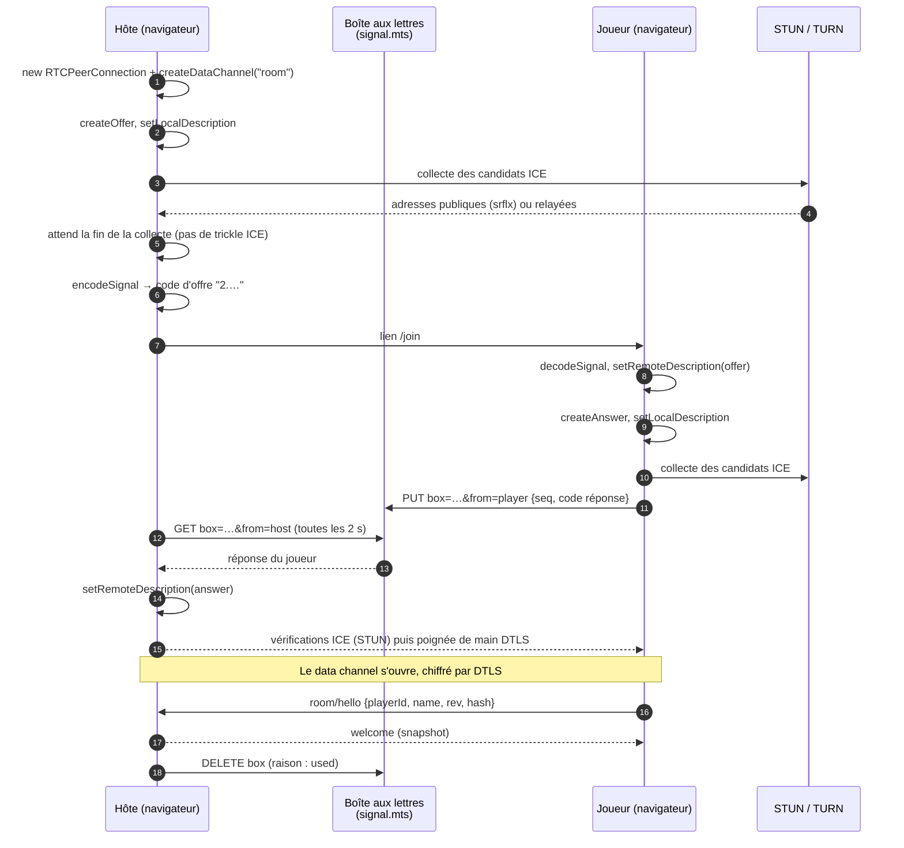
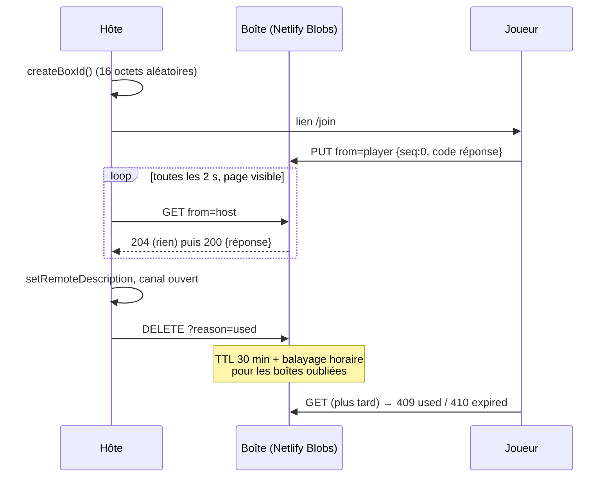
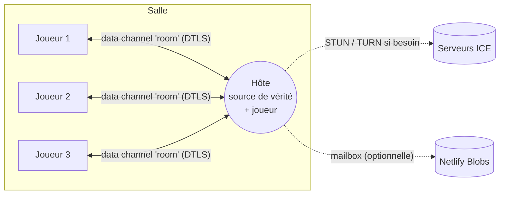

# Pair-à-pair et chiffrement : montée en compétence

Document de formation pour un développeur qui arrive sur le projet. Il explique le réseau pair-à-pair (WebRTC) et le chiffrement des données, et illustre chaque notion avec ce que **cette application** fait réellement. Quand l'application ne chiffre pas quelque chose, c'est écrit noir sur blanc.

Pré-requis : TypeScript, notions de HTTP et de TLS. Lecture complémentaire dans le dépôt : [docs/rules.md](../rules.md) (couches, services pair-à-pair), [ADR 0002](../adr/0002-manual-webrtc-signalling.md), [ADR 0003](../adr/0003-open-relay-turn.md), [ADR 0004](../adr/0004-signal-mailbox.md) et la [spec des salles](../../.scratch/p2p-rooms/spec.md).

## Sommaire

1. [Vue d'ensemble](#1-vue-densemble)
2. [WebRTC en quelques minutes](#2-webrtc-en-quelques-minutes)
3. [SDP, offer et answer](#3-sdp-offer-et-answer)
4. [Les codes compacts de l'application](#4-les-codes-compacts-de-lapplication)
5. [ICE, STUN, TURN et les types de NAT](#5-ice-stun-turn-et-les-types-de-nat)
6. [La signalisation : codes manuels et boîte aux lettres](#6-la-signalisation--codes-manuels-et-boîte-aux-lettres)
7. [Les data channels et la topologie en étoile](#7-les-data-channels-et-la-topologie-en-étoile)
8. [Le protocole applicatif : enveloppes et `PeerApi`](#8-le-protocole-applicatif--enveloppes-et-peerapi)
9. [Découpage des gros messages (framing)](#9-découpage-des-gros-messages-framing)
10. [Reconnexion](#10-reconnexion)
11. [Chiffrement : ce qui l'est, ce qui ne l'est pas](#11-chiffrement--ce-qui-lest-ce-qui-ne-lest-pas)
12. [Stockage local : IndexedDB et localStorage](#12-stockage-local--indexeddb-et-localstorage)
13. [SHA-256 dans l'application](#13-sha-256-dans-lapplication)
14. [Modèle de menaces](#14-modèle-de-menaces)
15. [Améliorations possibles](#15-améliorations-possibles)
16. [Pour aller plus loin](#pour-aller-plus-loin)
17. [Glossaire](#glossaire)

---

## 1. Vue d'ensemble

L'application n'a pas de backend de jeu. Un joueur ouvre une **salle** et devient l'**hôte** ; les autres le rejoignent. Toutes les données de jeu transitent en pair-à-pair (P2P) dans des canaux WebRTC. Le seul code serveur, ce sont trois fonctions Netlify dans [netlify/functions/](../../netlify/functions/), qui ne voient jamais les données de jeu :

| Fonction | Rôle | Voit |
| --- | --- | --- |
| [ice-servers.mts](../../netlify/functions/ice-servers.mts) | Distribue des identifiants TURN (clé d'API gardée côté serveur) | Rien de la partie |
| [signal.mts](../../netlify/functions/signal.mts) | Boîte aux lettres de signalisation (optionnelle) | Les codes d'offre et de réponse (donc des adresses IP) |
| [signal-sweep.mts](../../netlify/functions/signal-sweep.mts) | Nettoyage horaire des boîtes périmées | Idem |

Couches côté client (voir [docs/rules.md](../rules.md)) : composant, puis business, puis service, puis `PeerApi` ([peer-api.service.ts](../../src/app/core/p2p/peer-api.service.ts)), puis `RoomTransport` ([room-transport.ts](../../src/app/core/p2p/room-transport.ts)), implémenté par [webrtc-transport.ts](../../src/app/core/p2p/webrtc-transport.ts) (le seul fichier qui touche `RTCPeerConnection`) et par [fake-transport.ts](../../src/app/core/p2p/fake-transport.ts) (tests, réseau en mémoire).

L'interface `RoomTransport` est une couture volontaire : on peut changer la signalisation ou le transport sans toucher au reste.

## 2. WebRTC en quelques minutes

WebRTC permet à deux navigateurs d'échanger directement des médias ou des données, sans serveur au milieu **une fois la connexion établie**. Trois briques :

- **`RTCPeerConnection`** : la connexion elle-même. Elle négocie les paramètres (SDP), trouve un chemin réseau (ICE) et sécurise le tout (DTLS).
- **`RTCDataChannel`** : un canal de messages (texte ou binaire) au-dessus de la connexion, qui roule sur SCTP, lui-même encapsulé dans DTLS, lui-même sur UDP.
- **La signalisation** : l'échange initial d'une offre et d'une réponse. WebRTC **ne la définit pas** : c'est à l'application de choisir comment les deux pairs se la transmettent.

Pile protocolaire d'un data channel :

```
Messages applicatifs (JSON)
  SCTP      (fiabilité, ordre, messages)
    DTLS    (chiffrement, authentification par empreinte)
      ICE/UDP (STUN, TURN)
```

Ici, un seul canal par joueur, créé ainsi dans `createInvite` :

```ts
const channel = connection.createDataChannel('room', { ordered: true });
```

`ordered: true` et pas de `maxRetransmits` : le canal est **ordonné et fiable**, ce qui convient à des requêtes et des états de jeu.

## 3. SDP, offer et answer

**SDP** (Session Description Protocol) est un texte qui décrit ce qu'un pair sait faire et comment le joindre : identifiants ICE (`ufrag`, `pwd`), empreinte du certificat DTLS (`a=fingerprint`), rôle DTLS (`a=setup`), candidats réseau (`a=candidate`), port SCTP, taille de message maximale.

Le pair qui initie crée une **offer** (`createOffer`), l'autre répond par une **answer** (`createAnswer`). Chacun les enregistre : `setLocalDescription` pour la sienne, `setRemoteDescription` pour celle de l'autre.

Dans l'application, l'**hôte** fait l'offre (c'est lui qui « invite »), le **joueur** répond.

Séquence complète, avec la signalisation par boîte aux lettres (cas normal) :



Sans boîte aux lettres, les étapes 8 à 11 sont remplacées par un copier-coller manuel du code de réponse.

## 4. Les codes compacts de l'application

Un SDP de navigateur fait plusieurs centaines de caractères, trop pour un QR code lisible. Une première version envoyait le SDP compressé (~760 caractères) ; elle a été **remplacée** sans compatibilité ascendante (voir [ADR 0002](../adr/0002-manual-webrtc-signalling.md)). Aujourd'hui :

- [compact-sdp.ts](../../src/app/core/p2p/helpers/compact-sdp.ts) garde seulement ce dont un data channel a besoin : `ufrag`, `pwd`, empreinte DTLS, rôle `setup`, `mid`, candidats UDP (type, adresse, port). Les candidats TCP sont abandonnés ; priorités et fondations sont recalculées ; l'autre côté **reconstruit** un SDP standard (`buildDataChannelSdp`, avec `a=sctp-port:5000` et `a=max-message-size:262144` fixes).
- La forme binaire est `[flags][ufrag][pwd][hash][empreinte][mid][nb][candidats…]`, le drapeau 8 des `flags` marquant une invitation « relais ».
- [signal-codec.ts](../../src/app/core/p2p/helpers/signal-codec.ts) encode en base64url avec préfixe de version : `"2." + base64url(binaire)`.

```ts
export function encodeSignal(description: SignalDescription): string {
  const compact = parseDataChannelSdp(description.sdp);
  if (!compact) throw new Error('Unsupported SDP: expected a single data channel');
  return `${SIGNAL_CODE_VERSION}.${toBase64Url(packCompactSdp(compact, ...))}`;
}
```

Mesures consignées dans l'ADR 0002 (Chrome, 2026-11-07) : offre 177 caractères, réponse 142, lien d'invitation ~205. `decodeSignal` vérifie la version, le type attendu (`offer` ou `answer`) et lève une `SignalCodeError` explicite sinon.

Point de sécurité : ce code **contient l'empreinte DTLS et les adresses IP** des candidats (voir [section 11](#11-chiffrement--ce-qui-lest-ce-qui-ne-lest-pas)).

## 5. ICE, STUN, TURN et les types de NAT

### Le problème

La plupart des appareils sont derrière un **NAT** (la box, le réseau mobile) : ils ont une adresse privée et ne sont pas joignables directement depuis Internet. **ICE** (Interactive Connectivity Establishment) est la procédure qui rassemble des **candidats** (chemins possibles) et teste lesquels fonctionnent.

Types de candidats, tels que les compte `candidateTypes()` dans le transport :

| Type | Origine | Exemple |
| --- | --- | --- |
| `host` | Adresse locale de l'interface (ou nom mDNS `<uuid>.local`) | Même Wi-Fi |
| `srflx` | Adresse publique découverte via **STUN** | Deux réseaux différents |
| `prflx` | Découverte pendant les tests de connectivité | Rare |
| `relay` | Adresse allouée sur un serveur **TURN** | Réseaux stricts |

### STUN

Un serveur STUN est un « écho » sans état : il répond « voici l'adresse publique d'où tu me parles ». Il ne relaie rien. L'application utilise par défaut le STUN public de Google ([ice-servers.ts](../../src/app/core/p2p/helpers/ice-servers.ts)) :

```ts
export const STUN_ONLY: RTCIceServer[] = [{ urls: 'stun:stun.l.google.com:19302' }];
```

STUN voit votre IP, jamais les données de jeu.

### TURN

Quand aucun chemin direct n'existe, un serveur **TURN** relaie les paquets. C'est de la bande passante réelle, donc un service payant ou limité. Ici, [ADR 0003](../adr/0003-open-relay-turn.md) : Open Relay de Metered (20 Go par mois gratuits), via la fonction Netlify `ice-servers.mts` qui garde la clé d'API côté serveur. Le client appelle `fetchIceServers()` ; en cas d'échec (`ng serve`, hors ligne, quota épuisé), il retombe sur STUN seul.

Le relais n'est **pas** proposé à chaque invitation :

1. La première invitation est « directe » : STUN seul, aucun appel à la fonction, codes plus courts.
2. Si elle échoue, l'hôte crée une invitation **relais** (drapeau dans le code) ; les deux côtés demandent alors des serveurs TURN et utilisent `iceTransportPolicy: 'relay'`.

```ts
private async newConnection(relay: boolean): Promise<RTCPeerConnection> {
  if (!relay) return new RTCPeerConnection({ iceServers: this.directServers });
  const iceServers = await this.iceServers();
  if (!iceServers.some((s) => [s.urls].flat().some((u) => u.startsWith('turn'))))
    throw new TransportError('relay-unavailable');
  return new RTCPeerConnection({ iceServers, iceTransportPolicy: 'relay' });
}
```

Si la fonction est injoignable, l'application refuse de créer une invitation relais qui ne marcherait pas (`relay-unavailable`).

### Types de NAT (rappel)

| NAT | Comportement | Connexion directe avec STUN ? |
| --- | --- | --- |
| Full cone | Une adresse publique:port par socket interne, tout le monde peut y écrire | Oui |
| Restreint (adresse ou port) | Seuls les pairs déjà contactés peuvent répondre | Oui, grâce au « hole punching » simultané |
| **Symétrique** | Un port public différent par destination | Non en général : il faut TURN |

Les réseaux d'entreprise, d'école et certains opérateurs mobiles utilisent souvent un NAT symétrique ou bloquent l'UDP ; c'est le cas d'usage du relais (ADR 0003).

### Pas de trickle ICE

Le « trickle ICE » envoie les candidats au fil de l'eau. Ici, il n'y a pas de canal de signalisation temps réel garanti, donc **tous les candidats doivent tenir dans le code unique**. `gathered()` attend `iceGatheringState === 'complete'`, avec un délai maximal de 4 s (`gatherTimeoutMs`), après quoi on envoie ce qui a été trouvé. `collectCandidates()` mémorise aussi les événements `icecandidate`, car certains navigateurs (Firefox) peuvent les omettre de `localDescription`.

## 6. La signalisation : codes manuels et boîte aux lettres

Il faut bien qu'offre et réponse passent par *quelque chose*. Options étudiées dans [ADR 0002](../adr/0002-manual-webrtc-signalling.md) : Trystero (relais Nostr/MQTT/BitTorrent publics), PeerJS (courtier public), ou **poignée de main manuelle**. Choix : le manuel, pour ne dépendre d'aucune infrastructure.

### Mode manuel (repli)

1. L'hôte génère une invitation : lien `/join#<code d'offre>` + QR code. Le code est après `#` : le fragment d'URL n'est jamais envoyé dans une requête HTTP au serveur statique.
2. Le joueur ouvre le lien, son navigateur produit un code de réponse, qu'il renvoie par la même messagerie.
3. L'hôte colle la réponse (ou scanne le QR) : le canal s'ouvre.

Défaut sur téléphone : le joueur doit quitter la page pour envoyer le code, le navigateur met la page en pause, et la connexion expire (limite ~30 s). D'où la boîte aux lettres.

### Boîte aux lettres ([ADR 0004](../adr/0004-signal-mailbox.md))

Le lien devient `/join#<offre>~<boxId>`. Le `boxId` fait 16 octets aléatoires en base64url (22 caractères), généré par invitation ([invite-link.ts](../../src/app/core/p2p/helpers/invite-link.ts)) :

```ts
export function parseInviteFragment(fragment: string): InviteFragment {
  const text = fragment.startsWith('#') ? fragment.slice(1) : fragment;
  const tilde = text.indexOf('~');
  if (tilde < 0) return { offerCode: text, boxId: undefined };
  ...
}
```

L'API ([signal.mts](../../netlify/functions/signal.mts)) :

```
PUT    /.netlify/functions/signal?box=<id>&from=host|player   body { seq, code }
GET    /.netlify/functions/signal?box=<id>&from=host|player   → message de l'autre côté, ou 204
DELETE /.netlify/functions/signal?box=<id>[&reason=used|expired]
```

La logique est pure et testable dans [mailbox-handler.ts](../../src/app/core/p2p/helpers/mailbox-handler.ts) (`createMailboxHandler`, `sweepMailbox`), branchée sur Netlify Blobs (store `signal`) par la fonction. Chaque côté a sa propre clé (`<box>/host`, `<box>/player`) pour ne jamais s'écraser, plus une clé de métadonnées pour l'âge. Le TTL est de 30 minutes (`MAILBOX_TTL_MS`) ; une fonction planifiée `@hourly` supprime les boîtes oubliées. Un joueur qui lit une boîte fermée reçoit `409` (utilisée) ou `410` (expirée).

Le client est [signal-mailbox.service.ts](../../src/app/modules/room/services/signal-mailbox.service.ts) (`fetch`, délai de 5 s) ; l'orchestration est dans [room.business.ts](../../src/app/modules/room/business/room.business.ts) : l'hôte interroge toutes les 2 s (`HOST_POLL_MS`) tant que sa page est visible, le joueur toutes les 5 s (`PLAYER_POLL_MS`).



Repli vers le mode manuel si : le lien n'a pas de `boxId` valide, un `PUT` échoue ou dépasse 5 s, ou trois interrogations de l'hôte de suite échouent (`FAILED_POLLS_BEFORE_DOWN`).

### Ce que la boîte peut lire

La boîte stocke les codes **en clair** (pas de chiffrement applicatif) : offre et réponse, donc **empreintes DTLS et adresses IP** des candidats, pendant 30 minutes au plus. Elle ne voit **aucune donnée de jeu**, qui n'y passent jamais. Garde-fous : taille de corps limitée à 4096 caractères (code ≤ 2000), validation de `seq` et `code`, `Cache-Control: no-store`. Il n'y a **pas de limitation de débit** (ADR 0004), et l'authentification se résume à connaître le `boxId` (128 bits d'aléa) ; le paramètre `from` est déclaratif.

Nuance sur l'ADR : le `boxId` est dans le fragment du lien, donc absent de la requête qui charge la page ; en revanche l'application le met ensuite en paramètre de requête `box=` vers la fonction, qui le voit forcément.

## 7. Les data channels et la topologie en étoile

Un `RTCPeerConnection` par joueur, tous reliés à l'hôte : une **étoile**. Les joueurs ne se parlent jamais entre eux, l'hôte reçoit tout, applique les règles et redistribue.



Conséquences :

- L'hôte est la **source de vérité** : un client ne modifie jamais l'état partagé localement, il appelle un service, l'hôte valide puis publie.
- L'hôte est aussi un joueur : son UI appelle les mêmes services, exécutés **en processus** (`SELF_PEER`).
- L'hôte peut tricher (spec : « c'est une table entre amis »).
- Pas de lien client à client ; pas de migration d'hôte.

Côté transport, `WebRtcTransport` garde deux tables : `pending` (invitations en attente, par id) et `peers` (connexions établies). Côté joueur, l'hôte a toujours l'identifiant `HOST_PEER = 'host'`.

## 8. Le protocole applicatif : enveloppes et `PeerApi`

`PeerApi` est le « `HttpClient` » de l'application : il transforme le data channel en `request()` (Promesse) et `watch()` (Observable). Tout message est une **enveloppe** JSON ([envelope.ts](../../src/app/core/p2p/helpers/envelope.ts)) :

```ts
export type Envelope =
  | { v: 1; kind: 'request'; id: string; route: string; payload: unknown }
  | { v: 1; kind: 'response'; id: string; payload: unknown }
  | { v: 1; kind: 'error'; id: string; code: PeerApiErrorCode; message: string }
  | { v: 1; kind: 'publish'; topic: string; seq: number; payload: unknown };
```

- `request` (client vers hôte) reçoit `response` ou `error` avec le même `id` ; [correlation.ts](../../src/app/core/p2p/helpers/correlation.ts) gère les délais (10 s par défaut, `PEER_API_TIMEOUT_MS`).
- `publish` (hôte vers clients) pousse l'**état complet** d'un sujet, avec un `seq` croissant ; un client ignore tout `seq` inférieur ou égal au dernier appliqué. Un message perdu ou en retard est donc sans conséquence, et un nouveau joueur reçoit d'un coup le dernier état de chaque sujet.
- `decodeEnvelope` rejette tout ce qui est mal formé ou d'une autre version de protocole (`v`).
- Côté hôte, `askedPeer` mémorise à qui chaque requête a été envoyée : seule la réponse de **ce** joueur est acceptée.

Première route : `room/hello { playerId, name, rev, hash }`. Il n'y a pas de comptes : le profil `{ playerId (uuid), name }` est local.

## 9. Découpage des gros messages (framing)

Chaque navigateur annonce une taille maximale de message pour son data channel. Le SDP reconstruit par l'application annonce 256 Kio, mais **Safari ne vérifie pas cette limite** avant d'envoyer : un message trop gros (portrait PNG d'iPhone, grand monde) ferme son côté du canal alors que l'autre côté le croit encore connecté. Solution dans [message-frames.ts](../../src/app/core/p2p/helpers/message-frames.ts) : couper en trames de **16 000 unités UTF-16** au plus (≤ 48 Ko UTF-8).

Format d'une trame : `<marqueur><id>:<index>:<total>:<morceau>`, avec le marqueur `U+001E` (séparateur d'enregistrement). Un message entier ne commence jamais par ce caractère, puisque les enveloppes sont des objets JSON ; un message court est donc envoyé tel quel.

```ts
export function splitMessage(data: string, id: string, maxChars = MAX_FRAME_CHARS): string[] {
  if (data.length <= maxChars && !data.startsWith(FRAME_MARKER)) return [data];
  ...
  return parts.map((part, index) => `${FRAME_MARKER}${id}:${index}:${parts.length}:${part}`);
}
```

Détails qui comptent :

- On ne coupe **jamais** au milieu d'une paire de substitution UTF-16 (sinon chaque moitié deviendrait U+FFFD).
- `createFrameAssembler()` regroupe par expéditeur et identifiant de message ; il ignore les trames mal formées, borne `total` à 100 000 (`MAX_FRAMES`) contre les trames hostiles, et `drop(peer)` oublie les messages incomplets d'un joueur parti.
- Le canal étant ordonné et fiable, aucune retransmission applicative n'est nécessaire ; `send()` envoie les trames à la suite, et `bufferedAmount()` permet de surveiller la congestion (utilisé pour l'avertissement de taille de salle).

## 10. Reconnexion

Il n'y a **pas de reconnexion automatique** (ADR 0002) : sans serveur de signalisation permanent, un canal tombé ne peut pas se renégocier tout seul.

- Une déconnexion propre est vue immédiatement : le transport ferme tout sur `pagehide`. Après un crash ou une perte réseau, WebRTC met environ **20 s** à le détecter.
- Un siège hors ligne reste dans l'état de la salle ; l'hôte clique « Ré-inviter » et le joueur retrouve son siège et son personnage grâce à son `playerId` envoyé dans `hello`.
- Les invitations en attente vivent en mémoire de la page de l'hôte : recharger l'hôte les perd. L'état de la salle, lui, est sauvegardé dans IndexedDB.
- Avec la boîte aux lettres, une connexion qui échoue déclenche `retryInvite` : l'hôte dépose une nouvelle offre (`seq + 1`) dans la **même boîte**, et la page du joueur (qui interroge toutes les 5 s tant qu'elle est visible) y répond, sans délai limite. Dans ce mode, la nouvelle tentative passe d'abord par le relais, et reste directe si le relais est indisponible.

## 11. Chiffrement : ce qui l'est, ce qui ne l'est pas

### DTLS

Le data channel est protégé par **DTLS** (TLS adapté à UDP), obligatoire en WebRTC : on ne peut pas l'éteindre. Il assure confidentialité et intégrité du flux entre les deux navigateurs. Les paquets SRTP concernent l'audio/vidéo, que cette application n'utilise pas ; seuls les data channels sont concernés ici.

L'**authentification** vient de l'empreinte (`a=fingerprint`, SHA-256 du certificat auto-signé de chaque pair) échangée dans le SDP. Pendant la poignée de main DTLS, chaque côté vérifie que le certificat présenté correspond à l'empreinte reçue par la signalisation. Aucune autorité de certification n'intervient : la confiance repose sur le canal par lequel le code est passé. Cette empreinte est justement une des données que [compact-sdp.ts](../../src/app/core/p2p/helpers/compact-sdp.ts) conserve et reconstruit.

### Qui voit quoi

| Acteur | Voit | Ne voit pas |
| --- | --- | --- |
| Hôte et joueurs | Les données de jeu en clair (c'est leur rôle) | |
| Serveur STUN (Google) | Votre IP publique | Les données de jeu |
| Relais TURN (Metered) | Qui se connecte, quand, quel volume | Le contenu : il relaie des paquets DTLS chiffrés de bout en bout entre les deux pairs |
| Fonction `ice-servers` | Qu'un client demande des identifiants | Les données de jeu |
| Boîte aux lettres (Netlify) | Les codes d'offre et de réponse **en clair** : empreintes DTLS, adresses IP, id de boîte, horaires | Les données de jeu (elles n'y passent pas) |
| Canal par lequel vous partagez le lien (chat…) | Le lien complet, donc le code et le `boxId` | Les données de jeu |
| Hébergeur statique (Netlify) | Le chargement de l'app ; pas le fragment `#…` | Les données de jeu |
| Le réseau local, le FAI | Que vous parlez en UDP à telle IP, le volume | Le contenu (DTLS) |

Un relais TURN n'est donc **pas** un homme du milieu au sens du contenu : DTLS se négocie entre les deux navigateurs, à travers lui. L'ADR 0003 le dit : « the relay sees who connects and how much, not what ».

### Ce que l'application ne chiffre pas

- **Pas de chiffrement applicatif** (de bout en bout au-dessus de DTLS) : les enveloppes JSON partent en clair dans le canal DTLS. La protection s'arrête aux extrémités du canal.
- **Les codes d'invitation et de réponse ne sont pas chiffrés ni signés** : ils contiennent les adresses IP des candidats (l'ADR 0002 note qu'un lien publié publiquement expose l'adresse de l'hôte) et l'empreinte DTLS.
- **L'application ne vérifie pas l'empreinte par un second canal.** Si un attaquant contrôle le canal de signalisation (la boîte, le chat, ou quelqu'un qui obtient le lien avant le joueur prévu), il peut répondre à la place du joueur, ou substituer des codes, et l'authentification DTLS ne le détectera pas, puisqu'elle ne vaut que ce que vaut le canal de signalisation.
- **Les données au repos** (IndexedDB, `localStorage`) ne sont pas chiffrées (section suivante).
- Le `boxId` fait office de secret partagé pour la boîte, sans autre authentification ni limitation de débit.

## 12. Stockage local : IndexedDB et localStorage

Tout est stocké **en clair** dans le navigateur, à l'origine de l'application :

| Donnée | Où | Fichier |
| --- | --- | --- |
| Profil `{ playerId, name }` | `localStorage` | [profile-storage.service.ts](../../src/app/core/services/profile-storage.service.ts) |
| Mondes, images, salle hébergée, salles rejointes, copies de joueur | IndexedDB, base `rpg-manager` (v3) | [app-database.ts](../../src/app/core/helpers/app-database.ts) |
| Langue, journal de débogage | `localStorage` (d'après les fichiers qui y touchent : [language.business.ts](../../src/app/core/business/language.business.ts), [debug-log.service.ts](../../src/app/core/services/debug-log.service.ts)) | |

Ce que cela implique :

- Toute personne qui a accès au profil du navigateur (autre utilisateur de l'OS, extension malveillante, script XSS sur la même origine, appareil volé non chiffré) lit tout, y compris l'état de salle complet sur la machine hôte.
- IndexedDB est limité par origine : un autre site ne peut pas lire ces données, mais ce n'est pas du chiffrement.
- Le chiffrement de disque du système (BitLocker, FileVault, LUKS) est la protection réaliste actuelle.
- La page [privacy-page.component.ts](../../src/app/modules/home/pages/privacy-page.component.ts) décrit la politique de confidentialité côté utilisateur ; garder ce document et cette page cohérents.

## 13. SHA-256 dans l'application

SHA-256 est une fonction de hachage : empreinte de 32 octets, sans clé, non réversible. Utilisée ici à deux endroits via `crypto.subtle.digest('SHA-256', …)` (WebCrypto), et indirectement dans l'empreinte DTLS.

1. **Images adressées par contenu** ([image-storage.service.ts](../../src/app/core/services/image-storage.service.ts)) : l'identifiant d'une image est le SHA-256 de ses octets, en hexadécimal. La même image n'est donc stockée (et plus tard envoyée) qu'une fois.

   ```ts
   const id = await sha256Hex(bytes);
   if (!(await db.getKey('images', id))) await db.put('images', { id, bytes, type: blob.type });
   ```

2. **Détection de divergence des copies de joueur** ([player-copy.rules.ts](../../src/app/modules/room/helpers/player-copy.rules.ts)) : `hashPlayerRecord` hache le contenu d'une fiche personnage, sérialisée de façon **stable** (clés triées, `undefined` ignoré) et sans `rev` ni `updatedAt`. Le `hash` accompagne `room/hello` : s'il diffère de celui de l'hôte, la boîte de dialogue « Pick a save » s'ouvre.

3. **Empreinte DTLS** : le `sha-256` des certificats dans le SDP (voir section 11), géré par le navigateur.

Ce que SHA-256 **n'est pas** ici : un chiffrement (le contenu reste lisible), ni une authentification (pas de clé : n'importe qui peut calculer le hachage). Le hash de `hello` sert à détecter une différence de versions, pas à prouver une origine. Dans le code lu pour ce document, rien ne vérifie un hash d'image à la réception.

## 14. Modèle de menaces

Hypothèse de départ (spec) : une partie entre amis. L'hôte est digne de confiance pour les règles, pas de « anti-triche ».

| Menace | Exposition actuelle | Atténuation existante |
| --- | --- | --- |
| Écoute du trafic de jeu (réseau, FAI, relais TURN) | Faible | DTLS entre les navigateurs |
| Fuite de l'adresse IP via le lien d'invitation | Réelle et assumée (inhérente à WebRTC) | Texte de l'UI ; liens à usage unique ; boîte supprimée à la connexion, TTL 30 min |
| Lien d'invitation intercepté ou transféré avant le joueur prévu | Réelle : le premier qui répond occupe le canal | Invitation à usage unique (`invite-used`) ; l'hôte voit qui se connecte (nom, `playerId`) |
| Compromission de la boîte aux lettres ou de Netlify | Lecture des codes (IP, empreintes) ; possibilité de substituer une réponse | Aucune donnée de jeu ; durée de vie courte ; pas de vérification d'empreinte hors bande |
| Joueur malveillant (messages malformés, trames hostiles) | Moyenne | `decodeEnvelope` strict, `MAX_FRAMES`, réponses acceptées seulement du pair interrogé |
| Hôte malveillant | Totale sur l'état de la salle | Hors périmètre (spec) |
| Épuisement du quota TURN ou de la boîte (abus) | Possible : fonctions sans limitation de débit | Coût plafonné au quota gratuit (ADR 0003) ; repli manuel |
| Lecture des données locales (appareil partagé, XSS) | Totale, en clair | Isolation par origine uniquement |
| Disponibilité (Netlify en pause, Open Relay sans garantie) | Dégradation | Repli STUN et codes manuels ; PWA hors ligne |

## 15. Améliorations possibles

Ce sont des **pistes**, rien de ceci n'est implémenté.

1. **Vérification de l'empreinte hors bande.** Afficher un court code dérivé des deux empreintes DTLS (comme les SAS de Signal ou ZRTP) et demander aux joueurs de le comparer de vive voix. Cela détecterait une substitution par la boîte ou le chat.
2. **Couche E2E applicative avec WebCrypto.** Chiffrer le payload des enveloppes avec `crypto.subtle` (AES-GCM) sous une clé dérivée d'un échange ECDH (P-256 ou X25519 selon le support) authentifié par la comparaison ci-dessus. Intérêt : protection indépendante de DTLS (par exemple si l'on ajoutait un jour un relais applicatif). Coût : gestion des clés, nonces uniques, rotation. Dans ce modèle en étoile avec hôte de confiance, c'est surtout un renfort contre la substitution de signalisation.
3. **Chiffrer le contenu des codes dans la boîte.** Chiffrer l'offre et la réponse avec une clé placée dans le fragment du lien (jamais envoyée à un serveur) : la boîte ne verrait plus les IP. À noter : le lien lui-même contiendrait alors le secret.
4. **Authentifier les requêtes de la boîte**, par exemple en prouvant la connaissance du `boxId` sans le transmettre (HMAC), et ajouter de la limitation de débit.
5. **Chiffrer les données au repos** : clé dérivée d'un mot de passe (PBKDF2 ou Argon2 en WASM) puis AES-GCM, au prix d'un mot de passe à saisir et de la perte de données en cas d'oubli. Les images adressées par hash demandent un schéma réfléchi (le hash en clair révèle le contenu connu).
6. **Vérifier les hash d'image à la réception** pour garantir qu'un contenu correspond à son identifiant.
7. **Authentifier les joueurs** : `playerId` est un simple uuid local ; une paire de clés par profil (signature ECDSA ou Ed25519) empêcherait de se faire passer pour le propriétaire d'un siège.

## Pour aller plus loin

Dans le dépôt :

- [docs/rules.md](../rules.md) : couches et règles des services pair-à-pair.
- [ADR 0002](../adr/0002-manual-webrtc-signalling.md), [0003](../adr/0003-open-relay-turn.md), [0004](../adr/0004-signal-mailbox.md) et la [spec des salles](../../.scratch/p2p-rooms/spec.md).
- Les tests, qui sont de bons exemples d'usage : [compact-sdp.spec.ts](../../src/app/core/p2p/helpers/compact-sdp.spec.ts), [message-frames.spec.ts](../../src/app/core/p2p/helpers/message-frames.spec.ts), [mailbox-handler.spec.ts](../../src/app/core/p2p/helpers/mailbox-handler.spec.ts), [peer-api.service.spec.ts](../../src/app/core/p2p/peer-api.service.spec.ts) (sur le [fake-transport.ts](../../src/app/core/p2p/fake-transport.ts)).

Références externes (à consulter pour les détails normatifs) :

- MDN, « WebRTC API » et « Signaling and video calling ».
- RFC 8445 (ICE), RFC 8489 (STUN), RFC 8656 (TURN), RFC 8866 (SDP).
- RFC 6347 (DTLS 1.2) et RFC 8261 (SCTP sur DTLS), RFC 8831 (data channels WebRTC), RFC 8826 et 8827 (modèle de sécurité de WebRTC).
- RFC 4960 (SCTP).
- Spécification W3C « Web Cryptography API » et MDN « SubtleCrypto ».
- « WebRTC for the Curious » (webrtcforthecurious.com), un livre libre très pédagogique.
- Le site `webrtc.github.io/samples` pour expérimenter dans le navigateur, et `chrome://webrtc-internals` pour observer une vraie connexion.

## Glossaire

| Terme | Définition |
| --- | --- |
| **Answer** | Réponse SDP du joueur à l'offre de l'hôte. |
| **base64url** | Base64 sans `+`, `/` ni `=`, sûr dans une URL. |
| **Boîte aux lettres (mailbox)** | Fonction Netlify qui relaie les codes d'offre et de réponse (ADR 0004). |
| **Candidat ICE** | Chemin réseau possible (`host`, `srflx`, `prflx`, `relay`). |
| **Data channel** | Canal de messages d'une `RTCPeerConnection`, ici ordonné et fiable. |
| **DTLS** | TLS pour datagrammes ; chiffre et authentifie le data channel. |
| **Empreinte (fingerprint)** | Hachage SHA-256 du certificat DTLS d'un pair, placé dans le SDP. |
| **Enveloppe** | Message JSON de l'application : `request`, `response`, `error` ou `publish`. |
| **Frame (trame)** | Morceau d'un gros message (≤ 16 000 caractères) préfixé par `U+001E`. |
| **Hôte** | Joueur qui ouvre la salle ; source de vérité et centre de l'étoile. |
| **ICE** | Procédure de recherche et de test de chemins réseau. |
| **IndexedDB** | Base de données du navigateur, par origine, non chiffrée. |
| **Invitation directe / relais** | Directe : STUN seul. Relais : TURN seul (`iceTransportPolicy: 'relay'`). |
| **mDNS (candidat)** | Nom `<uuid>.local` qui masque l'IP locale d'un candidat `host`. |
| **NAT** | Traduction d'adresses d'une box ou d'un opérateur ; cache les adresses privées. |
| **Offer** | Proposition SDP de l'hôte. |
| **PeerApi** | « HttpClient » de l'application : requêtes/réponses et publications sur le canal. |
| **Pair (peer)** | Un des deux bouts d'une connexion. |
| **Relais (TURN)** | Serveur qui transmet les paquets quand aucun chemin direct n'existe. |
| **RoomTransport** | Interface du transport entre hôte et joueurs. |
| **SCTP** | Protocole de transport sur lequel roulent les data channels. |
| **SDP** | Description textuelle d'une session WebRTC. |
| **seq** | Compteur croissant ; sert à ignorer un `publish` périmé et à versionner les messages de la boîte. |
| **Signalisation** | Échange initial d'offre et de réponse, hors WebRTC. |
| **SHA-256** | Hachage de 32 octets ; utilisé pour les images, les copies de joueur et les empreintes DTLS. |
| **STUN** | Protocole « quelle est mon adresse publique ? » ; sans état, ne relaie rien. |
| **srflx** | Candidat « server reflexive » : adresse publique vue par STUN. |
| **Symétrique (NAT)** | NAT qui change de port public par destination ; nécessite TURN. |
| **Trickle ICE** | Envoi des candidats au fil de l'eau ; non utilisé ici. |
| **TTL** | Durée de vie ; 30 minutes pour une boîte. |
| **TURN** | Protocole de relais ; fourni ici par Open Relay (Metered). |
| **WebCrypto** | API navigateur `crypto.subtle` (hachage, AES, ECDH, signatures). |
