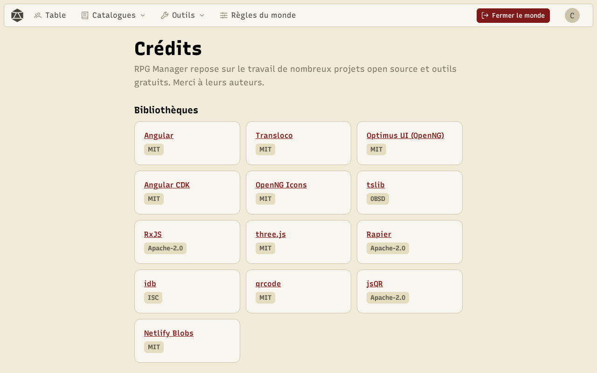
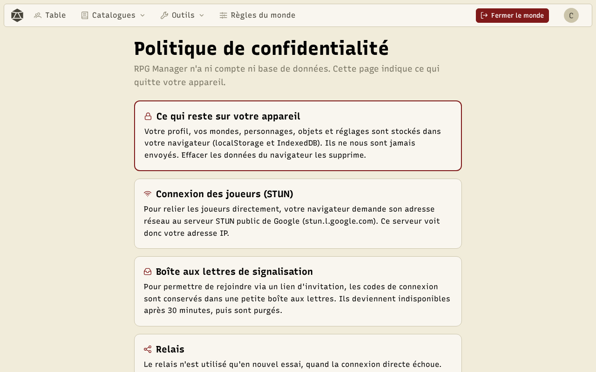

## Crédits

La page **Crédits**, en bas de chaque page, nomme les bibliothèques open source, les illustrations (dont les sprites d'objets de Florian Sciberras), les outils externes et l'usage de l'IA dans le projet.

## Confidentialité

L'application n'a ni compte ni serveur de jeu. La **politique de confidentialité** détaille ce qui reste sur votre appareil (profil, mondes, personnages, images, dans le stockage du navigateur) et le peu qui le quitte : les échanges directs entre les appareils d'une salle, l'aide réseau nécessaire pour qu'ils se trouvent, et le formulaire de contact si vous l'utilisez.

Une question, un problème ? Utilisez la page **Contact**. En cas de souci de connexion, exportez d'abord le **journal de diagnostic** depuis votre profil et joignez-le.
