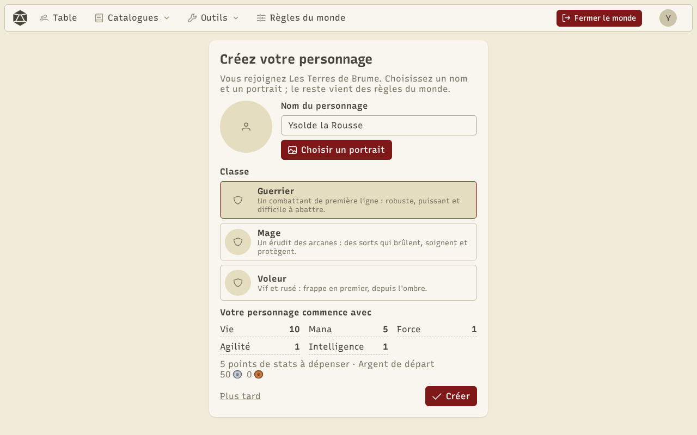
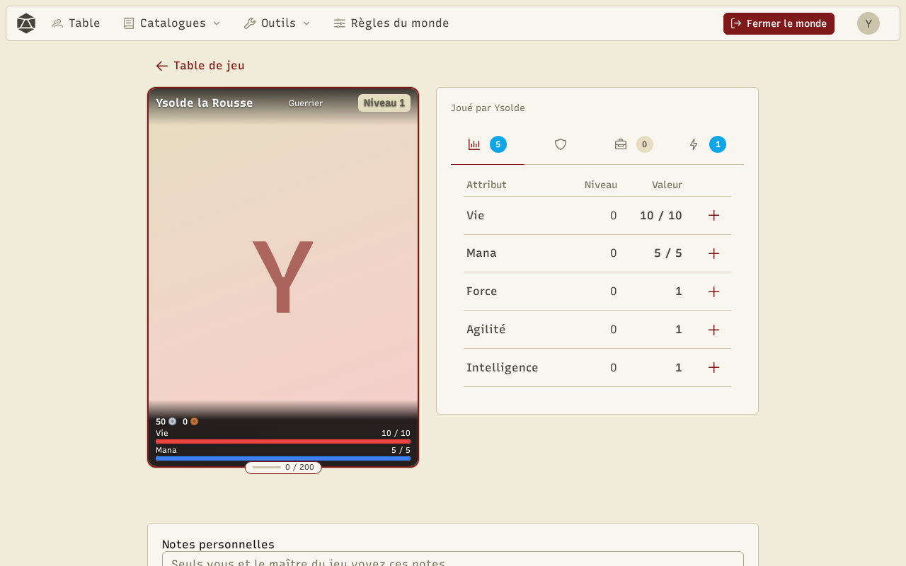

Chaque joueur a un **personnage** par monde. Il le crée la première fois qu'il rejoint la salle, et le retrouve à chaque retour.

## Créer son personnage

Choisissez un nom, un portrait et une **classe**. Le reste vient des règles du monde : la page indique les points de stats à dépenser et l'argent de départ.

## La fiche

La fiche montre la carte du personnage (portrait, classe, niveau, argent, barres et expérience) et quatre onglets, avec un compteur sur ceux qui demandent une action :

- **Stats** : chaque attribut avec son niveau et sa valeur actuelle sur le maximum. **+** dépense un point de stats.
- **Équipement** : les emplacements (tête, torse, mains, armes…) avec les objets équipés.
- **Inventaire** : les objets du personnage. Selon l'objet : équiper, utiliser (consommable), vendre, voir les détails.
- **Compétences** : l'arbre de la classe, pour apprendre et monter les compétences avec les points de compétence, et utiliser les compétences actives.

En bas de la fiche, les **notes personnelles** ne sont visibles que par le joueur et le MJ.

## Expérience et niveau

Le MJ donne de l'**expérience** depuis la table ou la fiche. Quand le personnage passe un niveau, il gagne des points de stats et des points de compétence, selon les [règles du monde](/docs/worlds/). Le maximum des attributs suit leur progression : monter le niveau d'un attribut augmente son maximum et sa valeur actuelle.
