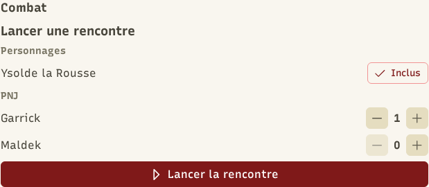
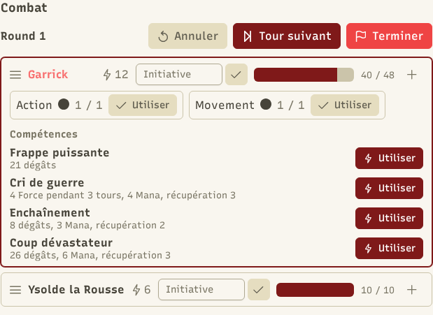
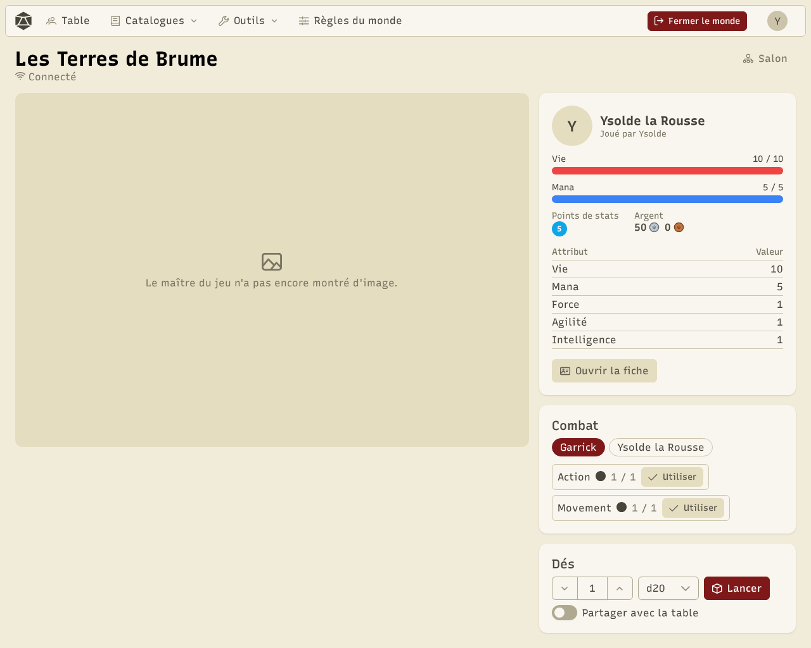
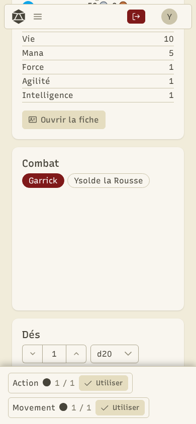

Le combat est une **aide de table**, pas un moteur de jeu : il suit l'ordre des tours, montre les chiffres de chacun et calcule ce que font les compétences. Les gens autour de la table décident, et le MJ peut tout changer à tout moment.

## Lancer une rencontre

Sur la table, section **Combat**, le MJ choisit les personnages présents (**Ajouter**) et les PNJ du catalogue, avec leur nombre (« Gobelin × 3 » crée trois gobelins). Puis **Lancer la rencontre**.

## Le déroulé

1. **Initiative** : selon le monde, l'application lance les dés, les joueurs saisissent leur jet, ou le MJ range les combattants à la main. Le MJ peut toujours réordonner.
2. **Le tour** : le combattant actif voit ses **compteurs d'actions** (Action 1/1, Déplacement 1/1), ses compétences actives avec ce qu'elles font à son niveau, ses consommables et l'attaque de base.
3. **Utiliser une compétence** : on choisit la compétence et ses cibles. Les dés sont lancés tout de suite, le coût et la recharge sont pris, et le résultat attend la **validation du MJ** : appliquer, modifier les montants (avec la défense), ou écarter.
4. **Tour suivant**, jusqu'à **Terminer** : le MJ répartit les **récompenses** (expérience, argent, butin des ennemis vaincus).

Le MJ peut aussi modifier un combattant (dégâts, soins, états, attributs) et **Annuler** la dernière action.

## Côté joueur

Le joueur voit l'ordre des tours, ses compteurs, ses compétences et ses objets, et joue quand c'est son tour. Ce qu'il voit des ennemis suit les réglages de visibilité des PNJ.

## Des étapes facultatives

Dans les [règles du monde](/docs/worlds/), chaque étape peut être désactivée : **initiative** (ordre libre), **compteurs d'actions**, **validation par le MJ** (les résultats s'appliquent tout de suite), **défense** et **récompenses**. Une **grille** avec une carte peut aussi être activée pour placer les combattants.
