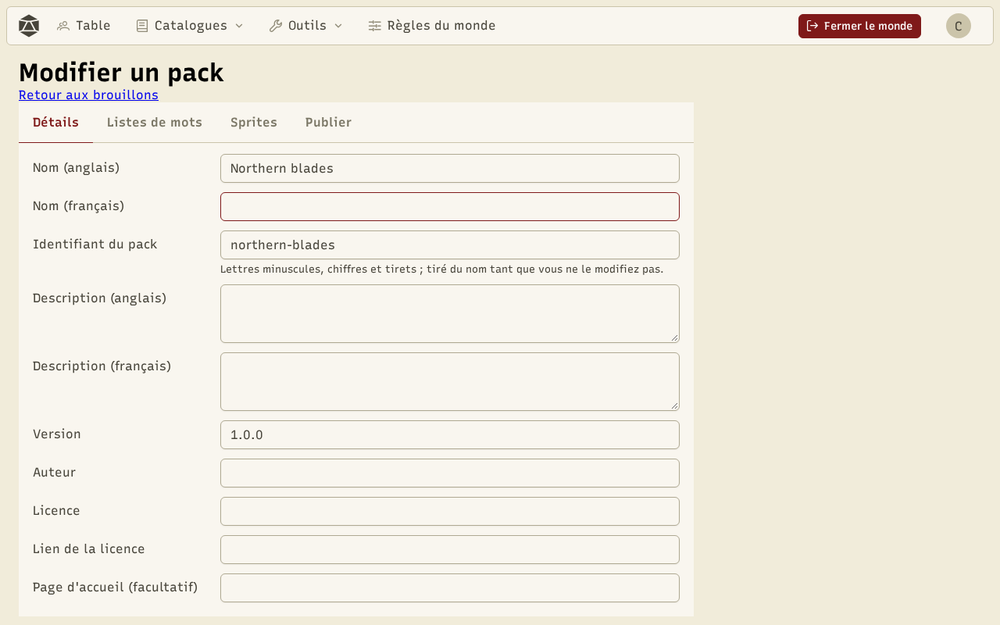
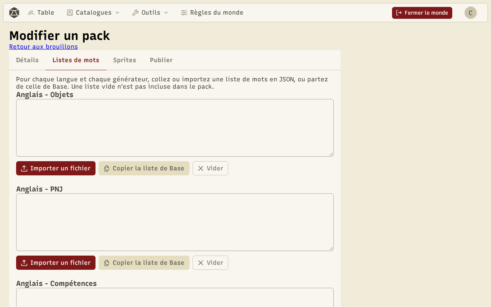
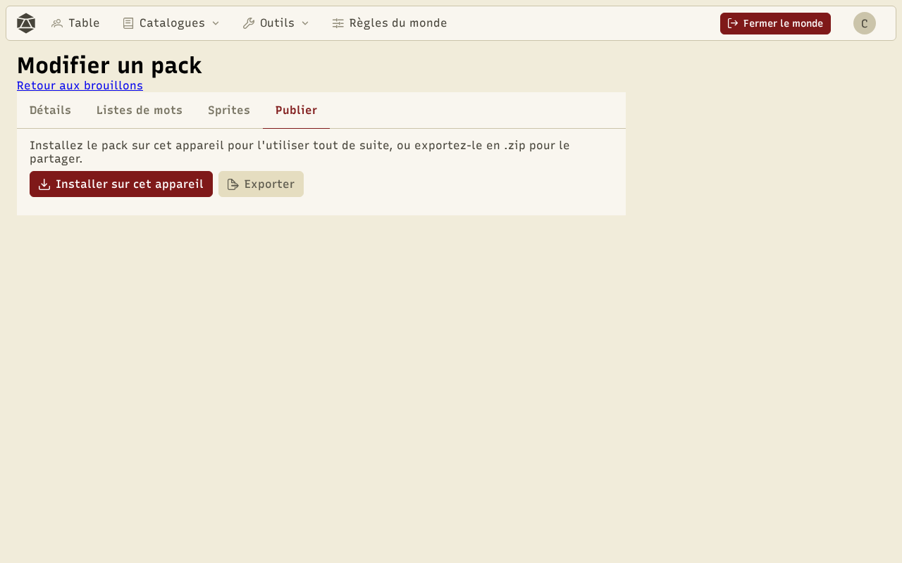

Un pack, ce sont des **données** : un fichier `pack.json` qui décrit le pack (ses catégories, ses teintes, ses sprites), plus les fichiers qu'il liste (listes de mots en JSON, images PNG, matériaux des sprites en JSON). Les notions de domaine, de catégorie, de teinte et de paramètre sont expliquées dans [Packs de contenu](/docs/packs/#comment-les-objets-sont-composés). Aucun code. Le plus simple est de le faire dans l'application, avec le **créateur de pack** ; vous pouvez aussi l'écrire à la main.

## Le créateur de pack

**Packs › Créer un pack** ouvre la liste de vos **brouillons**. Ils sont enregistrés sur cet appareil au fil de vos modifications : vous pouvez partir et revenir. **Nouveau brouillon** en ouvre un, avec quatre onglets.

### Détails

La **langue du pack** (français ou anglais, par défaut celle de l'application), le nom, la description, la version, l'auteur, la licence et son lien, et une page d'accueil facultative. L'**identifiant du pack** se déduit du nom (minuscules, chiffres et tirets) tant que vous ne le modifiez pas. Il ne peut pas reprendre celui d'un pack officiel ni d'un pack ajouté depuis un lien.



### Listes de mots

L'onglet a trois blocs, et le texte d'introduction rappelle que les listes vides ne sont pas incluses dans le pack.

**Objets** se remplit avec des formulaires :

- **Catégories** : **Ajouter une catégorie** demande un identifiant (en anglais, minuscules, chiffres et tirets, par exemple `sabre`), un **Parent** et, pour une racine, un **Type** ; l'**Emplacement** se choisit au niveau où il s'applique. Chaque catégorie a ses **Noms** (avec le **Genre** masculin ou féminin, et **Pluriel** pour un nom comme « Gants »), ses **Descriptions** (une par ligne, avec la [syntaxe des phrases](/docs/packs/#la-syntaxe-des-phrases)) et, si besoin, ses **Modèles de noms** (un par ligne, chacun avec `{base}`) et ses **Adjectifs** et **Suffixes** par rareté (repliés). Ces mots s'additionnent le long de la chaîne : une épée reçoit ceux de `sword`, de `weapon` et d'`equipment`, plus les mots communs. Mettez « affûté » sur `weapon` plutôt qu'en commun, pour qu'aucune capuche ne soit « affûtée ». Les identifiants déjà connus des packs installés sont proposés par autocomplétion, pour réutiliser les catégories standard.
- **Aperçu** : sous chaque catégorie, tire quelques objets d'essai avec ses noms et descriptions. Une catégorie sans nom affiche « Rien à tirer : cette catégorie a besoin d'un nom ».
- **Ligne de couverture** : « Pas encore de sprite pour : … » liste les catégories du pack qu'aucun sprite n'illustre encore. Elle n'empêche rien : un pack peut être sans sprites, et une catégorie sans sprite reçoit une image par type et emplacement.
- **Teintes** : **Ajouter une teinte** demande un identifiant (`fire`, `rust`…) et les trois couleurs du dégradé (**Ombre**, **Milieu**, **Lumière**), puis ses **Adjectifs** (un par ligne ; un adjectif accordé s'écrit `masculin|féminin`, suivi des pluriels s'ils sont irréguliers), ses **Suffixes** et ses **Descriptions**. **Convient à** choisit les catégories que la teinte peut colorer (vide : toutes) ; ses mots et descriptions ne sont tirés que pour ces objets, et une description de teinte est tirée une fois sur deux.
- **Adjectifs et suffixes communs** (repliés) : les mots qui vont à n'importe quel objet (« ancien », « légendaire »…), par rareté.
- **Modèles de noms** (repliés) : les modèles par rareté, utiles seulement pour la Base d'une langue.

**Partagé** contient les **Paramètres** : **Ajouter un paramètre** demande son nom (son **rôle dans la phrase** : `maker`, `place`…), puis ses expressions, une à une (**Nouvelle expression**). Chaque expression est un groupe nominal complet avec son article. Un pack sans langue n'a pas de textes : le formulaire demande d'en choisir une dans **Détails**.

Les **PNJ**, les **compétences** et les **classes** ont les mêmes deux sections que les objets, remplies avec des formulaires (les listes vides sont laissées de côté) :

- **Catégories** : **Ajouter une catégorie** demande un identifiant et un **Parent**, puis les champs du domaine : pour les PNJ, les **Rôles** et **Personne** (à décocher pour une créature) ; pour les compétences, le **Type** (active ou passive) et l'**Effet** (dégâts, soin, modification) ; pour les classes, les **Compétences favorites**, choisies parmi les catégories de compétences connues. Renommer une catégorie suit ses enfants, ses textes et les classes qui la favorisent. Les identifiants déjà connus des packs installés sont proposés par autocomplétion.
- **Textes** : par catégorie, les **Noms**, les **Descriptions** (une par ligne, [syntaxe des phrases](/docs/packs/#la-syntaxe-des-phrases)) et les **Adjectifs** ; pour les compétences et les classes aussi les **Suffixes** ; pour les catégories de PNJ qui ne sont pas des personnes, les **Modèles de noms**. Au-dessus, les listes de niveau supérieur : pour les PNJ les **Prénoms** (avec un genre), les **Épithètes** et les **Modèles** ; pour les compétences et les classes les **Modèles**, **Adjectifs** et **Suffixes**.
- **Aperçu** : sous chaque catégorie, quelques tirages d'essai.

**Copier la liste de Base** et **Importer un fichier** restent dans la partie **Avancé (JSON)** de chaque domaine ; ce que vous y changez apparaît dans les formulaires, et inversement.

**Avancé (JSON)** montre les fichiers bruts `items.json` et `common.json` (et celui de chaque domaine dans sa section) : importer, exporter ou copier ceux de Base. Ce que vous y changez apparaît dans les formulaires, et inversement.



### Sprites

Les sprites s'affichent 12 par page.

- **Ajouter une image PNG** : au plus 1 Mo et 256 × 256 pixels. Une image ajoutée ainsi est **en niveaux de gris** ou **colorée**.
- **Depuis mes sprites** : un sprite enregistré dans le [coloriseur](/docs/tools/), ajouté **avec ses masques** et ses catégories.

Pour chaque sprite : un identifiant, un libellé dans la langue du pack, les **Catégories** d'objets qu'il illustre (elles servent aux images aléatoires des objets) et la **Coloration** (niveaux de gris, avec masques ou colorée). **Modifier dans le coloriseur** ouvre un sprite en niveaux de gris ou avec masques dans le coloriseur ; **Enregistrer dans le brouillon** y renvoie ses matériaux.

Depuis le coloriseur, **Ajouter à un brouillon de pack** ajoute directement le sprite en cours, avec ses masques.

### Publier



- **Installer sur cet appareil** installe le pack ; cochez-le dans les règles d'un monde (ou dans **Outils › Règles du monde**) pour l'essayer dans les générateurs. Il apparaît sur la page des packs comme **Créé sur cet appareil**. Réinstaller le remplace.
- **Exporter** télécharge un `.zip` (`<identifiant>-<version>.zip`) avec `pack.json` et les fichiers, prêt à publier.

Les deux font les **mêmes contrôles** qu'**Ajouter un pack** : un brouillon qui s'exporte est un pack qui s'installe.

Pour modifier un pack créé ici, utilisez **Modifier comme brouillon** sur sa carte : son contenu est copié dans un nouveau brouillon qui garde son identifiant. Pour partir d'un autre pack (Base, un pack ajouté depuis un lien…), utilisez **Dupliquer** : la copie reçoit un nouvel identifiant.

### Traduire un pack

Un pack n'a qu'une langue. Pour proposer votre pack en anglais et en français, **dupliquez**-le, changez la langue dans **Détails** et traduisez le nom, la description, les noms, descriptions, adjectifs et paramètres, et les libellés. Les catégories et les teintes ne changent pas : leurs identifiants n'ont pas de langue. Publiez les deux packs ; chaque monde coche celui de sa langue. Si votre pack n'a que des images, des catégories et des teintes, laissez-le **sans langue** : un seul pack sert tous les mondes.

## Publier sur GitHub

1. Créez un dépôt GitHub **public**.
2. Décompressez l'export et envoyez `pack.json` et ses dossiers à la racine du dépôt (ou dans un dossier).
3. Donnez le lien du dépôt (`https://github.com/vous/mon-pack`, ou `…/tree/main/mon-dossier`). N'importe qui peut l'ajouter avec **Ajouter un pack**.

Pour une nouvelle version, changez la `version`, exportez, remplacez les fichiers du dépôt : **Mettre à jour** proposera la nouvelle version à ceux qui ont le pack.

Avant de publier, essayez le lien vous-même avec **Ajouter un pack** et **Vérifier**.

## Référence du format

Un dépôt minimal :

```
mon-pack/
├── pack.json
├── generators/
│   ├── items.json
│   └── common.json
└── sprites/
    ├── epee.png
    └── epee.json
```

Et son `pack.json` :

```json
{
  "format": 2,
  "id": "mon-pack",
  "language": "fr",
  "name": "Mon pack",
  "description": "Des épées du nord.",
  "version": "1.0.0",
  "author": "Votre nom",
  "license": "CC-BY-4.0",
  "licenseUrl": "https://creativecommons.org/licenses/by/4.0/",
  "tints": {
    "fire": {
      "gradient": [
        { "position": 0, "color": "#5a0a0a" },
        { "position": 0.5, "color": "#f97316" },
        { "position": 1, "color": "#fde047" }
      ]
    }
  },
  "domains": {
    "items": {
      "kinds": {
        "equipment": { "type": "equipment" },
        "weapon": { "parent": "equipment", "slot": "weapon1" },
        "sword": { "parent": "weapon" },
        "rapier": { "parent": "sword" }
      },
      "texts": "generators/items.json"
    }
  },
  "common": "generators/common.json",
  "sprites": [
    {
      "id": "epee",
      "label": "Épée",
      "domain": "items",
      "kinds": ["sword"],
      "kind": "masked",
      "image": "sprites/epee.png",
      "materials": "sprites/epee.json"
    }
  ]
}
```

| Champ | Contenu |
| --- | --- |
| `format` | Toujours `2`. |
| `id` | Minuscules, chiffres et tirets ; unique. |
| `language` | La langue du pack : `fr` ou `en`. Absent pour un pack neutre (sans `common` ni `texts`). |
| `name`, `description` | Des textes, dans la langue du pack. |
| `version`, `author`, `license` | Des textes. |
| `licenseUrl`, `homepage` | Des liens **https** (`homepage` est facultatif). |
| `tints` | Les teintes du pack : un identifiant et un `gradient` (liste de `position` de 0 à 1 et de `color`). |
| `domains` | Le contenu par domaine : `items`, et `npcs`, `skills`, `classes`. Chacun peut avoir `kinds` (l'arbre des catégories) et `texts` (le chemin de son fichier de langue). Un domaine inconnu de l'application est ignoré avec un avertissement, mais un champ inconnu dans un domaine connu est une erreur (pour repérer les fautes de frappe). |
| `common` | Le chemin de `generators/common.json` (les paramètres, partagés par tous les domaines). |
| `sprites` | La liste des sprites (voir ci-dessous). |

**Catégories** (`domains.items.kinds`) : chaque entrée a un `parent` facultatif. Seules les racines déclarent un `type` (`item`, `consumable` ou `equipment`) ; `slot` (`head`, `earring`, `necklace`, `ring`, `chest`, `hand`, `legs`, `foot`, `weapon1` ou `weapon2`) se déclare sur un niveau de la chaîne d'équipement. L'arbre n'a pas de cycle et sa racine déclare un `type` ; un `parent` déclaré dans un autre pack est permis. Les identifiants sont propres à chaque domaine (`items` `guard` et `npcs` `guard` sont différents).

**Sprites** : `id`, `label` (dans la langue du pack), `domain` (`items`), `kinds` (les catégories illustrées), `kind` (la coloration : `grayscale`, `masked` ou `colored`), `image`, et `materials` pour un sprite `masked` (le JSON exporté par le coloriseur). Plus de `type` ni de `slot` dans les sprites : ils viennent de la catégorie.

**`generators/items.json`** (liste de mots v2) :

```json
{
  "version": 2,
  "kinds": {
    "weapon": { "descriptions": ["Une arme [fiable|redoutable], {g:forgé|forgée} par {maker}."] },
    "sword": { "nouns": [{ "text": "Épée", "gender": "f" }, { "text": "Lame", "gender": "f" }] },
    "rapier": { "nouns": [{ "text": "Rapière", "gender": "f" }] },
    "gloves": { "nouns": [{ "text": "Gants", "gender": "m", "plural": true }] },
    "potion": {
      "nouns": [{ "text": "Potion", "gender": "f" }],
      "names": { "common": ["{base} de {effect}"] }
    }
  },
  "tints": {
    "fire": {
      "adjectives": { "rare": [{ "m": "ardent", "f": "ardente" }] },
      "suffixes": { "rare": ["des braises"] },
      "descriptions": ["Encore tiède au toucher, même après une nuit dehors."]
    }
  },
  "adjectives": { "common": [{ "m": "usé", "f": "usée" }] },
  "suffixes": { "rare": ["de vigueur"] },
  "templates": { "common": ["{base} {adjective}", "{base}"] }
}
```

- `version` : `2`.
- `kinds` : par catégorie, `nouns` (`text`, `gender` `m` ou `f`, `plural` facultatif), `descriptions` (des phrases) et `names` (modèles de noms par rareté, prioritaires sur ceux de la langue).
- `tints` : par teinte, `adjectives` et `suffixes` par rareté, et `descriptions`. Un adjectif accordé s'écrit `{ "m": …, "f": … }`, avec `mp` et `fp` pour les pluriels irréguliers.
- `adjectives`, `suffixes` : les mots communs, pour tout objet, par rareté (`common`, `uncommon`, `rare`, `mythic`, `legendary`). Une catégorie peut aussi avoir ses `adjectives` et `suffixes` (ils s'additionnent le long de la chaîne), et une entrée peut porter une `tint`. Dans le manifeste, une teinte peut avoir `fits` : la liste des catégories qu'elle colore.
- `templates` : les modèles de noms par rareté, avec `{base}` obligatoire (`{adjective}` et `{suffix}` facultatifs). Facultatifs : le Base de chaque langue les fournit ; à défaut, le nom est `{base}`.

**`generators/common.json`** (paramètres, partagés par tous les domaines) :

```json
{
  "version": 1,
  "params": {
    "maker": ["un forgeron nain", "les moines de {place}", "un apprenti [maladroit|pressé]"],
    "place": ["Valombre", "la côte gelée"],
    "effect": ["soin", "vigueur"]
  }
}
```

**Catégories de PNJ, de compétences et de classes** (`domains.npcs.kinds`, `domains.skills.kinds`, `domains.classes.kinds`) : même arbre, `parent` facultatif. PNJ : `roles` (liste de `story`, `merchant`, `enemy`) et `person` (booléen), hérités. Compétences : `type` (`active` ou `passive`, sur une racine) et `effect` (`damage`, `heal` ou `modify`). Classes : `skills`, une liste de catégories de compétences. Leurs fichiers `texts` sont en v2 (voir plus bas).

**`generators/npcs.json`** (v2) :

```json
{
  "version": 2,
  "given": [{ "text": "Brannoc", "gender": "m" }, { "text": "Mirelle", "gender": "f" }],
  "epithets": ["le Prudent", "Pied-de-cendre"],
  "templates": ["{given}", "{given} {epithet}"],
  "kinds": {
    "guard": { "nouns": [{ "text": "garde", "gender": "m" }, { "text": "garde", "gender": "f" }], "descriptions": ["{g:Posté|Postée} près de {place}, et {g:lassé|lassée} d'y être."] },
    "wolf": { "nouns": [{ "text": "loup", "gender": "m" }, { "text": "louve", "gender": "f" }], "adjectives": [{ "m": "gris", "f": "grise" }, "des neiges"], "descriptions": ["{g:Il|Elle} hurle à la lune."] },
    "beast": { "names": ["{noun} {adjective}", "{noun}"] }
  }
}
```

`given` (`text`, `gender`), `epithets`, `templates` (`{given}`, `{epithet}` : un nom de personne), puis par catégorie `nouns`, `descriptions`, `adjectives` et `names` (`{adjective}`, `{noun}` : un nom de créature).

**`generators/skills.json`** et **`generators/classes.json`** (v2, même forme) :

```json
{
  "version": 2,
  "templates": ["{noun} {adjective}", "{noun} {suffix}", "{noun}"],
  "adjectives": ["Ancien", "Secret"],
  "suffixes": ["du Serment", "de l'Aube"],
  "kinds": {
    "strike": {
      "nouns": [{ "text": "Frappe" }, { "text": "Fendoir" }],
      "descriptions": ["Un coup net, sans l'ombre d'un doute."],
      "adjectives": ["Brutale"],
      "suffixes": ["de fer"]
    }
  }
}
```

`templates` (`{noun}` obligatoire ; `{adjective}`, `{suffix}` facultatifs), `adjectives` et `suffixes` de niveau supérieur, puis par catégorie `nouns`, `descriptions`, `adjectives`, `suffixes` et `names`. Les mots s'additionnent le long de la chaîne de la catégorie.

Les classes ont la même forme ; leurs catégories portent les catégories de compétences favorites dans le manifeste :

```json
"classes": { "kinds": { "martial": { "skills": ["strike", "shot", "war-cry"] }, "warrior": { "parent": "martial" } }, "texts": "generators/classes.json" }
```

Chaque fichier a sa propre `version`, pour qu'un domaine évolue sans toucher aux autres. La validation d'un pack avertit seulement des paramètres qu'il n'utilise pas sans les définir, puisqu'un autre pack de la même langue peut les fournir.

Les chemins sont **relatifs** à `pack.json` : pas de `/` au début, pas de `..`, pas de lien.

**Limites** : `pack.json` jusqu'à 64 Ko, chaque fichier jusqu'à 1 Mo, le pack entier jusqu'à 20 Mo, les images jusqu'à 256 × 256 pixels.
