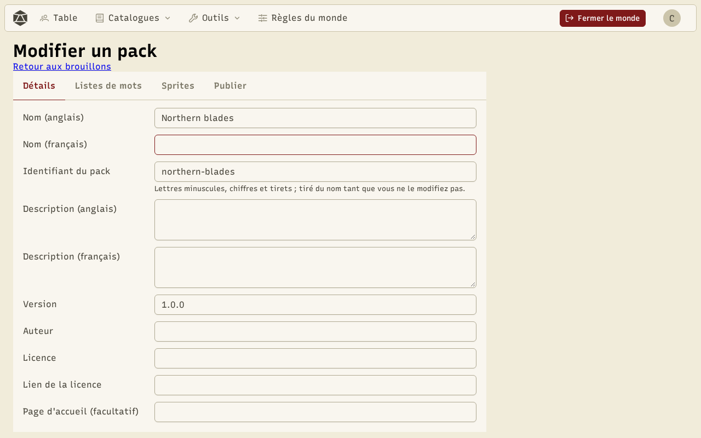
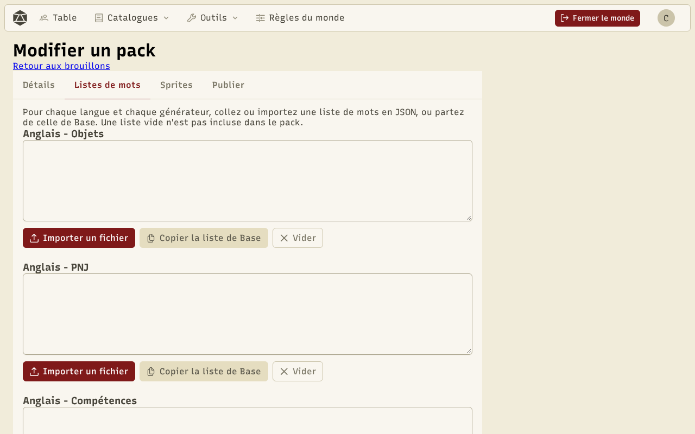
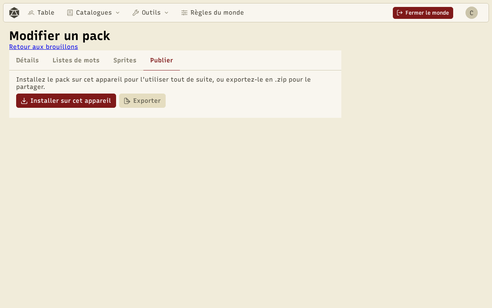

Un pack, ce sont des **données** : un fichier `pack.json` qui décrit le pack, plus les fichiers qu'il liste (listes de mots en JSON, images PNG, matériaux des sprites en JSON). Aucun code. Le plus simple est de le faire dans l'application, avec le **créateur de pack** ; vous pouvez aussi l'écrire à la main.

## Le créateur de pack

**Outils › Packs de contenu › Créer un pack** ouvre la liste de vos **brouillons**. Ils sont enregistrés sur cet appareil au fil de vos modifications : vous pouvez partir et revenir. **Nouveau brouillon** en ouvre un, avec quatre onglets.

### Détails

Le nom et la description en anglais et en français, la version, l'auteur, la licence et son lien, et une page d'accueil facultative. L'**identifiant du pack** se déduit du nom (minuscules, chiffres et tirets) tant que vous ne le modifiez pas. Il ne peut pas reprendre celui d'un pack officiel ni d'un pack ajouté depuis un lien.



### Listes de mots

Une case par langue et par générateur (objets, PNJ, compétences, classes), qui contient la liste en JSON. Les erreurs s'affichent pendant que vous écrivez. **Copier la liste de Base** part de la liste fournie avec l'application, le plus simple pour voir le format ; **Importer un fichier** charge un `.json`. Une case vide est laissée de côté.



### Sprites

- **Ajouter une image PNG** : au plus 1 Mo et 256 × 256 pixels. Une image ajoutée ainsi est **en niveaux de gris** ou **colorée**.
- **Depuis mes sprites** : un sprite enregistré dans le [coloriseur](/docs/tools/), ajouté **avec ses masques**, son type et son emplacement.

Pour chaque sprite : un identifiant, un libellé en anglais et en français, le type et l'emplacement d'objet (qui servent aux images aléatoires des objets), et la sorte. **Modifier dans le coloriseur** ouvre un sprite en niveaux de gris ou avec masques dans le coloriseur ; **Enregistrer dans le brouillon** y renvoie ses matériaux.

Depuis le coloriseur, **Ajouter à un brouillon de pack** ajoute directement le sprite en cours, avec ses masques.

### Publier



- **Installer sur cet appareil** installe le pack pour l'essayer tout de suite dans les générateurs. Il apparaît sur la page des packs comme **Créé sur cet appareil**. Réinstaller le remplace.
- **Exporter** télécharge un `.zip` (`<identifiant>-<version>.zip`) avec `pack.json` et les fichiers, prêt à publier.

Les deux font les **mêmes contrôles** qu'**Ajouter un pack** : un brouillon qui s'exporte est un pack qui s'installe.

Pour modifier un pack déjà installé depuis un lien ou créé ici, utilisez **Modifier comme brouillon** sur sa carte : son contenu est copié dans un nouveau brouillon.

## Publier sur GitHub

1. Créez un dépôt GitHub **public**.
2. Décompressez l'export et envoyez `pack.json` et ses dossiers à la racine du dépôt (ou dans un dossier).
3. Donnez le lien du dépôt (`https://github.com/vous/mon-pack`, ou `…/tree/main/mon-dossier`). N'importe qui peut l'ajouter avec **Ajouter un pack**.

Pour une nouvelle version, changez la `version`, exportez, remplacez les fichiers du dépôt : **Mettre à jour** proposera la nouvelle version à ceux qui ont le pack.

Avant de publier, essayez le lien vous-même avec **Ajouter un pack** et **Vérifier**.

## Référence du format

Un dépôt minimal :

```
mon-pack/
├── pack.json
├── generators/
│   └── fr/
│       └── items.json
└── sprites/
    ├── epee.png
    └── epee.json
```

Et son `pack.json` :

```json
{
  "format": 1,
  "id": "mon-pack",
  "name": { "en": "My pack", "fr": "Mon pack" },
  "description": { "en": "Swords from the north.", "fr": "Des épées du nord." },
  "version": "1.0.0",
  "author": "Votre nom",
  "license": "CC-BY-4.0",
  "licenseUrl": "https://creativecommons.org/licenses/by/4.0/",
  "generators": {
    "fr": { "items": "generators/fr/items.json" }
  },
  "sprites": [
    {
      "id": "epee",
      "en": "Sword",
      "fr": "Épée",
      "type": "equipment",
      "slot": "weapon1",
      "kind": "masked",
      "image": "sprites/epee.png",
      "materials": "sprites/epee.json"
    }
  ]
}
```

| Champ | Contenu |
| --- | --- |
| `format` | Toujours `1`. |
| `id` | Minuscules, chiffres et tirets ; unique. |
| `name`, `description` | Un texte en `en` et en `fr`. |
| `version`, `author`, `license` | Des textes. |
| `licenseUrl`, `homepage` | Des liens **https** (`homepage` est facultatif). |
| `generators` | Par langue (`en`, `fr`), les fichiers `items`, `npcs`, `skills`, `classes` ; chacun est facultatif. |
| `sprites` | La liste des sprites (voir ci-dessous). |

Pour chaque sprite : `id`, les libellés `en` et `fr`, `type` (`item`, `consumable` ou `equipment`), `slot` (`none` hors équipement, sinon `head`, `earring`, `necklace`, `ring`, `chest`, `hand`, `legs`, `foot`, `weapon1` ou `weapon2`), `kind` (`grayscale`, `masked` ou `colored`), `image`, et `materials` pour un sprite `masked` (le JSON exporté par le coloriseur).

Les chemins sont **relatifs** à `pack.json` : pas de `/` au début, pas de `..`, pas de lien.

**Limites** : `pack.json` jusqu'à 64 Ko, chaque fichier jusqu'à 1 Mo, le pack entier jusqu'à 20 Mo, les images jusqu'à 256 × 256 pixels.
