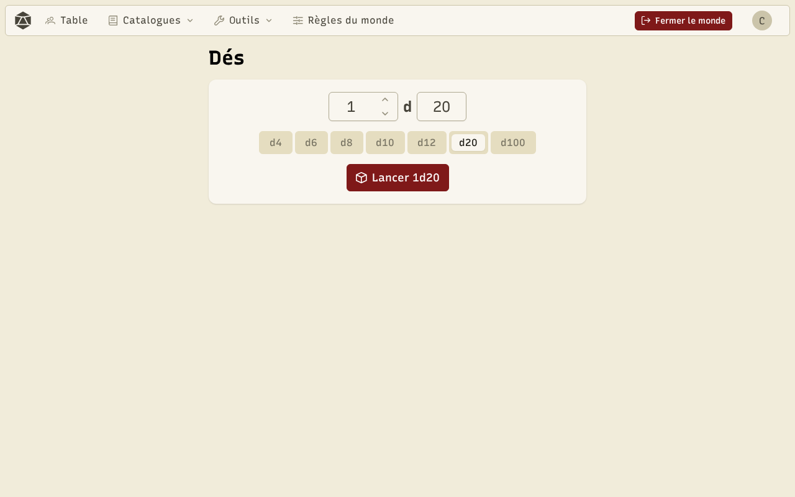
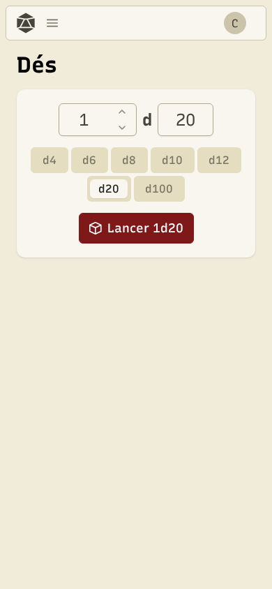

Le lanceur de dés fonctionne seul, depuis **Dés** dans le menu, ou pendant une partie, sur la table.

Choisissez le **nombre de dés** et le nombre de **faces** (d4, d6, d8, d10, d12, d20, d100), puis **Lancer**. Les dés roulent en 3D ; cliquez pour passer l'animation. Les **lancers récents** gardent l'historique.

Pendant une partie, **Partager avec la table** montre votre jet à tout le monde, dans **Lancers de la table**. Le partage est désactivé par défaut.

