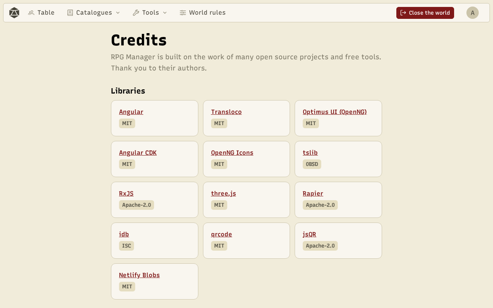
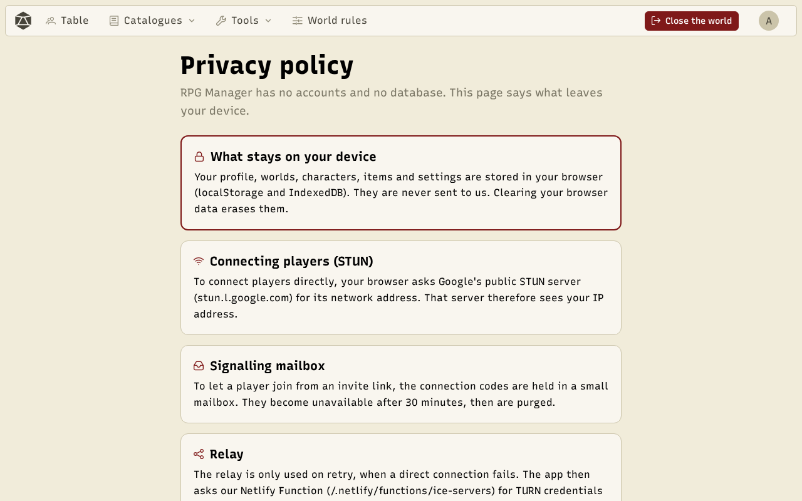

## Credits

The **Credits** page, at the bottom of every page, names the open source libraries, the illustrations (including Florian Sciberras's item sprites), the external tools and the use of AI in the project.

## Privacy

The app has no account and no game server. The **privacy policy** details what stays on your device (profile, worlds, characters, images, in the browser's storage) and the little that leaves it: the direct exchanges between the devices of a room, the network help they need to find each other, and the contact form if you use it.

A question, a problem? Use the **Contact** page. For a connection issue, first export the **diagnostic log** from your profile and attach it.
