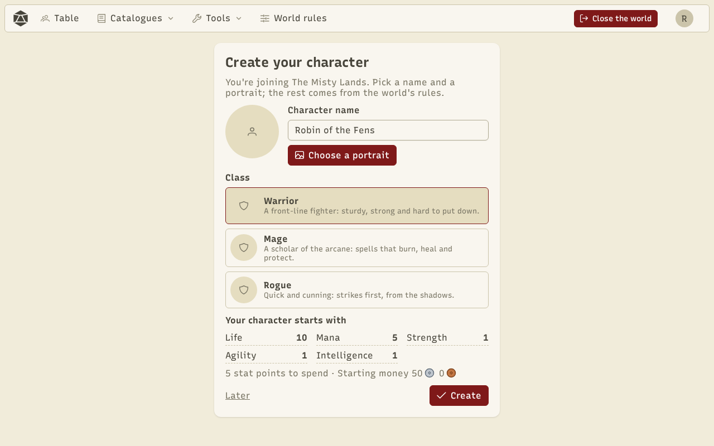
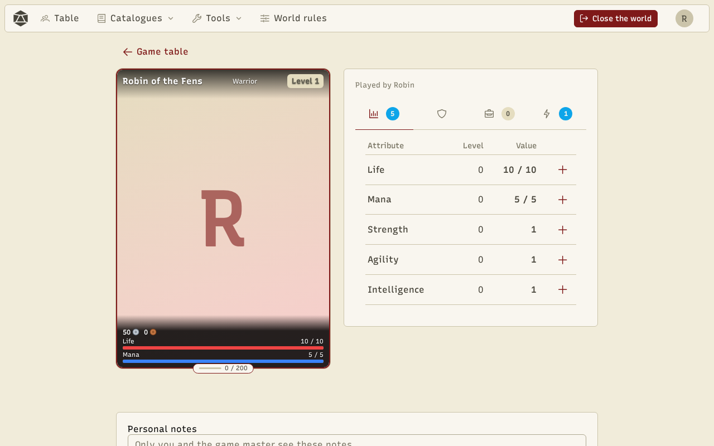

Each player has one **character** per world. They create it the first time they join the room, and find it again every time they come back.

## Create your character

Pick a name, a portrait and a **class**. The rest comes from the world rules: the page shows the stat points to spend and the starting money.

## The sheet

The sheet shows the character's card (portrait, class, level, money, bars and experience) and four tabs, with a counter on those that need something from you:

- **Stats**: every attribute with its level and current value over its maximum. **+** spends a stat point.
- **Equipment**: the slots (head, chest, hands, weapons…) with the equipped items.
- **Inventory**: the character's items. Depending on the item: equip, use (consumable), sell, see the details.
- **Skills**: the class tree, to learn and raise skills with skill points, and to use active skills.

At the bottom of the sheet, the **personal notes** are only seen by the player and the GM.

## Experience and level

The GM grants **experience** from the table or the sheet. When the character levels up, they get stat points and skill points, following the [world rules](/docs/en/worlds/). Attribute maxima follow their progression: raising an attribute's level raises its maximum and its current value.
