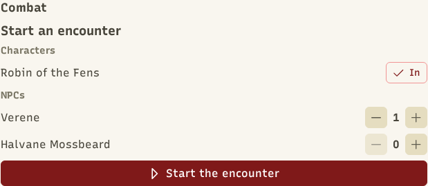
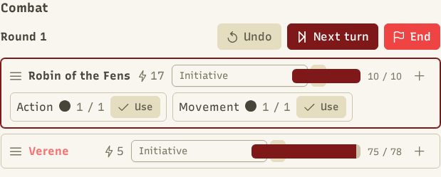
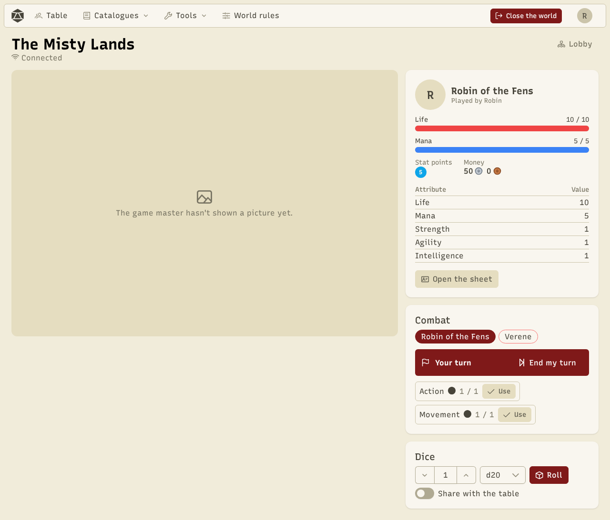
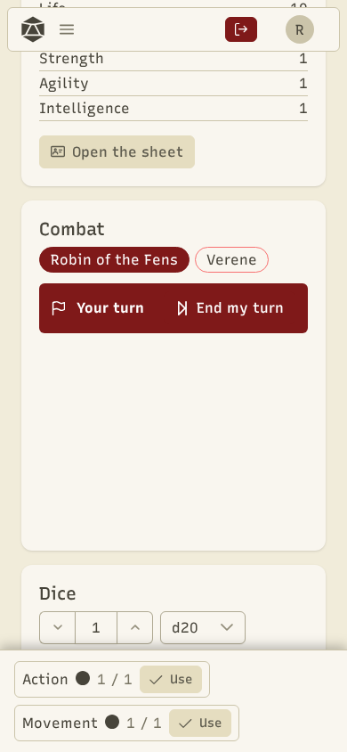

Combat is a **table aid**, not a game engine: it tracks the turn order, shows everyone's numbers and works out what skills do. The people at the table decide, and the GM can change anything at any time.

## Start an encounter

On the table, **Combat** section, the GM picks the characters present (**Add**) and NPCs from the catalogue, with a count ("Goblin × 3" makes three goblins). Then **Start the encounter**.

## How it goes

1. **Initiative**: depending on the world, the app rolls the dice, players type their roll, or the GM orders combatants by hand. The GM can always reorder.
2. **The turn**: the active combatant sees their **action counters** (Action 1/1, Movement 1/1), their active skills with what they do at their level, their consumables and the basic attack.
3. **Using a skill**: pick the skill and its targets. The dice are rolled at once, the cost and cooldown are taken, and the result waits for **GM validation**: apply, change the amounts (with defence), or dismiss.
4. **Next turn**, until **End**: the GM hands out the **rewards** (experience, money and loot of the defeated enemies).

The GM can also change a combatant (damage, heal, statuses, attributes) and **Undo** the last action.

## The player's side

The player sees the turn order, their counters, skills and items, and plays on their turn. What they see of enemies follows the NPC visibility settings.

## Optional steps

In the [world rules](/docs/en/worlds/), each step can be turned off: **initiative** (free order), **action counters**, **GM validation** (results apply at once), **defence** and **rewards**. A **grid** with a map can also be turned on to place the combatants.
