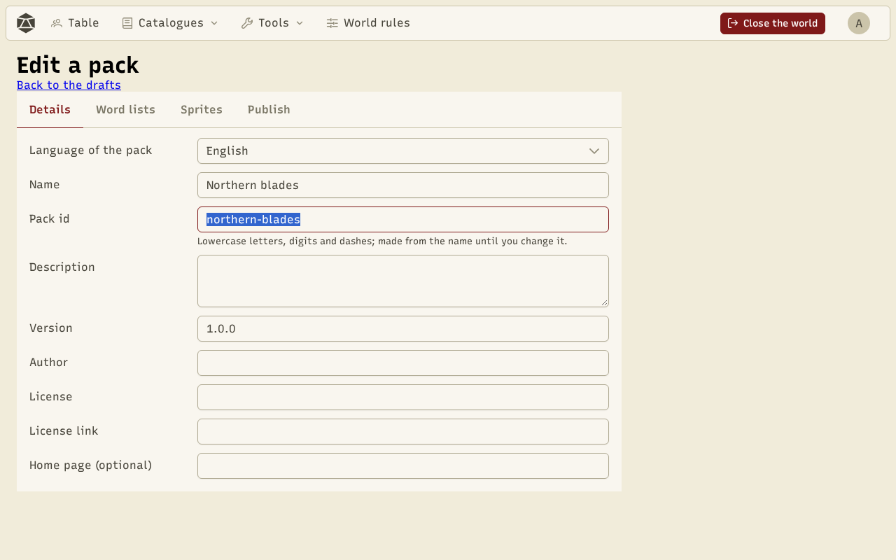
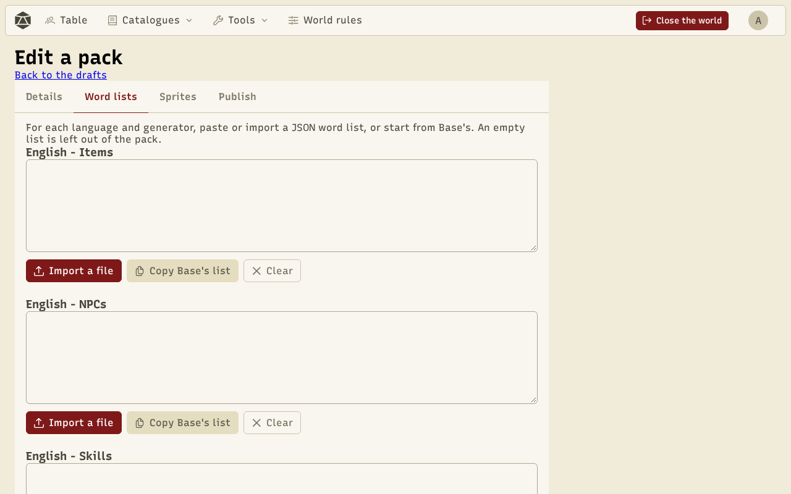
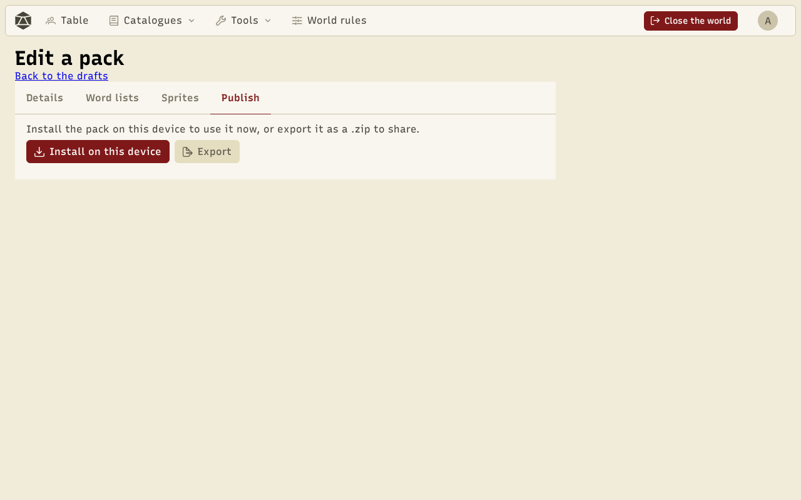

A pack is **data**: a `pack.json` file that describes the pack (its kinds, tints and sprites), plus the files it lists (word lists in JSON, PNG images, sprite materials in JSON). No code. The notions of domain, kind, tint and param are explained in [Content packs](/docs/en/packs/#how-items-are-put-together). The easiest way is to make it in the app, with the **pack creator**; you can also write it by hand.

## The pack creator

**Packs › Create a pack** opens the list of your **drafts**. They are saved on this device as you edit: you can leave and come back. **New draft** opens one, with four tabs.

### Details

The **pack language** (English or French, by default the app's), the name, the description, the version, the author, the license and its link, and an optional home page. The **pack id** is made from the name (lowercase letters, digits and dashes) until you change it. It cannot reuse the id of an official pack or of a pack added from a link.



### Word lists

The tab has three blocks, and its intro reminds you that empty lists are left out of the pack.

**Items** is filled with forms:

- **Kinds**: **Add a kind** asks for an id (English, lowercase letters, digits and dashes, for example `sabre`), a **Parent** and, for a root, a **Type**; the **Slot** is chosen on the level where it applies. Each kind has its **Nouns** (with the **Gender** masculine or feminine, and **Plural** for a noun such as "Gloves"), its **Descriptions** (one per line, using the [phrase syntax](/docs/en/packs/#the-phrase-syntax)) and, if needed, its **Name templates** (one per line, each with `{base}`) and its **Adjectives** and **Suffixes** per rarity (collapsed). These words add up along the chain: a sword gets those of `sword`, `weapon` and `equipment`, plus the common words. Put "sharpened" on `weapon` rather than in the common words, so no hood is "sharpened". Ids already known from installed packs are offered by autocompletion, so you can reuse the standard kinds.
- **Preview**: under each kind, draws a few trial items with its nouns and descriptions. A kind with no noun says "Nothing to draw: this kind needs a noun".
- **Coverage line**: "No sprite yet for: …" lists the pack's kinds that no sprite illustrates yet. It blocks nothing: a pack can have no sprites, and a kind with no sprite gets an image by type and slot.
- **Tints**: **Add a tint** asks for an id (`fire`, `rust`…) and the three colours of the gradient (**Shadow**, **Middle**, **Light**), then its **Adjectives** (one per line; a gendered adjective is written `masculine|feminine`, followed by the plurals if they are irregular), its **Suffixes** and its **Descriptions**. **Fits kinds** picks the kinds the tint can colour (empty: all); its words and descriptions are only drawn for those items, and a tint description is drawn one time in two.
- **Common adjectives and suffixes** (collapsed): words that fit any item ("ancient", "legendary"…), per rarity.
- **Name templates** (collapsed): the templates per rarity, only needed for a language Base. Untinted adjectives and suffixes stay in the raw file (see Advanced).

**Shared** holds the **Params**: **Add a param** asks for its name (its **role in the sentence**: `maker`, `place`…), then its phrases one by one (**New phrase**). Each phrase is a complete noun phrase with its article. A pack with no language has no texts: the form asks you to choose one in **Details**.

**NPCs**, **skills** and **classes** have the same two sections as items, filled with forms (empty lists are left out):

- **Kinds**: **Add a kind** asks for an id and a **Parent**, then the fields of the domain: for NPCs, the **Roles** and **Person** (untick it for a creature); for skills, the **Type** (active or passive) and the **Effect** (damage, heal, modify); for classes, the **Favoured skills**, picked among the known skill kinds. Renaming a kind follows its children, its texts and the classes that favour it. Ids already known from installed packs are offered by autocompletion.
- **Texts**: per kind, the **Nouns**, **Descriptions** (one per line, [phrase syntax](/docs/en/packs/#the-phrase-syntax)) and **Adjectives**; for skills and classes also **Suffixes**; for NPC kinds that are not persons, the **Name templates**. Above, the top-level lists: for NPCs the **Given names** (with a gender), the **Epithets** and the **Templates**; for skills and classes the **Templates**, **Adjectives** and **Suffixes**.
- **Preview**: under each kind, a few trial draws.

**Copy Base's list** and **Import a file** remain in the **Advanced (JSON)** part of each domain; what you change there shows up in the forms, and the other way round.

**Advanced (JSON)** shows the raw `items.json` and `common.json` files (and each domain's file in its section): import, export or copy Base's. What you change there shows up in the forms, and the other way round.



### Sprites

Sprites are shown 12 per page.

- **Add a PNG image**: at most 1 MB and 256 × 256 pixels. An image added this way is **grayscale** or **colored**.
- **From my sprites**: a sprite saved in the [colorizer](/docs/en/tools/), added **with its masks** and its kinds.

For each sprite: an id, a label in the pack's language, the item **Kinds** it illustrates (used for the items' random images), and the **Colouring** (grayscale, masked or colored). **Edit in the colorizer** opens a grayscale or masked sprite in the colorizer; **Save to the draft** sends its materials back.

From the colorizer, **Add to a pack draft** adds the current sprite directly, with its masks.

### Publish



- **Install on this device** installs the pack; tick it in a world's rules (or in **Tools › World rules**) to try it in the generators. It shows on the packs page as **Created on this device**. Installing it again replaces it.
- **Export** downloads a `.zip` (`<id>-<version>.zip`) with `pack.json` and the files, ready to publish.

Both run the **same checks** as **Add a pack**: a draft that exports is a pack that installs.

To change a pack made here, use **Edit as a draft** on its card: its content is copied into a new draft that keeps its id. To start from another pack (Base, a pack added from a link…), use **Duplicate**: the copy gets a new id.

### Translate a pack

A pack has one language. To offer your pack in English and French, **duplicate** it, change the language in **Details** and translate the name, description, nouns, descriptions, adjectives, params and labels. Kinds and tints stay the same: their ids have no language. Publish both packs; each world ticks the one in its language. If your pack only has images, kinds and tints, leave it **without a language**: one pack serves every world.

## Publish on GitHub

1. Create a **public** GitHub repository.
2. Unzip the export and push `pack.json` and its folders to the root of the repository (or to a folder).
3. Share the repository link (`https://github.com/you/my-pack`, or `…/tree/main/my-folder`). Anyone can add it with **Add a pack**.

For a new version, change the `version`, export, and replace the repository's files: **Update** will offer the new version to those who have the pack.

Before sharing, try the link yourself with **Add a pack** and **Check**.

## Format reference

A minimal repository:

```
my-pack/
├── pack.json
├── generators/
│   ├── items.json
│   └── common.json
└── sprites/
    ├── sword.png
    └── sword.json
```

And its `pack.json`:

```json
{
  "format": 2,
  "id": "my-pack",
  "language": "en",
  "name": "My pack",
  "description": "Swords from the north.",
  "version": "1.0.0",
  "author": "Your name",
  "license": "CC-BY-4.0",
  "licenseUrl": "https://creativecommons.org/licenses/by/4.0/",
  "tints": {
    "fire": {
      "gradient": [
        { "position": 0, "color": "#5a0a0a" },
        { "position": 0.5, "color": "#f97316" },
        { "position": 1, "color": "#fde047" }
      ]
    }
  },
  "domains": {
    "items": {
      "kinds": {
        "equipment": { "type": "equipment" },
        "weapon": { "parent": "equipment", "slot": "weapon1" },
        "sword": { "parent": "weapon" },
        "rapier": { "parent": "sword" }
      },
      "texts": "generators/items.json"
    }
  },
  "common": "generators/common.json",
  "sprites": [
    {
      "id": "sword",
      "label": "Sword",
      "domain": "items",
      "kinds": ["sword"],
      "kind": "masked",
      "image": "sprites/sword.png",
      "materials": "sprites/sword.json"
    }
  ]
}
```

| Field | Content |
| --- | --- |
| `format` | Always `2`. |
| `id` | Lowercase letters, digits and dashes; unique. |
| `language` | The pack's language: `en` or `fr`. Absent for a neutral pack (which has no `common` or `texts` either). |
| `name`, `description` | Texts, in the pack's language. |
| `version`, `author`, `license` | Texts. |
| `licenseUrl`, `homepage` | **https** links (`homepage` is optional). |
| `tints` | The pack's tints: an id and a `gradient` (a list of `position` from 0 to 1 and `color`). |
| `domains` | The content per domain: `items`, and `npcs`, `skills`, `classes`. Each can have `kinds` (the kind tree) and `texts` (the path to its language file). A domain the app doesn't know is ignored with a warning, but an unknown field inside a known domain is an error (to catch typos). |
| `common` | The path to `generators/common.json` (the params, shared by every domain). |
| `sprites` | The list of sprites (see below). |

**Kinds** (`domains.items.kinds`): each entry has an optional `parent`. Only roots declare a `type` (`item`, `consumable` or `equipment`); `slot` (`head`, `earring`, `necklace`, `ring`, `chest`, `hand`, `legs`, `foot`, `weapon1` or `weapon2`) is declared on one level of the equipment chain. The tree has no cycle and its root declares a `type`; a `parent` declared in another pack is allowed. Ids are scoped by domain (`items` `guard` and `npcs` `guard` are different).

**Sprites**: `id`, `label` (in the pack's language), `domain` (`items`), `kinds` (the kinds it illustrates), `kind` (the colouring: `grayscale`, `masked` or `colored`), `image`, and `materials` for a `masked` sprite (the JSON the colorizer exports). Sprites no longer have a `type` or `slot`: they come from the kind.

**`generators/items.json`** (word list v2):

```json
{
  "version": 2,
  "kinds": {
    "weapon": { "descriptions": ["A [reliable|fearsome] weapon, made by {maker}."] },
    "sword": { "nouns": [{ "text": "Sword", "gender": "m" }, { "text": "Blade", "gender": "f" }] },
    "rapier": { "nouns": [{ "text": "Rapier", "gender": "m" }] },
    "gloves": { "nouns": [{ "text": "Gloves", "gender": "m", "plural": true }] },
    "potion": {
      "nouns": [{ "text": "Potion", "gender": "f" }],
      "names": { "common": ["{base} of {effect}"] }
    }
  },
  "tints": {
    "fire": {
      "adjectives": { "rare": [{ "m": "fiery", "f": "fiery" }] },
      "suffixes": { "rare": ["of embers"] },
      "descriptions": ["Still warm to the touch, even after a night outside."]
    }
  },
  "adjectives": { "common": [{ "m": "worn", "f": "worn" }] },
  "suffixes": { "rare": ["of vigor"] },
  "templates": { "common": ["{adjective} {base}", "{base}"] }
}
```

- `version`: `2`.
- `kinds`: per kind, `nouns` (`text`, `gender` `m` or `f`, optional `plural`), `descriptions` (phrases) and `names` (name templates per rarity, taking priority over the language's).
- `tints`: per tint, `adjectives` and `suffixes` per rarity, and `descriptions`. A gendered adjective is written `{ "m": …, "f": … }`, with `mp` and `fp` for irregular plurals.
- `adjectives`, `suffixes`: the common words, for any item, per rarity (`common`, `uncommon`, `rare`, `mythic`, `legendary`). A kind can also have its own `adjectives` and `suffixes` (they add up along the chain), and an entry may carry a `tint`. In the manifest, a tint may have `fits`: the kinds it colours.
- `templates`: name templates per rarity, `{base}` required (`{adjective}` and `{suffix}` optional). Optional: each language's Base provides them; otherwise the name is `{base}`.

**`generators/common.json`** (params, shared by every domain):

```json
{
  "version": 1,
  "params": {
    "maker": ["a dwarf smith", "the monks of {place}", "a [clumsy|hasty] apprentice"],
    "place": ["Duskhollow", "the frozen coast"],
    "effect": ["healing", "vigor"]
  }
}
```

**NPC, skill and class kinds** (`domains.npcs.kinds`, `domains.skills.kinds`, `domains.classes.kinds`): same tree, `parent` optional. NPCs: `roles` (list of `story`, `merchant`, `enemy`) and `person` (boolean), inherited. Skills: `type` (`active` or `passive`, on a root) and `effect` (`damage`, `heal` or `modify`). Classes: `skills`, a list of skill kinds. Their `texts` files are v2 (below).

**`generators/npcs.json`** (v2):

```json
{
  "version": 2,
  "given": [{ "text": "Brannoc", "gender": "m" }, { "text": "Mirelle", "gender": "f" }],
  "epithets": ["the Wary", "Ashfoot"],
  "templates": ["{given}", "{given} {epithet}"],
  "kinds": {
    "guard": { "nouns": [{ "text": "Guard" }], "descriptions": ["Posted near {place}, and bored of it."] },
    "wolf": { "nouns": [{ "text": "Wolf" }], "adjectives": ["Grey", "Snow"], "descriptions": ["It howls at the moon."] },
    "beast": { "names": ["{adjective} {noun}", "{noun}"] }
  }
}
```

`given` (`text`, `gender`), `epithets`, `templates` (`{given}`, `{epithet}`: a name for a person), then per kind `nouns`, `descriptions`, `adjectives` and `names` (`{adjective}`, `{noun}`: a name for a creature).

**`generators/skills.json`** and **`generators/classes.json`** (v2, same shape):

```json
{
  "version": 2,
  "templates": ["{adjective} {noun}", "{noun} of {suffix}", "{noun}"],
  "adjectives": ["Ancient", "Secret"],
  "suffixes": ["the Oath", "Dawn"],
  "kinds": {
    "strike": {
      "nouns": [{ "text": "Strike" }, { "text": "Cleave" }],
      "descriptions": ["A clean blow, without a flicker of doubt."],
      "adjectives": ["Brutal"],
      "suffixes": ["Iron"]
    }
  }
}
```

`templates` (`{noun}` required; `{adjective}`, `{suffix}` optional), top-level `adjectives` and `suffixes`, then per kind `nouns`, `descriptions`, `adjectives`, `suffixes` and `names`. Words add up along the chain of the kind.

Classes use the same shape; their kinds carry the favoured skill kinds in the manifest:

```json
"classes": { "kinds": { "martial": { "skills": ["strike", "shot", "war-cry"] }, "warrior": { "parent": "martial" } }, "texts": "generators/classes.json" }
```

Each file carries its own `version`, so a domain can change without touching the others. Pack validation only warns about params it uses without defining, since another pack in the same language may provide them.

Paths are **relative** to `pack.json`: no leading `/`, no `..`, no links.

**Limits**: `pack.json` up to 64 KB, each file up to 1 MB, the whole pack up to 20 MB, images up to 256 × 256 pixels.
