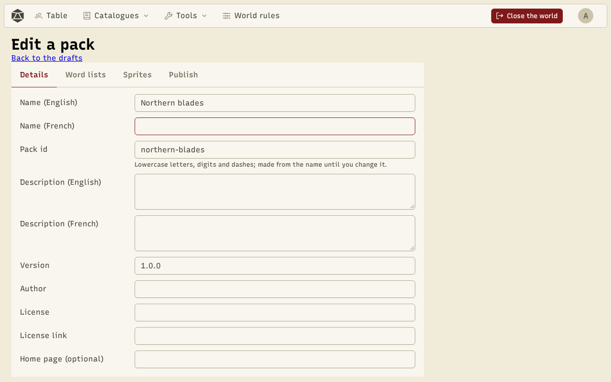
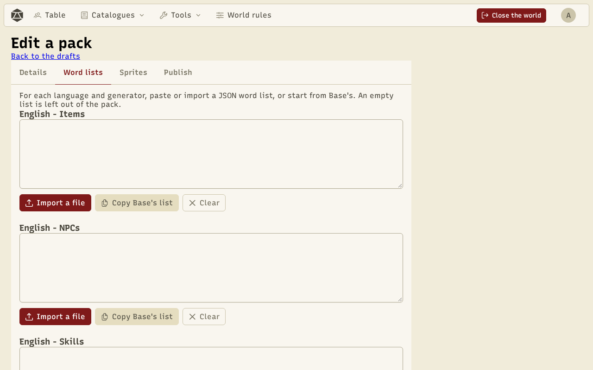
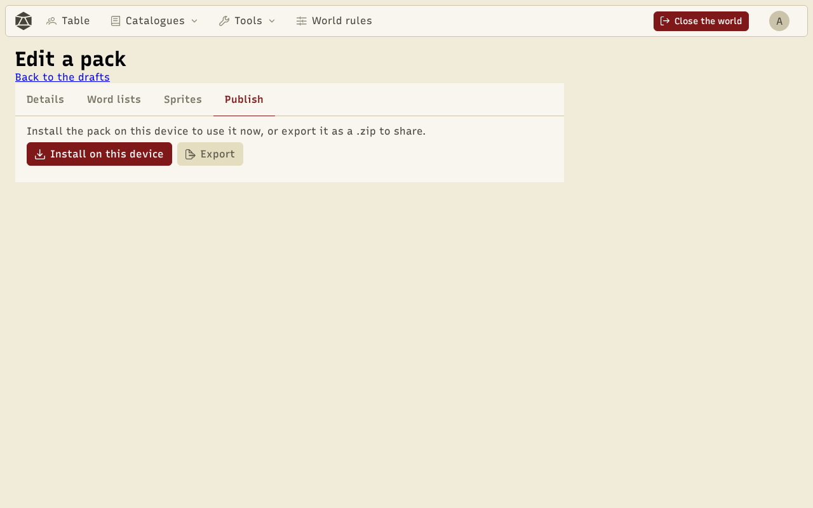

A pack is **data**: a `pack.json` file that describes the pack, plus the files it lists (word lists in JSON, PNG images, sprite materials in JSON). No code. The easiest way is to make it in the app, with the **pack creator**; you can also write it by hand.

## The pack creator

**Tools › Content packs › Create a pack** opens the list of your **drafts**. They are saved on this device as you edit: you can leave and come back. **New draft** opens one, with four tabs.

### Details

The name and description in English and French, the version, the author, the license and its link, and an optional home page. The **pack id** is made from the name (lowercase letters, digits and dashes) until you change it. It cannot reuse the id of an official pack or of a pack added from a link.



### Word lists

One box per language and generator (items, NPCs, skills, classes), holding the list as JSON. Errors are shown as you type. **Copy Base's list** starts from the list bundled with the app, the easiest way to see the format; **Import a file** loads a `.json`. An empty box is left out.



### Sprites

- **Add a PNG image**: at most 1 MB and 256 × 256 pixels. An image added this way is **grayscale** or **colored**.
- **From my sprites**: a sprite saved in the [colorizer](/docs/en/tools/), added **with its masks**, its type and its slot.

For each sprite: an id, an English and a French label, the item type and slot (used for the items' random images), and the kind. **Edit in the colorizer** opens a grayscale or masked sprite in the colorizer; **Save to the draft** sends its materials back.

From the colorizer, **Add to a pack draft** adds the current sprite directly, with its masks.

### Publish



- **Install on this device** installs the pack so you can try it in the generators at once. It shows on the packs page as **Created on this device**. Installing it again replaces it.
- **Export** downloads a `.zip` (`<id>-<version>.zip`) with `pack.json` and the files, ready to publish.

Both run the **same checks** as **Add a pack**: a draft that exports is a pack that installs.

To change a pack already installed from a link or made here, use **Edit as a draft** on its card: its content is copied into a new draft.

## Publish on GitHub

1. Create a **public** GitHub repository.
2. Unzip the export and push `pack.json` and its folders to the root of the repository (or to a folder).
3. Share the repository link (`https://github.com/you/my-pack`, or `…/tree/main/my-folder`). Anyone can add it with **Add a pack**.

For a new version, change the `version`, export, and replace the repository's files: **Update** will offer the new version to those who have the pack.

Before sharing, try the link yourself with **Add a pack** and **Check**.

## Format reference

A minimal repository:

```
my-pack/
├── pack.json
├── generators/
│   └── en/
│       └── items.json
└── sprites/
    ├── sword.png
    └── sword.json
```

And its `pack.json`:

```json
{
  "format": 1,
  "id": "my-pack",
  "name": { "en": "My pack", "fr": "Mon pack" },
  "description": { "en": "Swords from the north.", "fr": "Des épées du nord." },
  "version": "1.0.0",
  "author": "Your name",
  "license": "CC-BY-4.0",
  "licenseUrl": "https://creativecommons.org/licenses/by/4.0/",
  "generators": {
    "en": { "items": "generators/en/items.json" }
  },
  "sprites": [
    {
      "id": "sword",
      "en": "Sword",
      "fr": "Épée",
      "type": "equipment",
      "slot": "weapon1",
      "kind": "masked",
      "image": "sprites/sword.png",
      "materials": "sprites/sword.json"
    }
  ]
}
```

| Field | Content |
| --- | --- |
| `format` | Always `1`. |
| `id` | Lowercase letters, digits and dashes; unique. |
| `name`, `description` | A text in `en` and in `fr`. |
| `version`, `author`, `license` | Texts. |
| `licenseUrl`, `homepage` | **https** links (`homepage` is optional). |
| `generators` | Per language (`en`, `fr`), the `items`, `npcs`, `skills`, `classes` files; each one is optional. |
| `sprites` | The list of sprites (see below). |

For each sprite: `id`, the `en` and `fr` labels, `type` (`item`, `consumable` or `equipment`), `slot` (`none` for anything that isn't equipment, otherwise `head`, `earring`, `necklace`, `ring`, `chest`, `hand`, `legs`, `foot`, `weapon1` or `weapon2`), `kind` (`grayscale`, `masked` or `colored`), `image`, and `materials` for a `masked` sprite (the JSON the colorizer exports).

Paths are **relative** to `pack.json`: no leading `/`, no `..`, no links.

**Limits**: `pack.json` up to 64 KB, each file up to 1 MB, the whole pack up to 20 MB, images up to 256 × 256 pixels.
