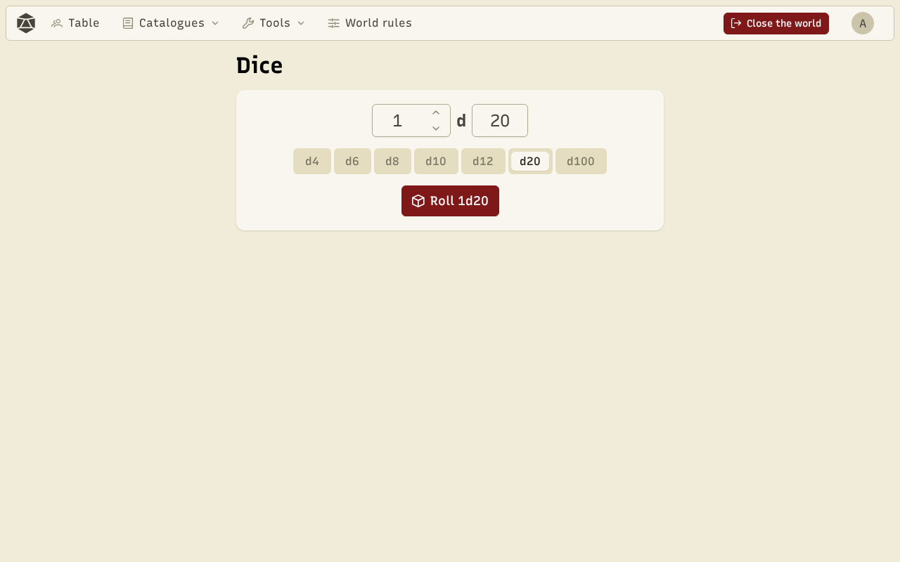
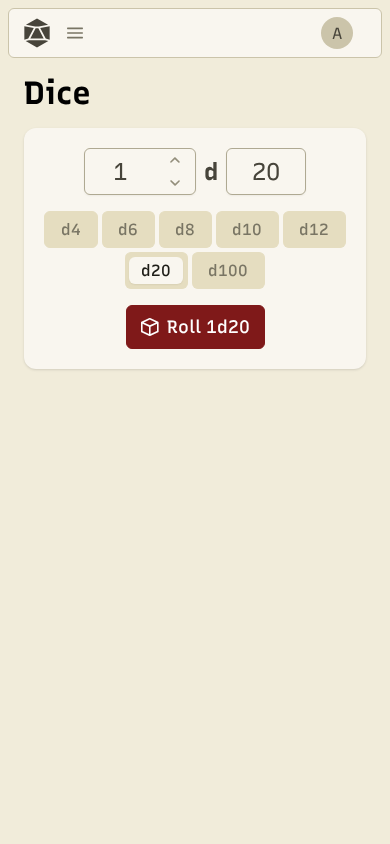

The dice roller works on its own, from **Dice** in the menu, or during a game, on the table.

Pick the **number of dice** and the number of **faces** (d4, d6, d8, d10, d12, d20, d100), then **Roll**. The dice roll in 3D; click to skip the animation. **Recent rolls** keeps the history.

During a game, **Share with the table** shows your roll to everyone, in **Table rolls**. Sharing is off by default.

