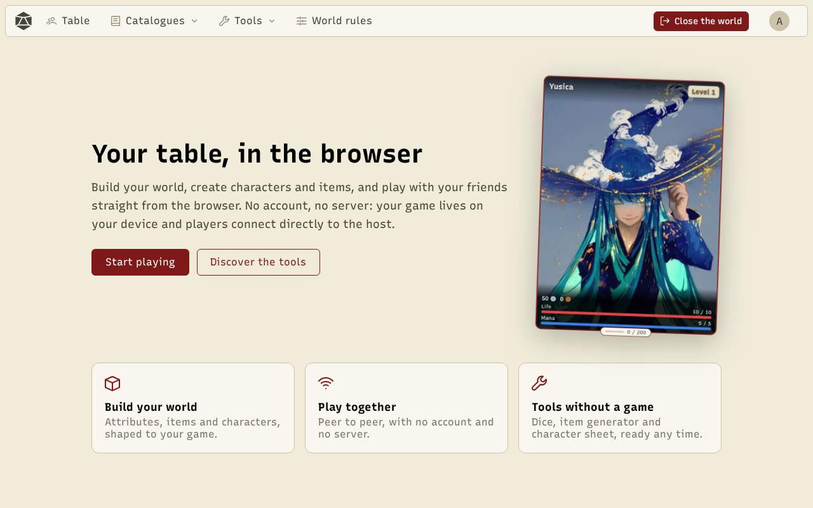
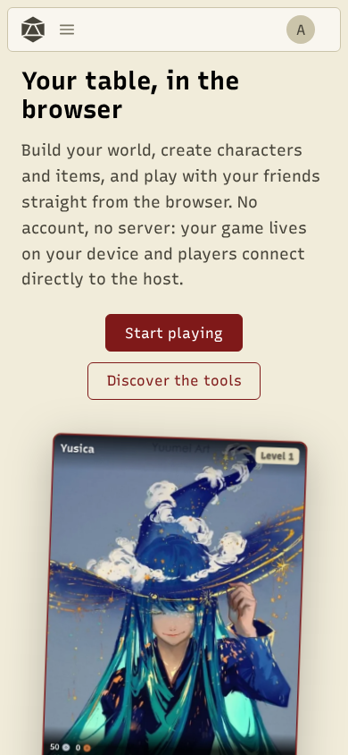
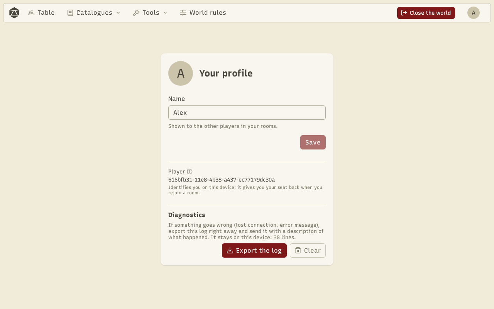

RPG Manager is a table aid for role-playing games: the game master (GM) prepares their world, then opens it to the players for a session. Everything runs in the browser, **with no account and no game server**: your data stays on your device and the devices at the table talk to each other directly.

## Open and install the app

Open the site in a recent browser (Chrome, Edge, Firefox, Safari). To have it as an app, with its own icon and full screen:

- **On a computer**: click the install icon in the address bar (Chrome, Edge).
- **On a phone**: the browser menu, then "Add to Home screen".

Once installed, the app opens even without a network: you can look at your worlds and characters offline.

## Your profile

There are no accounts. Your **profile** is just the name other players see, with a **player ID** created on this device: it gives you back your seat and your character when you return to a room. Open it from your avatar, top right, then **Profile**.

:::caution
Your profile, worlds and characters are stored **in this browser**. Clearing the site's data removes them: export your worlds now and then (see [Worlds and rules](/docs/en/worlds/)).
:::

## The menu

Outside a game, the top bar offers **Worlds** (your worlds and the ones you joined), **Dice**, **Catalogues** (try the catalogues on a sample world) and **Tools**. During a game it becomes **Table**, **Catalogues**, **Tools** and **World rules**, with a **Close the world** button.

Your avatar's menu holds your profile, this help and the language (French or English).
