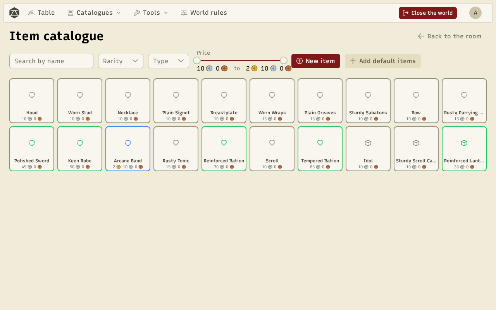
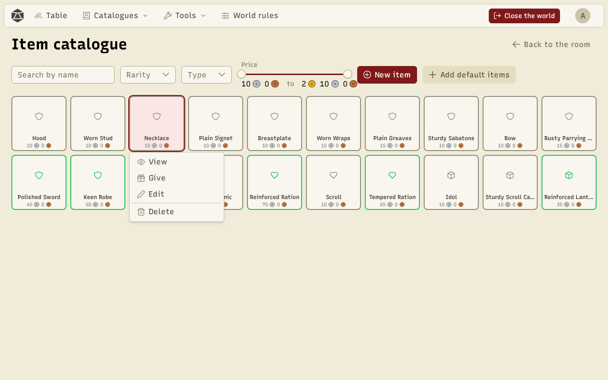
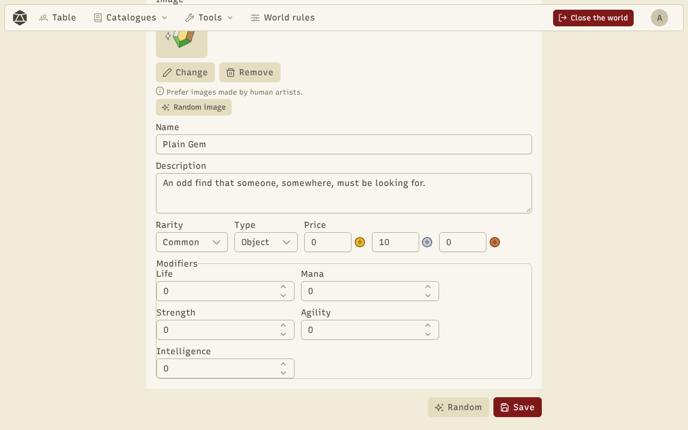

Every world has its **item catalogue**: weapons, armour, jewels, consumables… The game master creates items there, then gives them to characters. Open it from **Catalogues → Items** during a game.

The catalogue looks like a large inventory. The frame colour shows the **rarity** (common, uncommon, rare, mythic, legendary). At the top, search by name and filter by rarity, type (item, consumable, equipment) and price.

## Act on an item

Click an item (or right-click it): a menu opens right next to it.

- **View** shows the item's card.
- **Give** sends it to a character's inventory.
- **Edit** opens the editor.
- **Delete** removes it from the catalogue (copies already in inventories stay).

With the keyboard: Enter opens the selected item's menu, Escape closes it.

## Create and edit an item

**New item** opens the editor. The **Form** tab sets the image, name, description, rarity, type, equipment slot, price and modifiers (bonuses or penalties on attributes). The **JSON** tab shows the same item as text, and **Copy AI prompt** prepares a request for an AI. The **Generate** tab draws an item from a seed: the same seed always gives the same item.

The **Random** button draws a whole item **with its image**: an item sprite recoloured at random, picked from the item's name and type. **Random image** changes the image only. Your own saved sprites can be used too (see [Tools](/docs/en/tools/)).

:::note
The generated item images come from the "Fantasy items pack" by Florian Sciberras (CC BY 4.0). For your own illustrations, prefer the work of human artists.
:::
