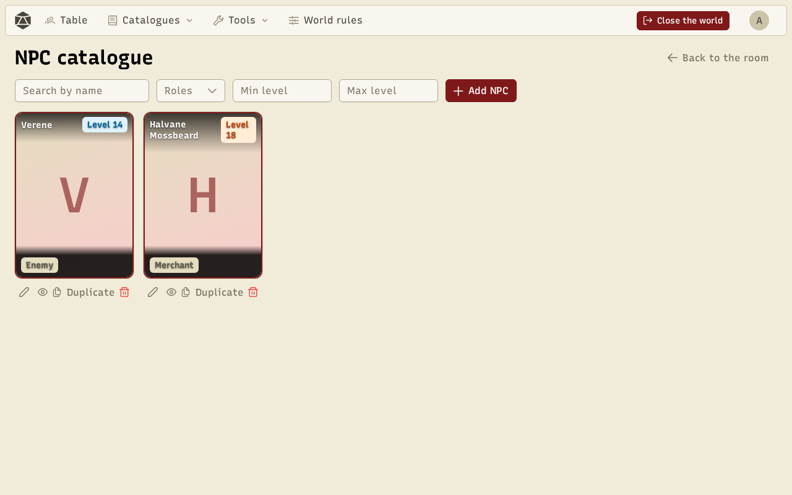
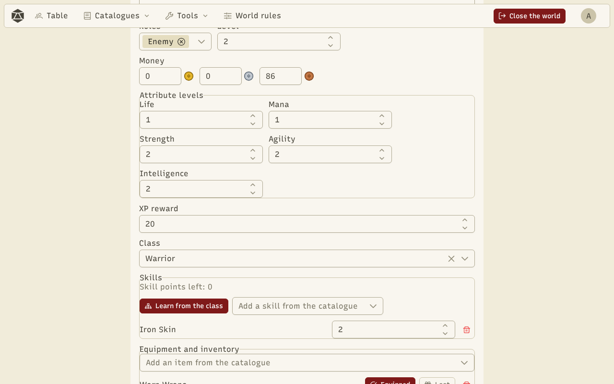

**NPCs** (non-player characters) follow the same rules as characters: attributes, level, equipment, skills. Each NPC has one or more **roles**: **Story**, **Merchant** or **Enemy**. Open the catalogue from **Catalogues → NPCs**.

Search by name, filter by role or level. Under each card: edit, view, duplicate, delete.

## The NPC editor

**Add NPC** opens the editor: portrait, name, description, roles, level, attributes, class and skills, equipment, a stock for a merchant, and rewards for an enemy (experience, money, loot). **Random** draws a whole NPC, with a person's name and a class.

## Show an NPC on the table

On the table, the GM can show up to four NPCs to every player. The name and portrait are always visible; the rest (description, level, life bar, life points, attributes, equipped items) depends on the role, following the **NPCs on the table** settings of the [world rules](/docs/en/worlds/).

## Merchants

A **Merchant** NPC has a **shop**. From the table, the GM opens it for every player or for one. Players buy from its stock and sell it their items. Prices follow the world's economy ratios (what merchants charge, what they pay).
