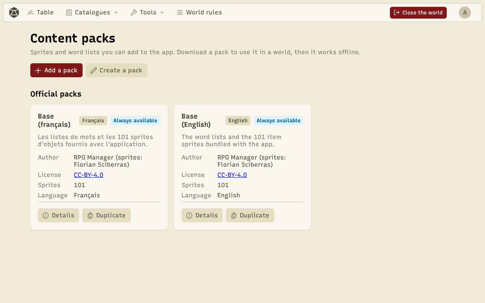
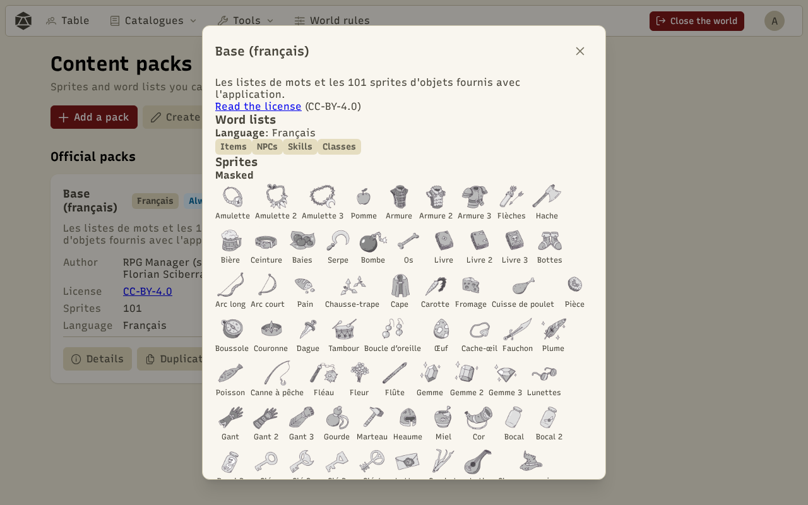
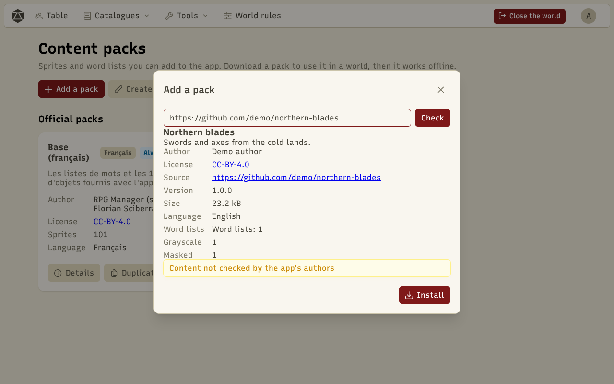
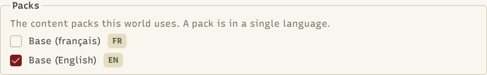
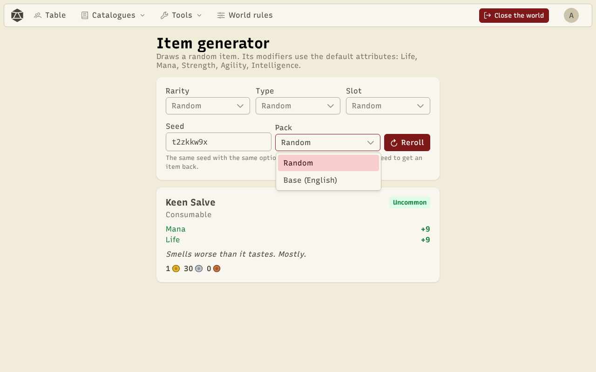

A **pack** adds content to the app: **word lists** for the generators (items, NPCs, skills, classes) and item **sprites**. Each pack is written in **one language** (English or French), shown on its card. To translate a pack, you make a second one in the other language.

The **Tools › Content packs** page installs and removes packs on the device. Each **world's rules** choose the packs it uses (see below).

## The Base packs

**Base (English)** and **Base (français)** hold the word lists and the 101 item sprites bundled with the app, each in its language. They are **always available** and cannot be removed. **Details** shows the license, the word lists and the sprites, grouped by kind.

A sprite is one of three **kinds**:

- **Grayscale**: an image you split into materials yourself in the [colorizer](/docs/en/tools/).
- **Masked**: a grayscale image shipped with its materials, ready to recolour.
- **Colored**: an image already in colour, used as is. The colorizer refuses it.

## Official packs

Official packs are listed on the page, but **their files are only downloaded when you click Download** (or **Install** from the rules of a world that uses it). They then stay on the device and work **offline**. **Remove from device** deletes them (you can download it again); worlds that used it then show it as missing.

For now, the two Bases are the only official packs.

## Add a pack from a link

**Add a pack** installs a pack made by someone else. Paste:

- a **GitHub repository** link (`https://github.com/owner/repository`), or one of its folders (`…/tree/main/my-pack`);
- or an **https** link to a `pack.json` file.

**Check** downloads the whole pack and checks every file, **without installing anything**. You see its name, author, license, source, size and what it adds. **Install** stores it on the device; then tick it in the rules of the worlds that should use it. If a file has a problem, the list of errors is shown and nothing is installed.

:::caution
A pack added from a link is **not checked by the app's authors**. It only holds data (text and images), never code, and the app checks its size and format, but its words and images can be anything. Only add packs whose source you know.
:::

Packs added from a link have their own section. **Update** downloads the pack again from its link and shows the old and new versions before replacing it. **Remove from device** deletes it. Items and NPCs already generated keep their names and images.

The authors and licenses of installed packs are listed in the [credits](/docs/en/about/).

**Duplicate**, on any card whose files are on the device, copies the pack into a new draft of the [pack creator](/docs/en/create-pack/), in the same language.

## A world's packs

In the creation wizard (**Rules** step) and in **World rules**, the **Packs** section lists the installed packs with their language. Tick the ones the world uses. A new world starts with the Base in the app's language. You can mix languages, for example Base (English) and a French sprite pack.

A ticked pack that isn't on the device (imported world, removed pack) is marked **missing**: **Install** downloads it if it is official, otherwise you can remove it from the world.

In the **Tools**, with no game running, the generators use the packs chosen in **Tools › World rules** (by default, the Base in the app's language).

## Choose the pack in the generators

The item editor, the item generator and the NPC editor have a **Pack** menu next to the seed.

It offers the world's packs that have content for this generator.

- **Random** (the default) picks the pack from the seed: the same seed, with the same packs, always gives the same result.
- A named pack uses its word lists, and its sprites for the item's random image. If none of the world's packs has a list for this generator, the Base in the app's language takes over.

The **Random** buttons for skills and classes pick a pack at random among those that have them.

To make your own pack, see [Create a pack](/docs/en/create-pack/).
