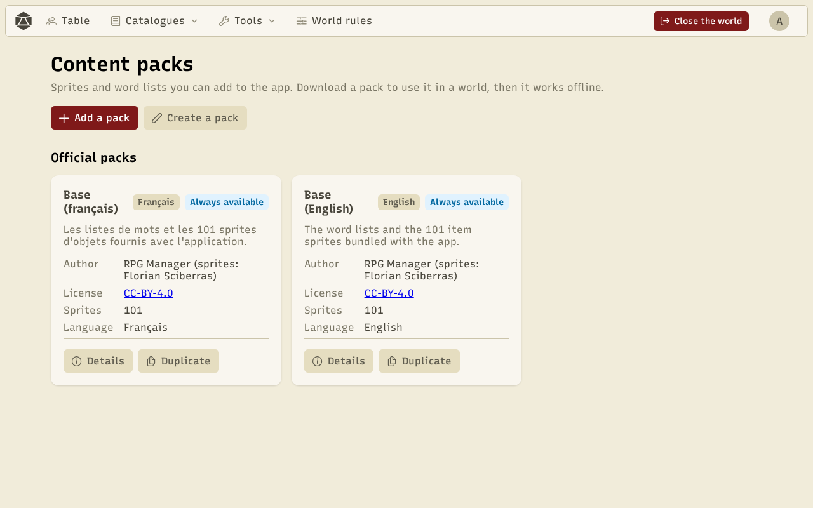
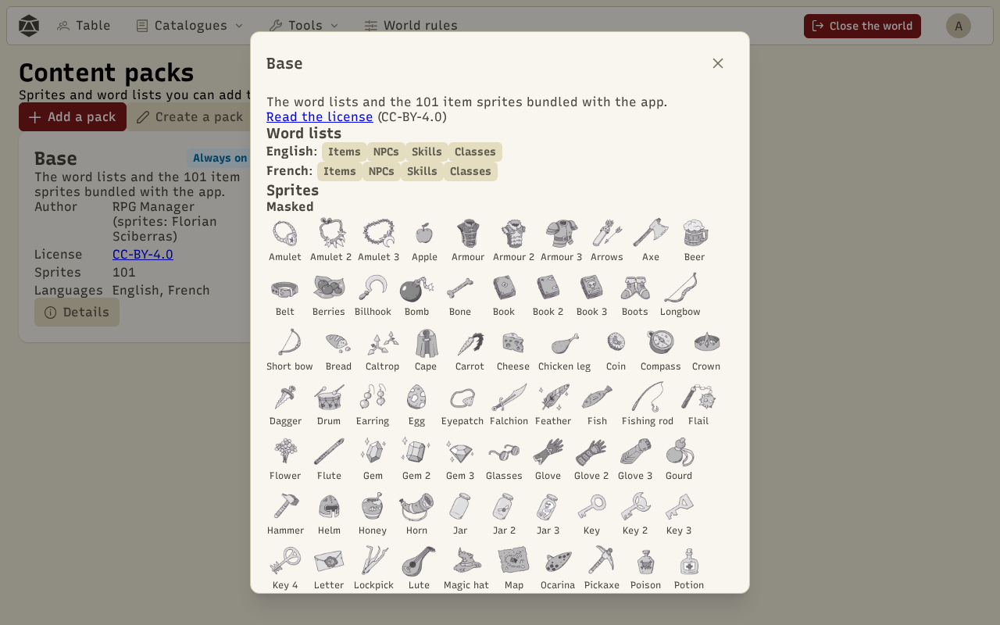
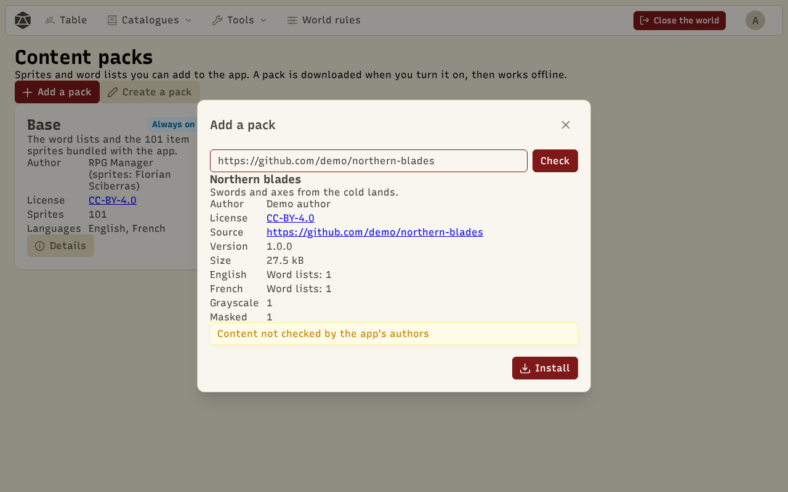
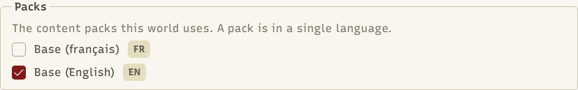

A **pack** adds content to the app: **word lists** for the generators (items, NPCs, skills, classes), item **sprites**, and what ties them together: **kinds** and **tints**. A pack that has texts is written in **one language** (English or French), shown on its card. To translate a pack, you make a second one in the other language. A pack can also have **no language** (see [Neutral packs](#neutral-packs)).

The **Packs** page installs and removes packs on the device. Each **world's rules** choose the packs it uses (see below).



## The Base packs

**Base (English)** and **Base (français)** hold the word lists, texts, kinds, tints and content bundled with the app, each in its language. The 101 item sprites live in a neutral pack, **Base assets** (no language, CC BY 4.0), that every world uses whatever its language. These three packs are **always available** and cannot be removed. **Details** shows the license, the word lists and the sprites, grouped by colouring.



A sprite has one of three **colourings**:

- **Grayscale**: an image you split into materials yourself in the [colorizer](/docs/en/tools/).
- **Masked**: a grayscale image shipped with its materials, ready to recolour.
- **Colored**: an image already in colour, used as is. The colorizer refuses it.

## Fixed content

Besides word lists and sprites, a pack can ship **fixed content**: ready-made **items**, **skills** and **classes** that are copied as they are into a world's catalogues, instead of being drawn by a generator. The pack declares the **attributes** its content uses (Life, Strength…).

- **Import from the packs** (in the item, skill and class catalogues) copies the fixed content of the world's active packs. Importing again updates the copies you did not edit and leaves your edited ones alone.
- When the world lacks an attribute the pack uses, you choose for each one: use one of your attributes, add it to the world, or skip it. Skipping drops the modifiers on it, and a **skill that needs a skipped attribute** (in an effect or a formula) is left out, with its place in the class trees. A skill whose **cost** is on a skipped attribute is kept, and becomes free.
- The Base packs ship the **starter classes and skills** (Warrior, Mage and Rogue with their skill trees) written on the default attributes (Life, Mana, Strength, Agility, Intelligence). A new world with **Add default classes and skills** ticked, and the tools' sandbox, get them from Base; a world that renamed or lacks one of these attributes simply gets the skills that do not need it. Active skills tick the first action type of the world (its movement counter for movement skills).

## Official packs

Official packs are listed on the page, but **their files are only downloaded when you click Download** (or **Install** from the rules of a world that uses it). They then stay on the device and work **offline**. **Remove from device** deletes them (you can download it again); worlds that used it then show it as missing.

For now, Base (English), Base (français) and Base assets are the only official packs.

## How items are put together

Generated items rest on a few notions shared by every pack.

- **Domain**: the type of content a pack's lists apply to: **items** (`items`), **NPCs** (`npcs`), **skills** (`skills`) and **classes** (`classes`). All four use the kinds, phrases and params described here; tints only concern items.
- **Kind**: a concrete thing, with no language: `sword`, `potion`, `wolf`, `fire-spell`, `warrior`. The pack gives its **nouns** and **descriptions** (in its language). For items, its **sprites** say which kinds they illustrate: that link keeps the image consistent with the name. A kind can also carry **fields** that depend on its domain (see below).
- **Tint**: a material or an element (`steel`, `fire`, `ice`…) with a colour **gradient**. An item's adjectives and suffixes can carry a tint: a "fiery" rapier is coloured with the `fire` gradient.
- **Param**: a list of word groups to insert into descriptions and names, for example `maker` ("a dwarf smith"). See [the phrase syntax](#the-phrase-syntax).

### The kind tree and inheritance

Kinds form a **tree**: a kind can have a **parent**. Only roots declare a `type` (item, consumable or equipment). The **slot** is declared once, on the level where it applies (for example `weapon`), and children inherit the type and the slot. Nouns, descriptions, name templates and sprites are looked up from the kind up through its parents: **the first level that has some wins**.

```
equipment            (type: equipment)
└── weapon           (slot: weapon)
    └── sword        (noun: Sword)
        ├── rapier   (noun: Rapier)
        └── sabre    (noun: Sabre)
```

A `rapier` is therefore a piece of equipment worn as a weapon (inherited), called "Rapier" (its own noun), gets the descriptions of `weapon`, and uses a sword picture (`sword`) when no sprite is made for `rapier`. When you add `sabre` under `sword`, it is drawn right away with a sword picture; a dedicated sprite can come later. Base's roots (`equipment`, `consumable`, `item`) carry the generic descriptions: there are no descriptions per type any more.

### Neutral packs

A pack can have **no language**: it then only holds sprites, kinds and tints (for example a drawing pack). Its images serve every world, whatever its language.

### The world language

Each world has a **language** (the **World language** setting, see [Worlds and rules](/docs/en/worlds/#the-world-language)). Generators pool the content of **all the world's active packs**, but:

- **texts** (nouns, adjectives, descriptions, params, name templates) only come from packs **in the world's language**;
- **kinds, tints and sprites** come from every active pack, whatever its language, and from neutral packs.

A pack in another language is still useful for its images, kinds and tints: the world rules show it as "images, kinds and tints only".

If two packs declare the same kind with a different `type`, slot or parent, the Base packs' declaration wins, then the first pack in the world's order; a warning is shown. Identical declarations merge silently. If two packs give the same tint with different gradients, they are variants of that tint: one is drawn for each image.

### How an item is drawn

The generator picks the type (or the one you fix), the slot, then a kind that has at least one noun in the world's language, a noun, and possibly an adjective and a suffix depending on rarity. It builds the name with a template (the kind's own, otherwise the language's), then draws a description from the nearest level of the kind that has some, plus those of the tint of the adjective or suffix. The item **keeps its kind and tints**: the random image button uses them, even if you rename the item. An item typed by hand, with no kind, is recognised by the nouns in its name; otherwise the image is chosen by type and slot.

### The phrase syntax

Descriptions, name templates and params are **phrases** that can vary:

| Syntax | Effect |
| --- | --- |
| `[a\|b\|c]` | A variant drawn at random. An empty option (`[very\|]`) makes the words optional. |
| `{maker}` | A param, drawn among those of that name in all the active packs of the world's language. A param can contain variants and other params (up to 5 levels). |
| `{g:he\|she}` | Agreement with the gender of the drawn noun (masculine\|feminine). |
| `{g:m\|f\|mp\|fp}` | The same agreement with plurals (masculine\|feminine\|masculine plural\|feminine plural), for plural nouns such as "Gloves". |
| `{base}`, `{adjective}`, `{suffix}` | In a name template: the drawn noun, adjective and suffix. |
| `{kind id}` | A noun of that kind, drawn from the kind or one of its descendants (see [Kind references](#kind-references)); `{kind id:adjective}` is one of its adjectives, agreed with the noun of the entry. A param with the same name wins. |

Example: "A [reliable\|fearsome] weapon, made by {maker}." A phrase whose param no active pack of the language defines is skipped (another one is drawn); if none is left, the text is empty.

**Plural nouns** (gloves, boots) are marked on the noun (the **Plural** box in the creator): the adjective then takes its plural form (by default the singular plus `s`, unless it ends in `s` or `x`).

### Kind references

Any name template, description or param can use the id of a **kind of any domain** (items, NPCs, skills, classes) as a placeholder: an item description can say `Forged by {blacksmith}.` with `blacksmith` a kind of the NPCs domain. `{blacksmith}` inserts a noun of that kind, drawn from the kind or one of its descendants that has nouns, among all the active packs; `{blacksmith:adjective}` inserts one of the kind's adjectives, agreed with the noun of the entry.

The draw happens once per placeholder id for each generated entry, so a name and a description that use the same id agree. When an id exists in several domains, the entry's own domain is searched first, then items, NPCs, skills and classes. A param named like a kind stays a param. An id that is neither a param nor a kind of an active pack is a warning in the pack creator.

### Naming conventions

So that packs stay compatible with each other, follow these conventions; the Base packs do.

- **Kinds**: English, singular, `kebab-case`, the concrete thing (`sword`, `war-hammer`, `healing-potion`). A sub-kind gets a `parent` rather than a new isolated name.
- **Tints**: a material or an element (`steel`, `gold`, `fire`, `ice`, `rust`, `shadow`), not a raw colour.
- **Params**: named by their **role in the sentence** (`maker`, `owner`, `place`, `event`, `creature`, `effect`). Each entry is a complete noun phrase with its article ("a dwarf smith"), so it fits anywhere without agreement.

### What the Base packs publish

Both Bases declare **the same kinds and the same tints** (they merge). If you name your kinds and tints like them, your sprites and words fit together with theirs.

- **Roots**: `equipment`, `consumable`, `item`.
- **Equipment slots**: `head`, `earring`, `necklace`, `ring`, `chest`, `hand`, `legs`, `foot`, `weapon` (slot `weapon1`) and `shield` (slot `weapon2`), all children of `equipment`.
- **Kinds** below them: for example `sword`, `rapier`, `dagger`, `axe`, `bow-long`, `staff`, `mace` under `weapon`; `helm`, `crown`, `hood` under `head`; `armor`, `cape`, `robe`, `tunic` under `chest`; `potion`, `elixir`, `bread`, `scroll` under `consumable`; `key`, `book`, `torch`, `gem`, `lantern` under `item`. The full list is in Base's `pack.json`.
- **Tints**: `steel`, `wood`, `gold`, `ice`, `fire`, `leaf`, `arcane`, `rust`, `silver`, `shadow`.
- **Params** (`generators/common.json`): `maker`, `owner`, `place`, `event`, `creature`, `effect`.
- **Cross-domain reference**: a weapon description uses `{blacksmith}`, a kind of Base's NPCs; the `material` param holds the materials.

Base also publishes the kinds of the three other domains.

- **NPCs** (20): `townsfolk` (roles `story`; `peasant`, `noble`, `scholar`, `priest`), `trader` (role `merchant`; `merchant`, `innkeeper`, `blacksmith`, `peddler`), `guard` (roles `story`, `enemy`), `outlaw` (role `enemy`; `bandit`, `cultist`, `mercenary`) and `beast` (role `enemy`, not a person; `wolf`, `bear`, `giant-spider`, `boar`).
- **Skills** (20): `attack` (active, damage; `strike`, `shot`, `fire-spell`, `frost-spell`, `lightning-spell`, `shadow-spell`), `healing` (active, heal; `prayer`, `remedy`), `support` (active, modify; `blessing`, `curse`, `war-cry`, `song`) and `trait` (passive; `toughness`, `focus`, `agility`, `presence`).
- **Classes** (18): `martial` (`warrior`, `berserker`, `knight`), `arcane` (`mage`, `warlock`, `sorcerer`), `divine` (`cleric`, `paladin`), `nature` (`druid`, `ranger`, `shaman`) and `cunning` (`rogue`, `assassin`, `bard`). Each family lists its favoured skill kinds, for example `martial`: `strike`, `shot`, `war-cry`, `toughness`.
### NPC, skill and class kinds

The three other domains use the same tree and the same inheritance (parent, first level with words wins). What a kind carries depends on the domain.

- **NPCs**: `roles` (`story`, `merchant`, `enemy`: the roles a generated NPC can take) and `person` (`false` for a creature: it then has a noun as its name, no given name). Roles and `person` are inherited from the parent. Texts: `given` (given names with a `gender`), `epithets`, `templates` (`{given}`, `{epithet}`), then per kind `nouns`, `descriptions`, `adjectives` and `names` (name templates with `{adjective}` and `{noun}`, for kinds that are not persons).
- **Skills**: `type` (`active` or `passive`, on a root) and `effect` (`damage`, `heal` or `modify`, for an active skill). Texts: `templates`, `adjectives`, `suffixes`, then per kind `nouns`, `descriptions`, `adjectives`, `suffixes` and `names`.
- **Classes**: `skills`, the **favoured skill kinds**. A class's skill tree is drawn from the world's skills whose kind chain holds one of them (when there are at least 3 of them; otherwise it is topped up with other skills). Texts like skills: `templates`, `adjectives`, `suffixes`, then per kind `nouns`, `descriptions`, `adjectives`, `suffixes` and `names`.

For skills and classes, the generator picks a kind, a noun, maybe an adjective and a suffix (those of the kind, then the top-level ones), and builds the name with a template (`{adjective}`, `{noun}`, `{suffix}`). The description comes from the nearest level of the kind that has some. An NPC, skill or class **keeps its kind**.

## Add a pack from a link

**Add a pack** installs a pack made by someone else. Paste:

- a **GitHub repository** link (`https://github.com/owner/repository`), or one of its folders (`…/tree/main/my-pack`);
- or an **https** link to a `pack.json` file.

**Check** downloads the whole pack and checks every file, **without installing anything**. You see its name, author, license, source, size and what it adds. **Install** stores it on the device; then tick it in the rules of the worlds that should use it. If a file has a problem, the list of errors is shown and nothing is installed.



:::caution
A pack added from a link is **not checked by the app's authors**. It only holds data (text and images), never code, and the app checks its size and format, but its words and images can be anything. Only add packs whose source you know.
:::

Packs added from a link have their own section. **Update** downloads the pack again from its link and shows the old and new versions before replacing it. **Remove from device** deletes it. Items and NPCs already generated keep their names and images.

The authors and licenses of installed packs are listed in the [credits](/docs/en/about/).

**Duplicate**, on any card whose files are on the device, copies the pack into a new draft of the [pack creator](/docs/en/create-pack/), in the same language.

## A world's packs

In the creation wizard (**Rules** step) and in **World rules**, the **Packs** section lists the installed packs with their language. Tick the ones the world uses. A new world starts with the Base in the app's language and Base assets (the sprites). You can mix languages, for example Base (English) and a French sprite pack: only its images, kinds and tints are used (see [the world language](#the-world-language)).



A ticked pack that isn't on the device (imported world, removed pack) is marked **missing**: **Install** downloads it if it is official, otherwise you can remove it from the world.

In the **Tools**, with no game running, the generators use the packs chosen in **Tools › World rules** (by default, the Base in the app's language and Base assets).

## Packs in the generators

No generator has a **Pack** menu any more: items, NPCs, skills and classes all pool **all the world's active packs** together (see above), so a pack you add enriches every generator at once. The same seed, with the same packs and language, always gives the same result.

To make your own pack, see [Create a pack](/docs/en/create-pack/).
