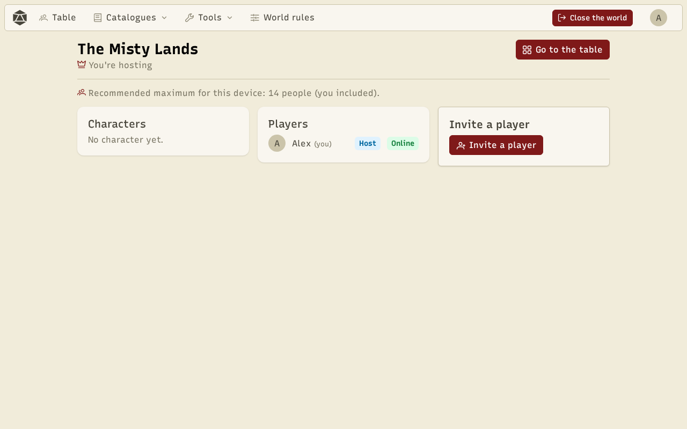
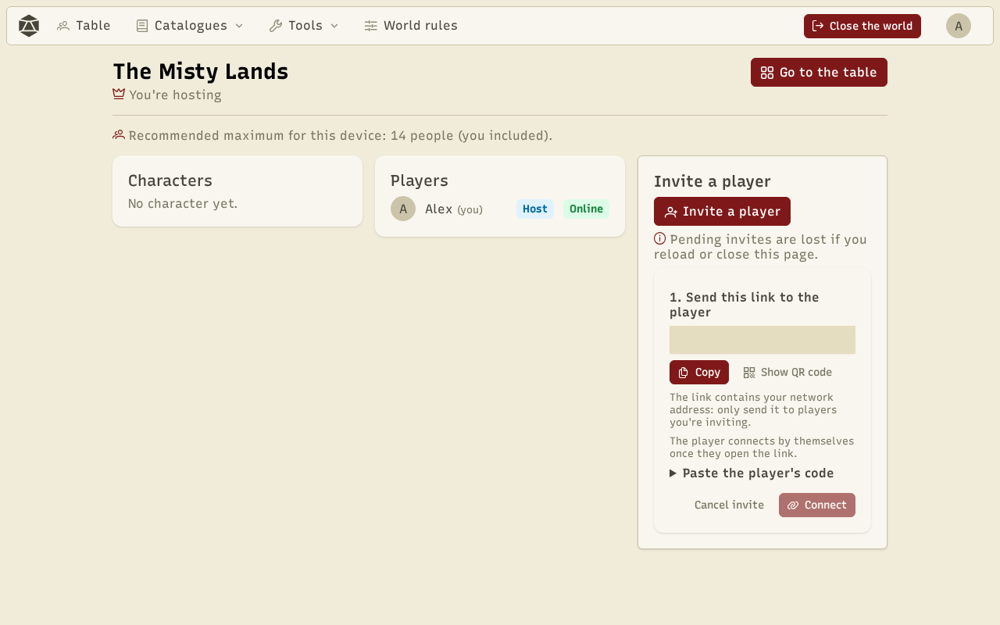
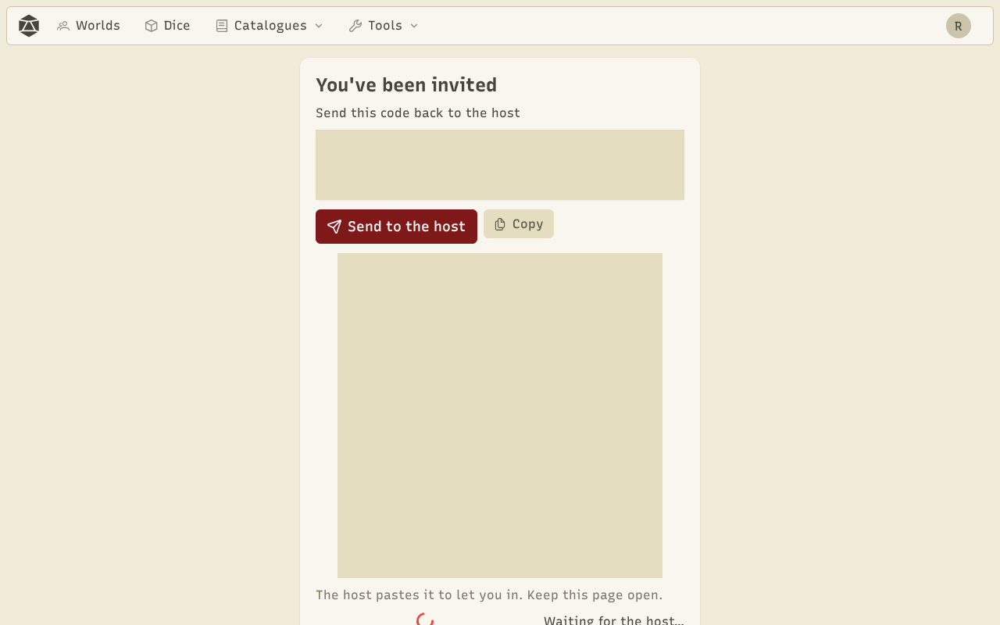

To play, the game master **hosts** their world: their device becomes the host of the **room**. Players join it with an invite link. Devices connect directly to each other, with no game server.

## Host

In **Worlds**, click **Host** under your world. The **lobby** opens: the members list and the invites.

## Invite a player

Click **Invite a player**, then send the link to the player (**Copy**, **Share**, or **Show QR code** for them to scan). An invite is for one player; create one per player.

Usually the player connects on their own as soon as they open the link. When automatic connection isn't available, the player gets an **answer code** to send back to you: paste it in **Paste the player's code**, then **Connect**.

:::caution
The link contains your network address: only send it to the players you invite.
:::

## Join

The player opens the link. When the connection isn't automatic, the page shows their answer code (and its QR code): they send it to the host with **Send to the host** or **Copy**, and keep the page open.

On their first visit, the player creates their character (see [Characters](/docs/en/characters/)), then arrives at the table.

## Reload, re-invite, come back

- If the host reloads the page, the room reopens, but connections don't survive: use **Re-invite** next to each player.
- If a direct connection fails, **Try through the relay** goes through a network relay.
- A player gets their seat and character back thanks to their player ID.

## Offline

Every player keeps a copy of their character. In **Worlds → Joined worlds**, they can look at it even while the host is offline, and do what the [world rules](/docs/en/worlds/) allow offline. Changes are sent to the host when it is back.
