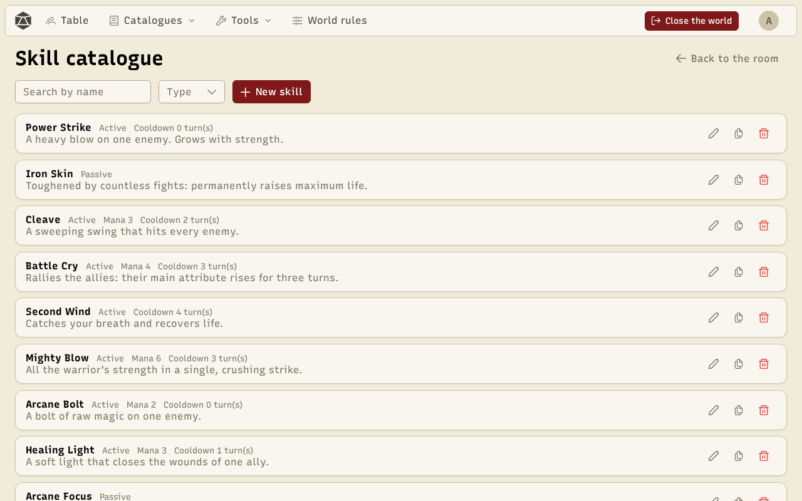
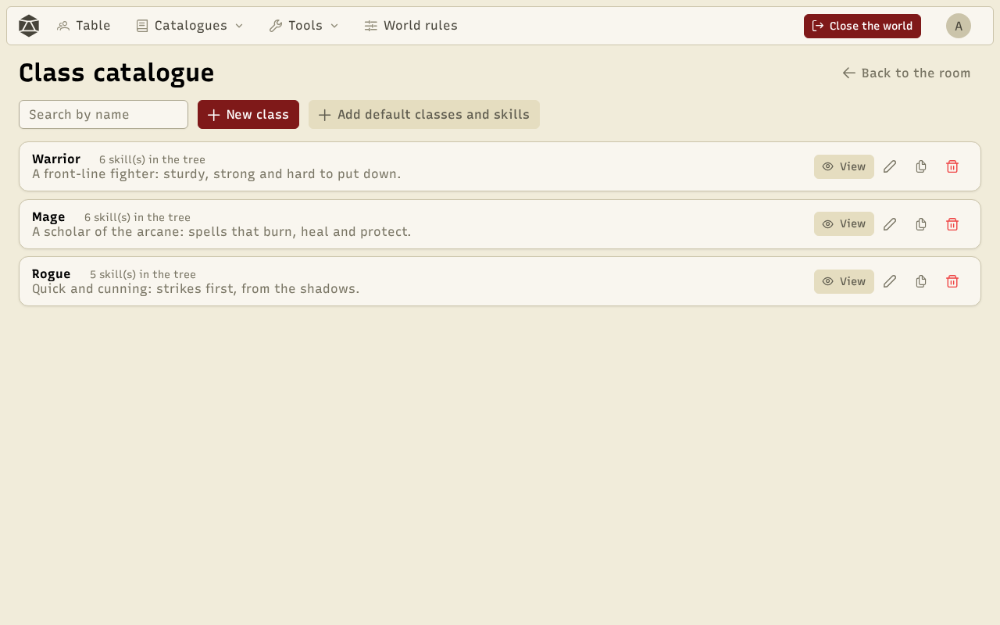

**Skills** describe what characters can do: an attack, a heal, a lasting bonus… **Classes** arrange them in trees that players unlock with their **skill points**.

## The skill catalogue

**Catalogues → Skills** lists the world's skills, one card each.

A skill has a **type** (active or passive), a cost (in mana for instance), a cooldown, a maximum **skill level** and **effects**: damage, heal or a change to an attribute, with formulas. An active skill can roll dice and have a **success formula** (for example "roll + skill level ≥ 10"). Formula presets help write them.

## Classes

**Catalogues → Classes** lists the classes and how many skills their tree has.

The class editor draws the **skill tree** by drag and drop: a skill can require another one to reach a given level. **Add default classes and skills** fills the world with classes ready to play (Warrior, Mage…).

## Skill points

Characters get skill points at the start and at each level (set in the [world rules](/docs/en/worlds/)), and the GM can grant more. On their sheet, **Skills** tab, players learn a skill of their class or raise its level, as long as its requirements are met.
