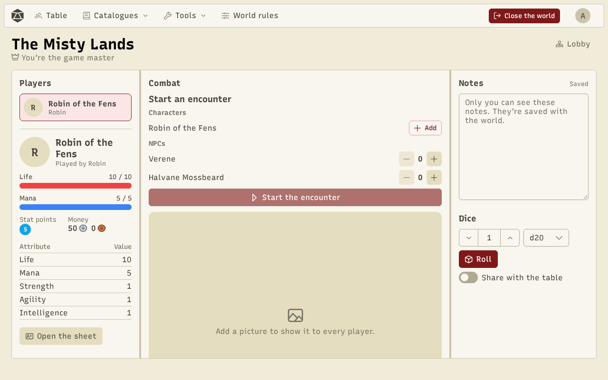
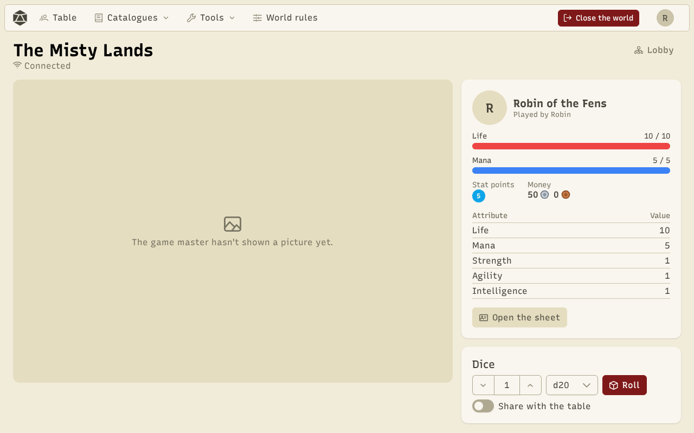
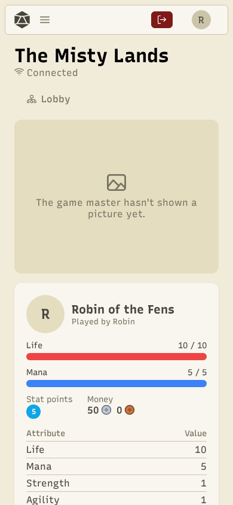

The **table** is the main screen of a game. The game master and the players don't see the same thing.

## The GM's table

- **Players**: the characters present, with their bars and attributes. Click a character to open their sheet and grant experience, stat points or skill points.
- **Combat**: start an encounter (see [Combat](/docs/en/combat/)).
- **Illustration**: add an image to show it to every player. Added images stay in the **quick images**: one click shows them again.
- **NPCs**: show up to four NPCs, and open a merchant's shop.
- **Notes**: your GM notes, only you see them, saved with the world.
- **Dice**: roll, and share the roll with the table if you want.

## A player's table

The player sees the illustration the GM shows, the NPCs shown, their character (bars, money, attributes) and their dice.

**Open the sheet** leads to the character's full sheet. **Share with the table** shows the roll to everyone.

On a phone, everything stacks in one column.

