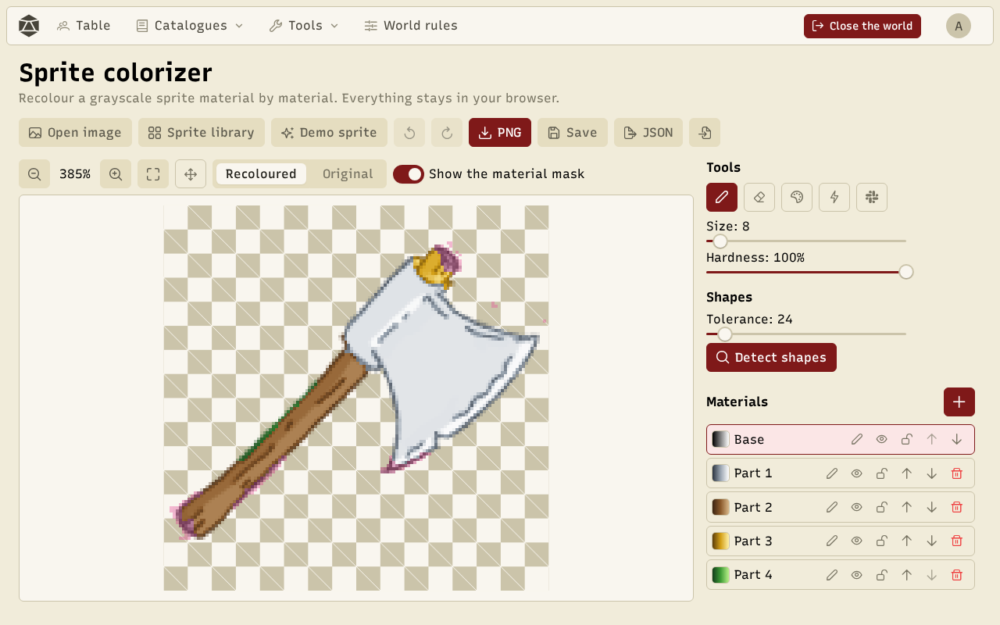
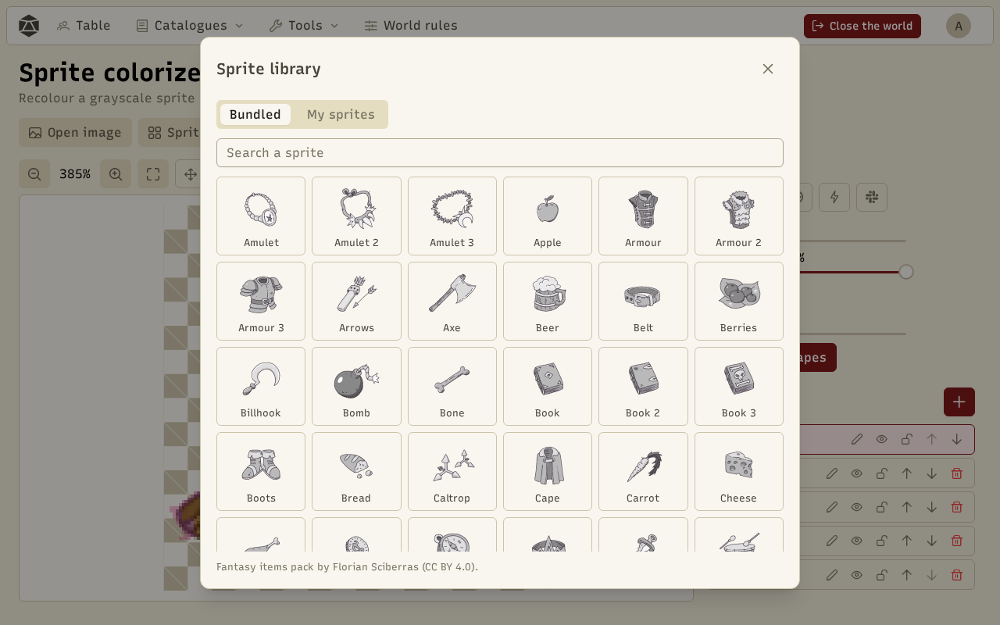
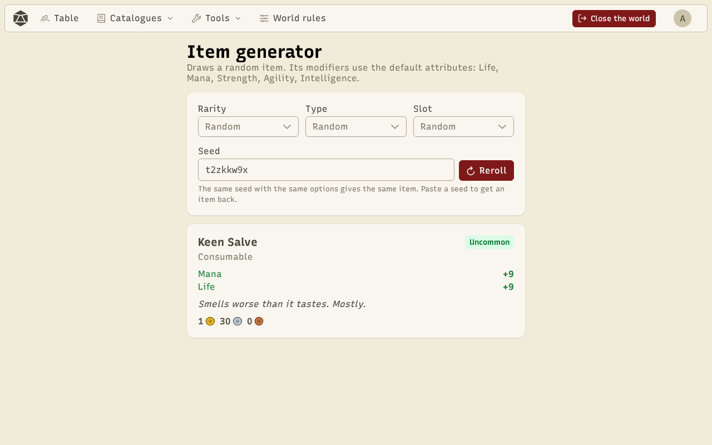
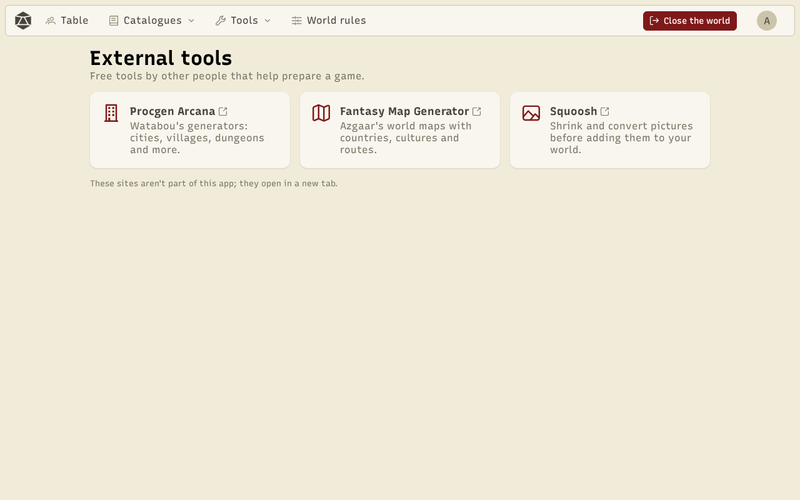

**Tools** work without a game, from the **Tools** menu. The sample catalogues, sheet and combat run on a **sandbox world**: nothing is saved there.

## Sprite colorizer

The colorizer recolours a grayscale sprite **material by material** (blade, handle, gem…), with gradients that keep the shadows and highlights.

- **Open image**, **Demo sprite** (an axe), or the **Sprite library**.
- Selection tools: brush, eraser, bucket, magic wand, polygon, and **Detect shapes** to suggest areas.
- **Materials**: each has its mask and gradient, editable or taken from the **presets** (steel, wood, gold, ice…).
- **Save** keeps the sprite and its materials on this device; **PNG** and **JSON** export them.

The library offers the 101 sprites of the "Fantasy items pack" (Florian Sciberras, CC BY 4.0), already split into materials, and your saved sprites (**My sprites**). Give a saved sprite an **item kind** so random item images can use it. More sprites can come from [content packs](/docs/en/packs/).

## Item generator

Draws items from a seed, with the rarity, type and slot you want. The same seed always gives the same item.

## External tools

Links to free generators made by others (maps, towns, images), which are not part of the app.

