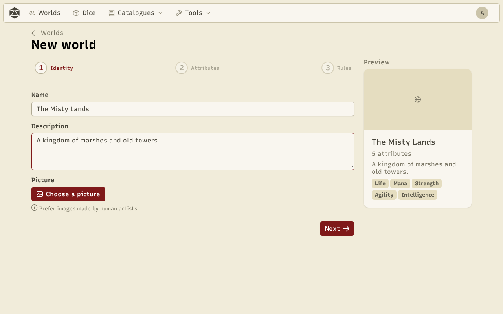
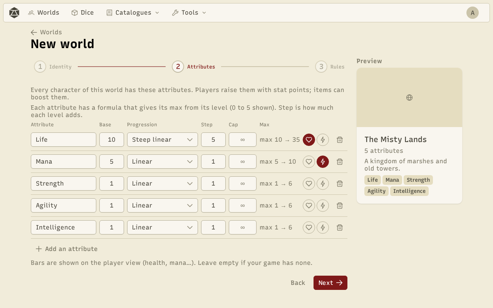
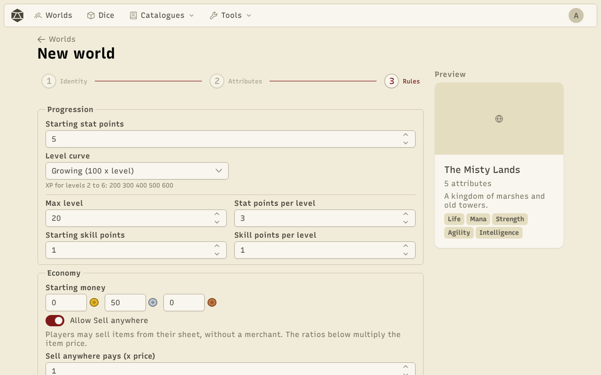
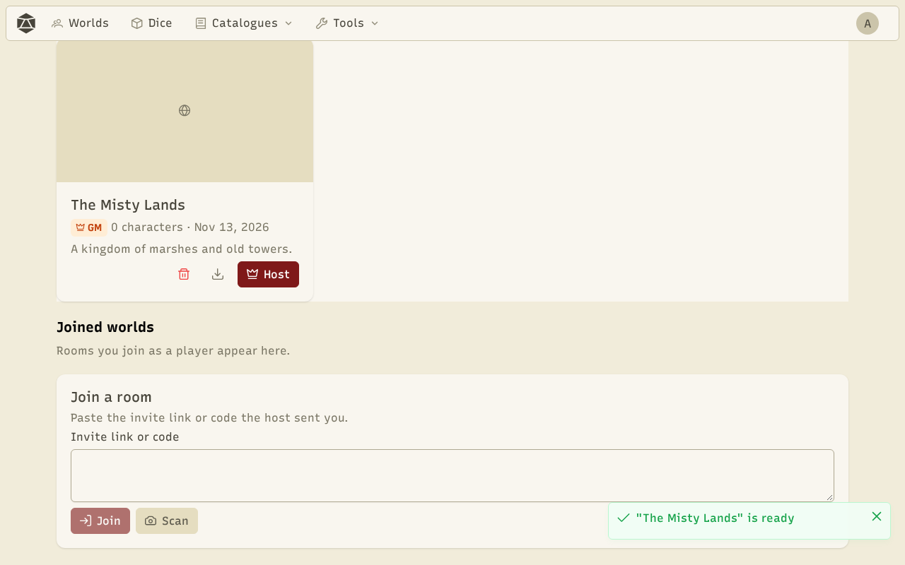
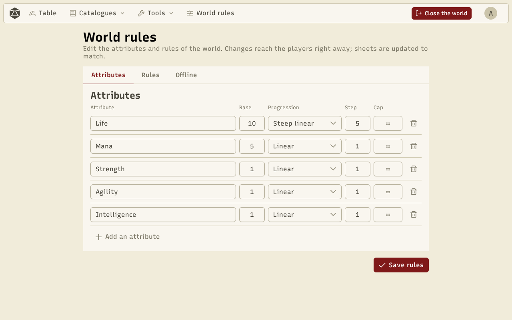
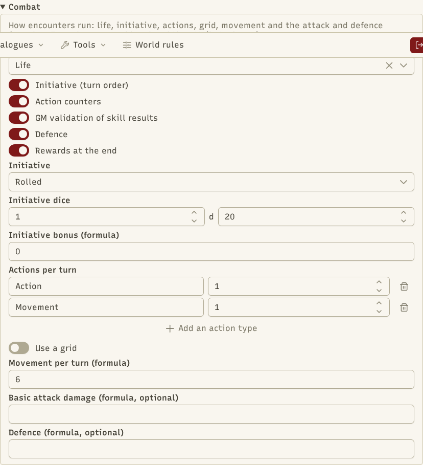

A **world** holds everything a game needs: the characters' attributes, the progression rules, the economy, the catalogues (items, NPCs, skills, classes) and the combat settings. The game master creates it and hosts it.

## Create a world

In **Worlds**, click **New world**. The wizard has three steps, with a preview of the world on the right.

**1. Identity**: the name and a short description.

**2. Attributes**: what every character has (Life, Mana, Strength…). Each one has a base value and a **progression** that gives its maximum by level: linear, steep linear, diminishing, percent or custom (a formula). The heart and bolt icons pick the two attributes shown as bars (life and mana).

**3. Rules**: progression, economy, skills, combat and the world's [content packs](/docs/en/packs/#a-worlds-packs) (by default, the Base in the app's language). You can also add the **default items** and the **default classes and skills** to have a playable world right away.

## Your worlds

Your worlds are listed in **Worlds**, with the ones you joined as a player (a **GM** or **Player** badge). For each of your worlds: **Host** to start a game, **Export as a file** to keep a copy or move it to another device, **Import** to load it back.

## The world rules

Once the game is running, **World rules** lets you adjust everything. Changes reach the players at once. The page has three tabs:

- **Attributes**: the same settings as in the wizard.
- **Rules**: progression (stat and skill points, max level, the XP curve: flat, growing, steep, classic or custom), economy (starting money, selling), skills (whether they roll dice), what players see of NPCs shown on the table, combat, and the [packs](/docs/en/packs/#a-worlds-packs) the generators use.
- **Offline**: what players can still do while the host is offline (roll dice, write notes, equip, sell…).

### Combat

The **Combat** section sets the life attribute (0 means down), initiative, actions per turn, the grid, movement, and the basic attack and defence formulas. **Every combat step is optional**: initiative, action counters, GM validation of results, defence and end-of-combat rewards. A step that is off hides its settings and leaves the combats (see [Combat](/docs/en/combat/)).

:::tip
Formulas (progression, initiative, attack, defence…) accept numbers, `+ - * / ^`, parentheses, `min`, `max`, `floor`, `round`, `sqrt`, plus `level` and attributes by name. They are checked as you type.
:::
