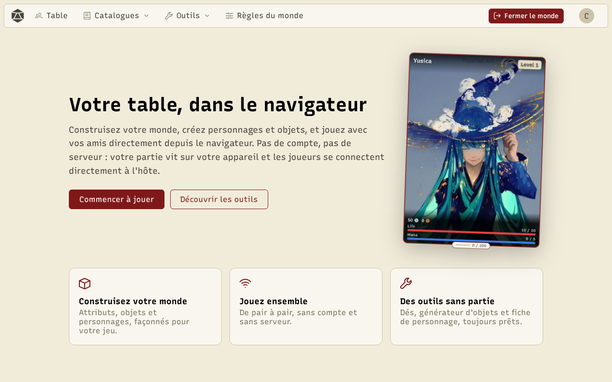
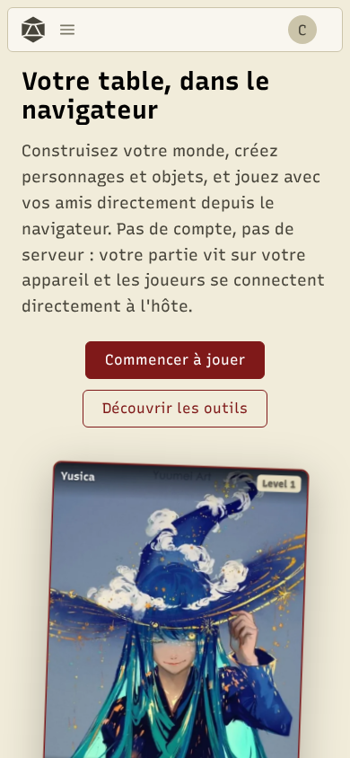
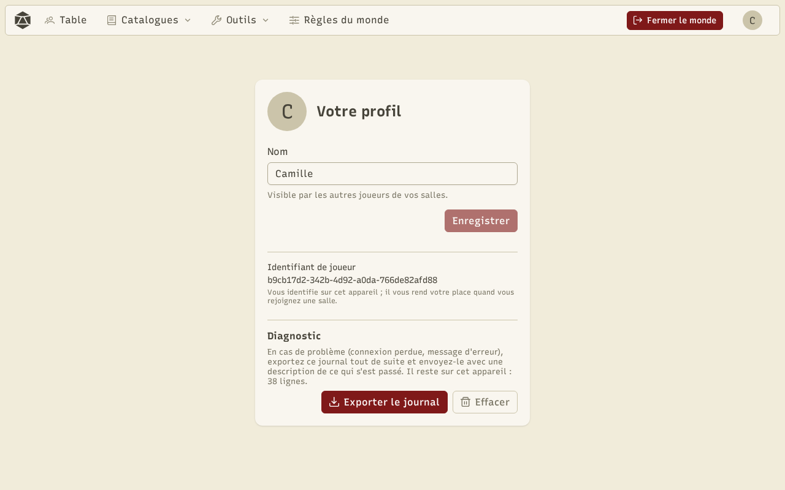

RPG Manager est une aide de table pour le jeu de rôle : le meneur de jeu (MJ) y prépare son monde, puis l'ouvre à ses joueurs le temps d'une partie. Tout fonctionne dans le navigateur, **sans compte et sans serveur de jeu** : les données restent sur votre appareil et les appareils de la table se parlent directement.

## Ouvrir et installer l'application

Ouvrez le site dans un navigateur récent (Chrome, Edge, Firefox, Safari). Pour l'avoir comme une application, avec son icône et en plein écran :

- **Sur ordinateur** : cliquez sur l'icône d'installation dans la barre d'adresse (Chrome, Edge).
- **Sur téléphone** : menu du navigateur, puis « Ajouter à l'écran d'accueil ».

Une fois installée, l'application s'ouvre même sans réseau : vous pouvez consulter vos mondes et vos personnages hors ligne.

## Votre profil

Il n'y a pas de compte. Votre **profil** est simplement le nom que voient les autres joueurs, avec un **identifiant de joueur** créé sur cet appareil : c'est lui qui vous rend votre place et votre personnage quand vous revenez dans une salle. Ouvrez-le depuis votre avatar, en haut à droite, puis **Profil**.

:::caution
Le profil, les mondes et les personnages sont enregistrés **dans ce navigateur**. Si vous effacez les données du site, ils disparaissent : exportez vos mondes de temps en temps (voir [Mondes et règles](/docs/worlds/)).
:::

## Le menu

Hors d'une partie, la barre du haut propose **Mondes** (vos mondes et ceux que vous avez rejoints), **Dés**, **Catalogues** (essayer les catalogues sur un monde d'exemple) et **Outils**. Pendant une partie, elle devient **Table**, **Catalogues**, **Outils** et **Règles du monde**, avec un bouton **Fermer le monde**.

Le menu de votre avatar regroupe votre profil, cette aide et le choix de la langue (français ou anglais).
