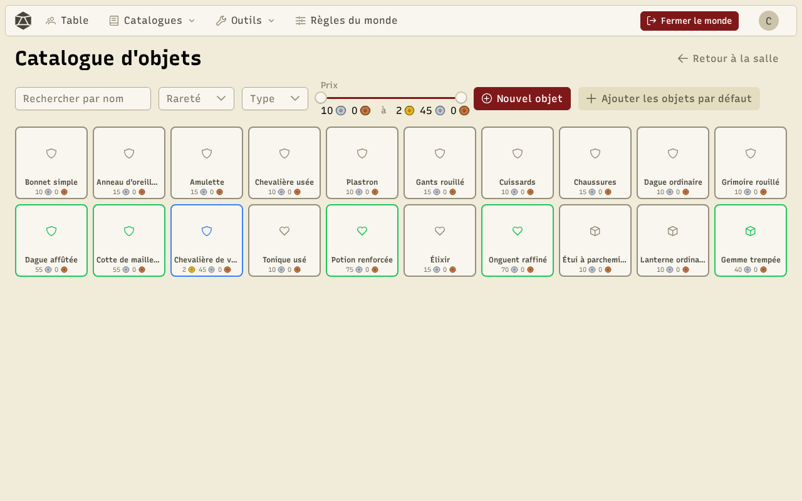
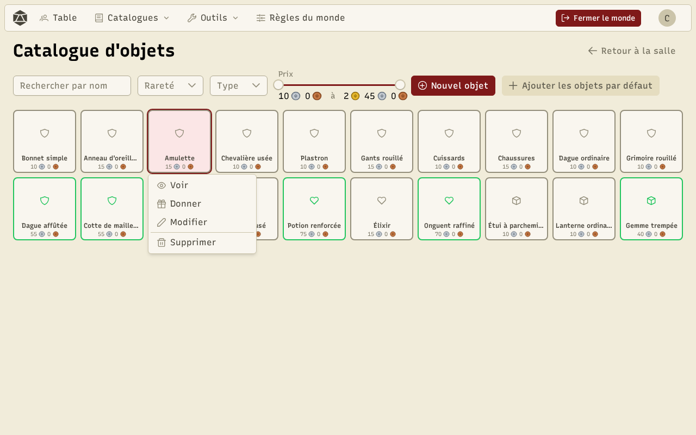
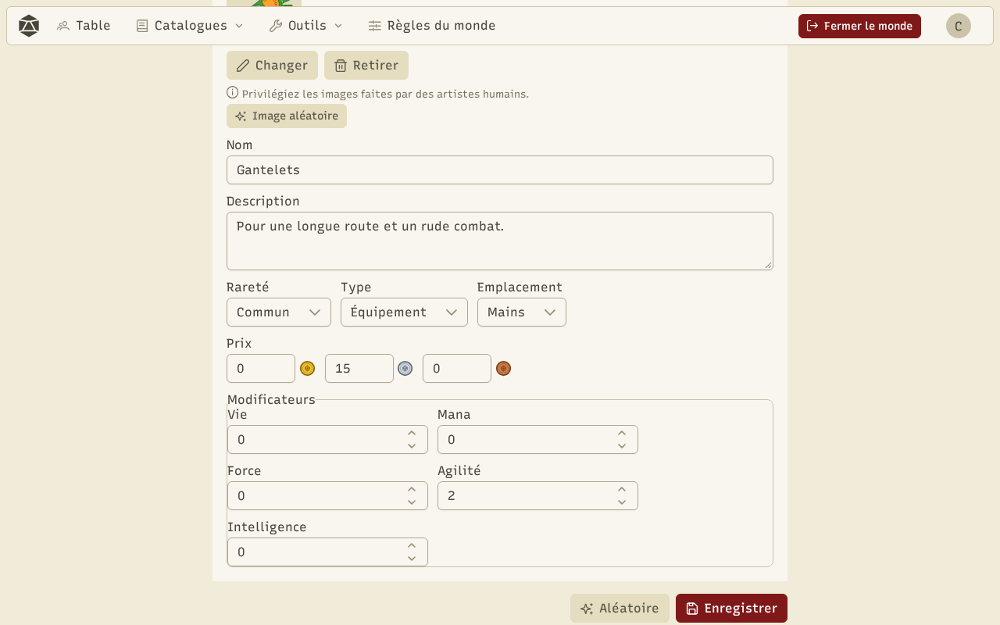

Chaque monde a son **catalogue d'objets** : armes, armures, bijoux, consommables… Le meneur de jeu y crée les objets, puis les donne aux personnages. Ouvrez-le depuis **Catalogues → Objets** pendant une partie.

Le catalogue se présente comme un grand inventaire. La couleur du cadre indique la **rareté** (commun, peu commun, rare, mythique, légendaire). En haut, cherchez par nom et filtrez par rareté, par type (objet, consommable, équipement) et par prix.

## Agir sur un objet

Cliquez sur un objet (ou faites un clic droit) : un menu s'ouvre juste à côté.

- **Voir** affiche la carte de l'objet.
- **Donner** l'envoie dans l'inventaire d'un personnage.
- **Modifier** ouvre l'éditeur.
- **Supprimer** le retire du catalogue (les exemplaires déjà dans les inventaires restent).

Au clavier : Entrée ouvre le menu de l'objet sélectionné, Échap le referme.

## Créer et modifier un objet

**Nouvel objet** ouvre l'éditeur. L'onglet **Formulaire** règle l'image, le nom, la description, la rareté, le type, l'emplacement d'équipement, le prix et les modificateurs (bonus ou malus sur les attributs). L'onglet **JSON** montre le même objet en texte, et **Copier le prompt IA** prépare une demande pour une IA. L'onglet **Générer** tire un objet à partir d'une graine : la même graine donne toujours le même objet.

Le bouton **Aléatoire** tire un objet complet **avec son image** : un sprite d'objet recoloré au hasard, choisi d'après le nom et le type de l'objet. **Image aléatoire** change seulement l'image. Vos propres sprites enregistrés peuvent servir aussi (voir [Outils](/docs/tools/)).

:::note
Les images d'objets générées viennent du « Fantasy items pack » de Florian Sciberras (CC BY 4.0). Pour vos propres illustrations, préférez le travail d'artistes humains.
:::
