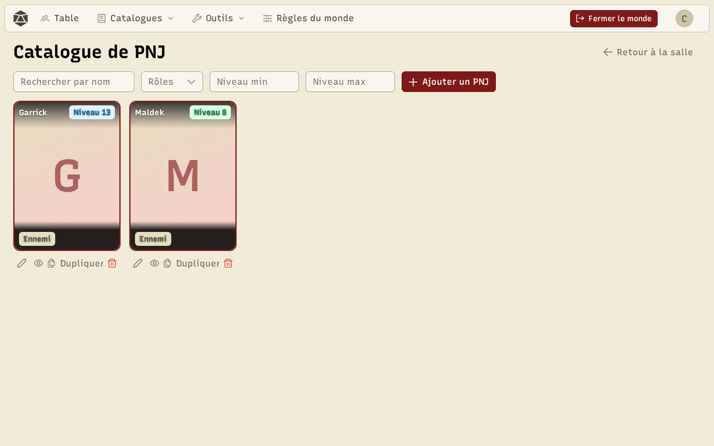
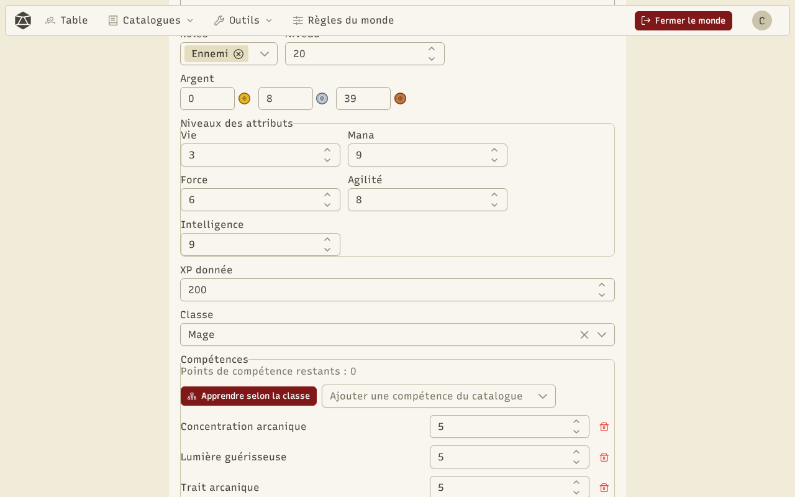

Les **PNJ** (personnages non joueurs) suivent les mêmes règles que les personnages : attributs, niveau, équipement, compétences. Chaque PNJ a un ou plusieurs **rôles** : **Histoire**, **Marchand** ou **Ennemi**. Ouvrez le catalogue depuis **Catalogues → PNJ**.

Cherchez par nom, filtrez par rôle ou par niveau. Sous chaque carte : modifier, voir, dupliquer, supprimer.

## L'éditeur de PNJ

**Ajouter un PNJ** ouvre l'éditeur : portrait, nom, description, rôles, niveau, attributs, classe et compétences, équipement, stock pour un marchand, et récompenses pour un ennemi (expérience, argent, butin). **Aléatoire** tire un PNJ complet, avec un nom de personne et une classe.

## Montrer un PNJ sur la table

Sur la table, le MJ peut montrer jusqu'à quatre PNJ à tous les joueurs. Le nom et le portrait sont toujours visibles ; le reste (description, niveau, barre de vie, points de vie, attributs, objets équipés) dépend du rôle, selon les réglages **PNJ sur la table** des [règles du monde](/docs/worlds/).

## Les marchands

Un PNJ **Marchand** a une **boutique**. Depuis la table, le MJ l'ouvre pour tous les joueurs ou pour un seul. Les joueurs y achètent son stock et lui vendent leurs objets. Les prix suivent les ratios de l'économie du monde (ce que les marchands font payer, ce qu'ils paient).
