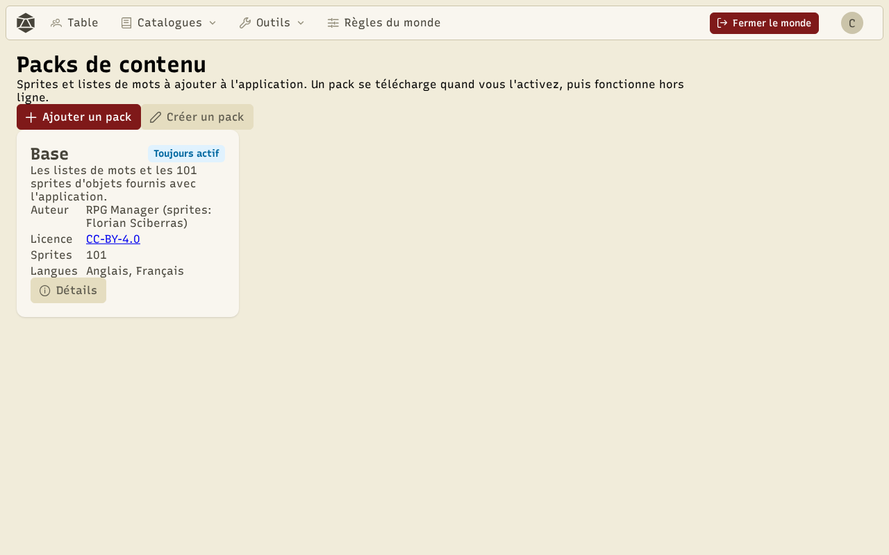
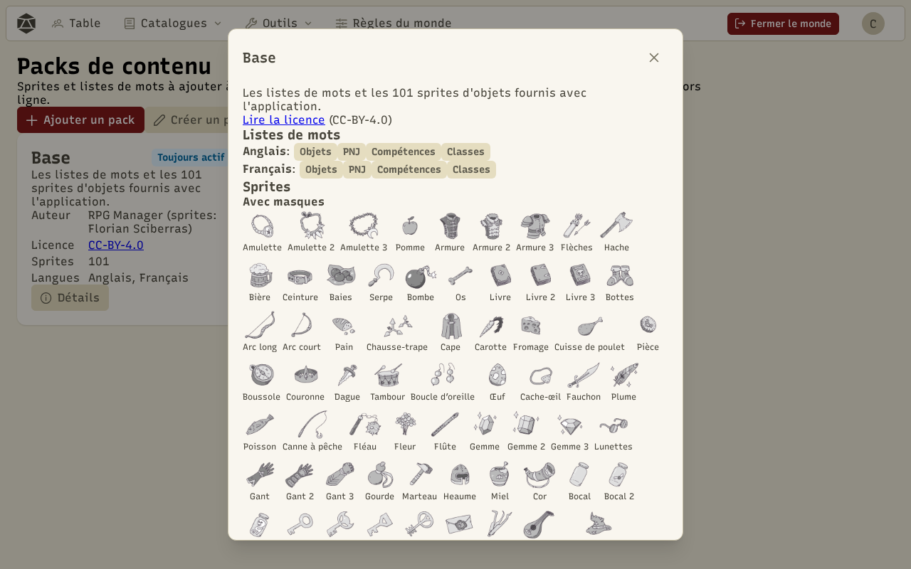
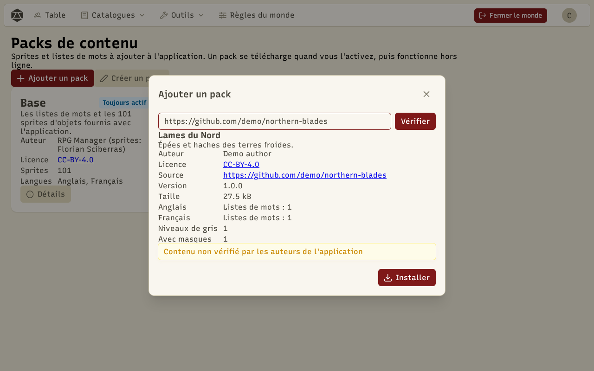
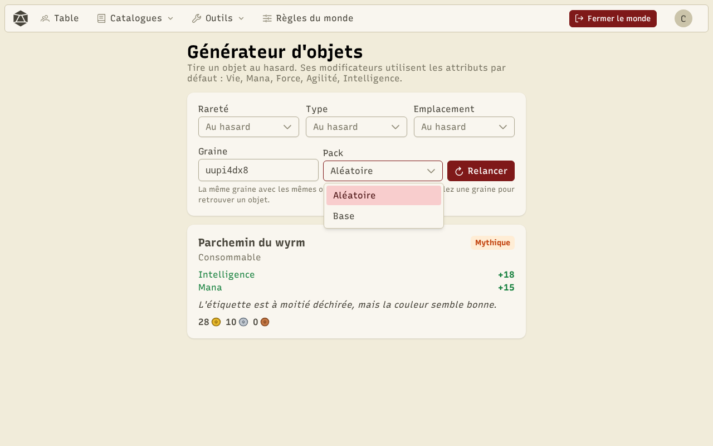

Un **pack** ajoute du contenu à l'application : des **listes de mots** pour les générateurs (objets, PNJ, compétences, classes) et des **sprites** d'objets. Les packs se gèrent depuis **Outils › Packs de contenu**.

## Le pack Base

**Base** contient les listes de mots et les 101 sprites d'objets fournis avec l'application. Il est **toujours actif** et ne peut pas être retiré. **Détails** montre sa licence, ses listes de mots par langue et ses sprites, rangés par sorte.

Un sprite peut être de trois **sortes** :

- **Niveaux de gris** : une image à découper soi-même en matériaux dans le [coloriseur](/docs/tools/).
- **Avec masques** : une image en niveaux de gris livrée avec ses matériaux, prête à recolorer.
- **Coloré** : une image déjà en couleurs, utilisée telle quelle. Le coloriseur la refuse.

## Packs officiels

Les packs officiels sont listés sur la page, mais **leurs fichiers ne sont téléchargés que quand vous les activez**. Ils restent ensuite sur l'appareil et fonctionnent **hors ligne**. Désactiver un pack garde ses fichiers ; **Supprimer de l'appareil** les efface (vous pourrez le télécharger de nouveau).

Pour l'instant, Base est le seul pack officiel.

## Ajouter un pack depuis un lien

**Ajouter un pack** installe un pack fait par quelqu'un d'autre. Collez :

- le lien d'un **dépôt GitHub** (`https://github.com/auteur/depot`), éventuellement d'un dossier (`…/tree/main/mon-pack`) ;
- ou un lien **https** vers un fichier `pack.json`.

**Vérifier** télécharge tout le pack et contrôle chaque fichier, **sans rien installer**. Vous voyez son nom, son auteur, sa licence, sa source, sa taille et ce qu'il ajoute. **Installer** l'enregistre sur l'appareil et l'active. Si un fichier pose problème, la liste des erreurs s'affiche et rien n'est installé.

:::caution
Un pack ajouté depuis un lien n'est **pas vérifié par les auteurs de l'application**. Il ne contient que des données (textes et images), jamais de code, et l'application contrôle sa taille et son format, mais ses mots et ses images peuvent être n'importe quoi. N'ajoutez que des packs dont vous connaissez la source.
:::

Les packs ajoutés depuis un lien ont leur propre section. **Mettre à jour** retélécharge le pack depuis son lien et montre l'ancienne et la nouvelle version avant de remplacer. **Supprimer de l'appareil** l'efface. Les objets et PNJ déjà générés gardent leurs noms et leurs images.

Les auteurs et licences des packs installés apparaissent dans les [crédits](/docs/about/).

## Choisir le pack dans les générateurs

L'éditeur d'objets, le générateur d'objets et l'éditeur de PNJ ont un menu **Pack** à côté de la graine.

- **Aléatoire** (par défaut) tire le pack à partir de la graine : la même graine, avec les mêmes packs actifs, donne toujours le même résultat.
- Un pack nommé utilise ses listes de mots, et ses sprites pour l'image aléatoire de l'objet. S'il n'a pas de liste dans votre langue, Base prend le relais.

Les boutons **Aléatoire** des compétences et des classes choisissent un pack au hasard parmi ceux qui en proposent.

Pour faire votre propre pack, voir [Créer un pack](/docs/create-pack/).
