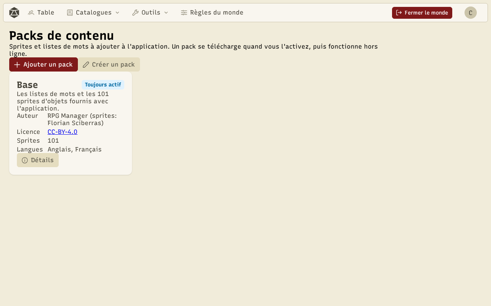
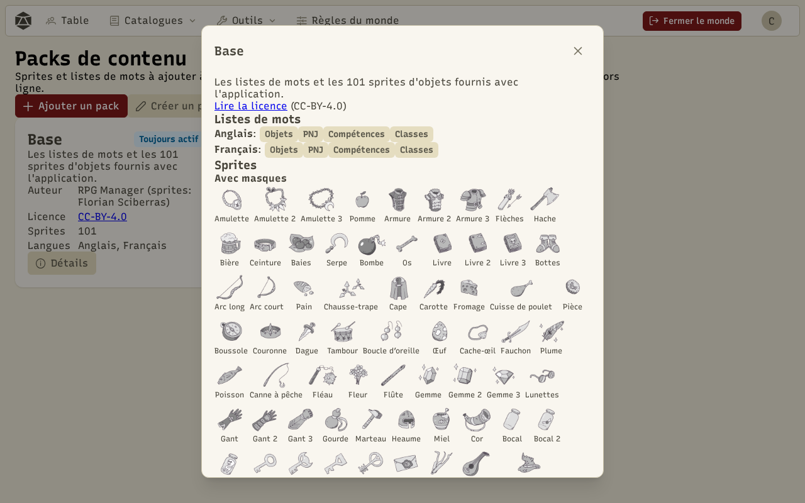
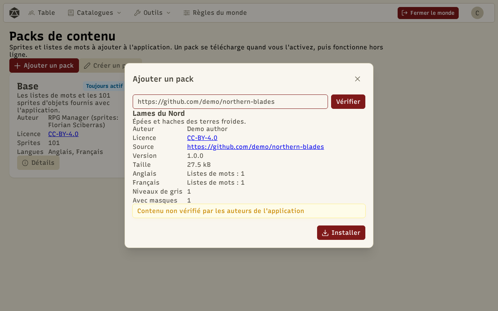
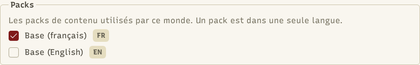

Un **pack** ajoute du contenu à l'application : des **listes de mots** pour les générateurs (objets, PNJ, compétences, classes), des **sprites** d'objets, et ce qui les relie : des **catégories** et des **teintes**. Un pack qui a des textes est écrit dans **une seule langue** (français ou anglais), affichée sur sa carte. Pour traduire un pack, on en fait un deuxième, dans l'autre langue. Un pack peut aussi n'avoir **aucune langue** (voir [Packs neutres](#packs-neutres)).

La page **Packs** installe et supprime les packs de l'appareil. Ce sont les **règles de chaque monde** qui choisissent ceux qu'il utilise (voir plus bas).



## Les packs Base

**Base (français)** et **Base (English)** contiennent les listes de mots, les catégories, les teintes et les 101 sprites d'objets fournis avec l'application, chacun dans sa langue. Ils sont **toujours disponibles** et ne peuvent pas être retirés. **Détails** montre la licence, les listes de mots et les sprites, rangés par coloration.



Un sprite peut être de trois **colorations** :

- **Niveaux de gris** : une image à découper soi-même en matériaux dans le [coloriseur](/docs/tools/).
- **Avec masques** : une image en niveaux de gris livrée avec ses matériaux, prête à recolorer.
- **Coloré** : une image déjà en couleurs, utilisée telle quelle. Le coloriseur la refuse.

## Contenu fixe

En plus des listes de mots et des sprites, un pack peut fournir du **contenu fixe** : des **objets**, **compétences** et **classes** prêts à l'emploi, copiés tels quels dans les catalogues d'un monde au lieu d'être tirés par un générateur. Le pack déclare les **attributs** que son contenu utilise (Vie, Force…).

- **Importer depuis les packs** (dans les catalogues d'objets, de compétences et de classes) copie le contenu fixe des packs actifs du monde. Importer de nouveau met à jour les copies que vous n'avez pas modifiées et laisse les vôtres tranquilles.
- Quand le monde n'a pas un attribut utilisé par le pack, vous choisissez pour chacun : utiliser un de vos attributs, l'ajouter au monde, ou l'ignorer. Ignorer retire les modificateurs qui le visent, et une **compétence qui a besoin d'un attribut ignoré** (dans un effet ou une formule) est écartée, avec sa place dans les arbres de classe. Une compétence dont le **coût** porte sur un attribut ignoré est gardée, et devient gratuite.
- Les packs Base fournissent les **classes et compétences de départ** (Guerrier, Mage et Voleur avec leurs arbres de compétences), écrites sur les attributs par défaut (Vie, Mana, Force, Agilité, Intelligence). Un nouveau monde où **Ajouter des classes et compétences par défaut** est coché, et le bac à sable des outils, les reçoivent de Base ; un monde qui a renommé ou n'a pas un de ces attributs reçoit simplement les compétences qui n'en ont pas besoin. Les compétences actives utilisent le premier type d'action du monde (son compteur de mouvement pour les compétences de déplacement).

## Packs officiels

Les packs officiels sont listés sur la page, mais **leurs fichiers ne sont téléchargés que quand vous cliquez sur Télécharger** (ou **Installer** depuis les règles d'un monde qui l'utilise). Ils restent ensuite sur l'appareil et fonctionnent **hors ligne**. **Supprimer de l'appareil** les efface (vous pourrez le télécharger de nouveau) ; les mondes qui l'utilisaient le montrent alors comme manquant.

Pour l'instant, les deux Base sont les seuls packs officiels.

## Comment les objets sont composés

Les objets générés reposent sur quelques notions, communes à tous les packs.

- **Domaine** : le type de contenu auquel s'appliquent les listes d'un pack : les **objets** (`items`), les **PNJ** (`npcs`), les **compétences** (`skills`) et les **classes** (`classes`). Les quatre utilisent les catégories, les phrases et les paramètres décrits ici ; les teintes ne concernent que les objets.
- **Catégorie** : une chose concrète, sans langue : `sword`, `potion`, `wolf`, `fire-spell`, `warrior`. Le pack donne ses **noms** et ses **descriptions** (dans sa langue). Pour les objets, ses **sprites** disent quelles catégories ils illustrent : ce lien garde l'image cohérente avec le nom. Une catégorie peut aussi porter des **champs** propres à son domaine (voir plus bas).
- **Teinte** (*tint*) : un matériau ou un élément (`steel`, `fire`, `ice`…) avec un **dégradé** de couleurs. Les adjectifs et les suffixes d'un objet peuvent porter une teinte : « Rapière **ardente** » est colorée avec le dégradé `fire`.
- **Paramètre** : une liste de groupes de mots à insérer dans les descriptions et les noms, par exemple `maker` (« un forgeron nain »). Voir [la syntaxe des phrases](#la-syntaxe-des-phrases).

### Arbre des catégories et héritage

Les catégories forment un **arbre** : une catégorie peut avoir un **parent**. Seules les racines déclarent un `type` (objet, consommable ou équipement). L'**emplacement** (`slot`) se déclare une seule fois, au niveau où il s'applique (par exemple `weapon`), et les enfants héritent du type et de l'emplacement. Les noms, les descriptions, les modèles de noms et les sprites se cherchent de la catégorie vers ses parents : **le premier niveau qui en a gagne**.

```
equipment            (type : équipement)
└── weapon           (emplacement : arme)
    └── sword        (nom : Épée)
        ├── rapier   (nom : Rapière)
        └── sabre    (nom : Sabre)
```

Une `rapier` est donc un équipement qui se porte en arme (hérité), s'appelle « Rapière » (son propre nom), reçoit les descriptions d'`weapon` et prend l'image d'une épée (`sword`) si aucun sprite n'est fait pour `rapier`. Quand vous ajoutez `sabre` sous `sword`, il se dessine tout de suite avec l'image d'une épée ; un sprite dédié pourra venir plus tard. Les racines du Base (`equipment`, `consumable`, `item`) portent les descriptions génériques : il n'y a plus de description par type.

### Packs neutres

Un pack peut n'avoir **aucune langue** : il ne contient alors que des sprites, des catégories et des teintes (par exemple un pack de dessins). Ses images servent à tous les mondes, quelle que soit leur langue.

### La langue du monde

Chaque monde a une **langue** (réglage **Langue du monde**, voir [Mondes et règles](/docs/worlds/#la-langue-du-monde)). Les générateurs mélangent le contenu de **tous les packs actifs** du monde, mais :

- les **textes** (noms, adjectifs, descriptions, paramètres, modèles de noms) ne viennent que des packs **dans la langue du monde** ;
- les **catégories, teintes et sprites** viennent de tous les packs actifs, quelle que soit leur langue, et des packs neutres.

Un pack d'une autre langue reste donc utile pour ses images, ses catégories et ses teintes : les règles du monde l'indiquent par « images, catégories et teintes uniquement ».

Si deux packs déclarent la même catégorie avec un `type`, un emplacement ou un parent différent, la déclaration des packs Base l'emporte, puis le premier pack dans l'ordre du monde ; un avertissement s'affiche. Des déclarations identiques fusionnent sans bruit. Si deux packs donnent la même teinte avec des dégradés différents, ce sont des variantes de la teinte : une est tirée pour chaque image.

### Le tirage d'un objet

Le générateur choisit le type (ou celui que vous fixez), l'emplacement, puis une catégorie qui a au moins un nom dans la langue du monde, un nom, et éventuellement un adjectif et un suffixe selon la rareté. Il compose le nom avec un modèle (celui de la catégorie, sinon celui de la langue), puis tire une description parmi celles du niveau le plus proche de la catégorie, plus celles de la teinte de l'adjectif ou du suffixe. L'objet **garde sa catégorie et ses teintes** : le bouton d'image aléatoire en tient compte, même si vous renommez l'objet. Un objet saisi à la main, sans catégorie, est reconnu par les noms de ses mots ; sinon l'image est choisie par type et emplacement.

### La syntaxe des phrases

Les descriptions, les modèles de noms et les paramètres sont des **phrases** qui peuvent varier :

| Syntaxe | Effet |
| --- | --- |
| `[a\|b\|c]` | Une variante tirée au hasard. Une option vide (`[très\|]`) rend les mots facultatifs. |
| `{maker}` | Un paramètre, tiré parmi ceux de ce nom dans tous les packs actifs de la langue du monde. Un paramètre peut contenir des variantes et d'autres paramètres (jusqu'à 5 niveaux). |
| `{g:forgé\|forgée}` | Accord avec le genre du nom tiré (masculin\|féminin). |
| `{g:forgé\|forgée\|forgés\|forgées}` | Même accord, avec le pluriel (masculin\|féminin\|masculin pluriel\|féminin pluriel), pour les noms pluriels comme « Gants ». |
| `{base}`, `{adjective}`, `{suffix}` | Dans un modèle de nom : le nom tiré, l'adjectif et le suffixe. |

Exemple : « Une arme [fiable\|redoutable], {g:forgé\|forgée} par {maker}. » Une phrase dont le paramètre n'est défini par aucun pack actif de la langue est laissée de côté (une autre est tirée) ; s'il n'en reste aucune, le texte est vide.

Les **noms pluriels** (des gants, des bottes) se marquent dans le nom (case **Pluriel** dans le créateur) : l'adjectif prend alors sa forme plurielle (par défaut le singulier avec un `s`, sauf s'il finit par `s` ou `x`).

### Conventions de nommage

Pour que les packs restent compatibles entre eux, suivez ces conventions ; les packs Base les respectent.

- **Catégories** : en anglais, au singulier, en `kebab-case`, la chose concrète (`sword`, `war-hammer`, `healing-potion`). Une sous-catégorie reçoit un `parent` plutôt qu'un nom isolé.
- **Teintes** : un matériau ou un élément (`steel`, `gold`, `fire`, `ice`, `rust`, `shadow`), pas une couleur brute.
- **Paramètres** : nommés par leur **rôle dans la phrase** (`maker`, `owner`, `place`, `event`, `material`, `creature`, `effect`). Chaque entrée est un groupe nominal complet avec son article (« un forgeron nain »), pour s'insérer partout sans accord.

### Ce que publient les packs Base

Les deux Base déclarent **les mêmes catégories et les mêmes teintes** (elles fusionnent). Si vous nommez vos catégories et teintes comme eux, vos sprites et vos mots s'accordent avec les leurs.

- **Racines** : `equipment` (équipement), `consumable` (consommable), `item` (objet).
- **Emplacements d'équipement** : `head`, `earring`, `necklace`, `ring`, `chest`, `hand`, `legs`, `foot`, `weapon` (arme, emplacement `weapon1`) et `shield` (emplacement `weapon2`), tous enfants de `equipment`.
- **Catégories** en dessous : par exemple `sword`, `rapier`, `dagger`, `axe`, `bow-long`, `staff`, `mace` sous `weapon` ; `helm`, `crown`, `hood` sous `head` ; `armor`, `cape`, `robe`, `tunic` sous `chest` ; `potion`, `elixir`, `bread`, `scroll` sous `consumable` ; `key`, `book`, `torch`, `gem`, `lantern` sous `item`. La liste complète est dans le `pack.json` de Base.
- **Teintes** : `steel`, `wood`, `gold`, `ice`, `fire`, `leaf`, `arcane`, `rust`, `silver`, `shadow`.
- **Paramètres** (`generators/common.json`) : `maker`, `owner`, `place`, `event`, `material`, `creature`, `effect`.

Base publie aussi les catégories des trois autres domaines.

- **PNJ** (20) : `townsfolk` (rôle `story` ; `peasant`, `noble`, `scholar`, `priest`), `trader` (rôle `merchant` ; `merchant`, `innkeeper`, `blacksmith`, `peddler`), `guard` (rôles `story`, `enemy`), `outlaw` (rôle `enemy` ; `bandit`, `cultist`, `mercenary`) et `beast` (rôle `enemy`, pas une personne ; `wolf`, `bear`, `giant-spider`, `boar`).
- **Compétences** (20) : `attack` (active, dégâts ; `strike`, `shot`, `fire-spell`, `frost-spell`, `lightning-spell`, `shadow-spell`), `healing` (active, soin ; `prayer`, `remedy`), `support` (active, modification ; `blessing`, `curse`, `war-cry`, `song`) et `trait` (passive ; `toughness`, `focus`, `agility`, `presence`).
- **Classes** (18) : `martial` (`warrior`, `berserker`, `knight`), `arcane` (`mage`, `warlock`, `sorcerer`), `divine` (`cleric`, `paladin`), `nature` (`druid`, `ranger`, `shaman`) et `cunning` (`rogue`, `assassin`, `bard`). Chaque famille liste ses catégories de compétences favorites, par exemple `martial` : `strike`, `shot`, `war-cry`, `toughness`.
### Catégories de PNJ, de compétences et de classes

Les trois autres domaines utilisent le même arbre et le même héritage (parent, le premier niveau qui a des mots l'emporte). Ce que porte une catégorie dépend du domaine.

- **PNJ** : `roles` (`story`, `merchant`, `enemy` : les rôles que peut prendre un PNJ généré) et `person` (`false` pour une créature : son nom est alors un nom commun, sans prénom). Les rôles et `person` sont hérités du parent. Textes : `given` (prénoms avec un `gender`), `epithets` (épithètes), `templates` (`{given}`, `{epithet}`), puis par catégorie `nouns`, `descriptions`, `adjectives` et `names` (modèles de noms avec `{adjective}` et `{noun}`, pour les catégories qui ne sont pas des personnes).
- **Compétences** : `type` (`active` ou `passive`, sur une racine) et `effect` (`damage`, `heal` ou `modify`, pour une compétence active). Textes : `templates`, `adjectives`, `suffixes`, puis par catégorie `nouns`, `descriptions`, `adjectives`, `suffixes` et `names`.
- **Classes** : `skills`, les **catégories de compétences favorites**. L'arbre de compétences d'une classe est tiré parmi les compétences du monde dont la chaîne de catégories en contient une (quand il y en a au moins 3 ; sinon il est complété par d'autres compétences). Textes comme les compétences : `templates`, `adjectives`, `suffixes`, puis par catégorie `nouns`, `descriptions`, `adjectives`, `suffixes` et `names`.

Pour les compétences et les classes, le générateur tire une catégorie, un nom, éventuellement un adjectif et un suffixe (ceux de la catégorie, puis ceux du niveau supérieur), et compose le nom avec un modèle (`{adjective}`, `{noun}`, `{suffix}`). La description vient du niveau le plus proche de la catégorie qui en a. Un PNJ, une compétence ou une classe **garde sa catégorie**.

## Ajouter un pack depuis un lien

**Ajouter un pack** installe un pack fait par quelqu'un d'autre. Collez :

- le lien d'un **dépôt GitHub** (`https://github.com/auteur/depot`), éventuellement d'un dossier (`…/tree/main/mon-pack`) ;
- ou un lien **https** vers un fichier `pack.json`.

**Vérifier** télécharge tout le pack et contrôle chaque fichier, **sans rien installer**. Vous voyez son nom, son auteur, sa licence, sa source, sa taille et ce qu'il ajoute. **Installer** l'enregistre sur l'appareil ; cochez-le ensuite dans les règles des mondes qui doivent l'utiliser. Si un fichier pose problème, la liste des erreurs s'affiche et rien n'est installé.



:::caution
Un pack ajouté depuis un lien n'est **pas vérifié par les auteurs de l'application**. Il ne contient que des données (textes et images), jamais de code, et l'application contrôle sa taille et son format, mais ses mots et ses images peuvent être n'importe quoi. N'ajoutez que des packs dont vous connaissez la source.
:::

Les packs ajoutés depuis un lien ont leur propre section. **Mettre à jour** retélécharge le pack depuis son lien et montre l'ancienne et la nouvelle version avant de remplacer. **Supprimer de l'appareil** l'efface. Les objets et PNJ déjà générés gardent leurs noms et leurs images.

Les auteurs et licences des packs installés apparaissent dans les [crédits](/docs/about/).

**Dupliquer**, sur n'importe quelle carte dont les fichiers sont sur l'appareil, copie le pack dans un nouveau brouillon du [créateur de pack](/docs/create-pack/), dans la même langue.

## Les packs d'un monde

Dans l'assistant de création (étape **Règles**) et dans **Règles du monde**, la section **Packs** liste les packs installés avec leur langue. Cochez ceux que le monde utilise. Un nouveau monde commence avec le Base de la langue de l'application. Vous pouvez mélanger les langues, par exemple Base (français) et un pack de sprites anglais : seuls ses images, catégories et teintes servent (voir [la langue du monde](#la-langue-du-monde)).



Un pack coché mais absent de l'appareil (monde importé, pack supprimé) est marqué **manquant** : **Installer** le télécharge si c'est un pack officiel, sinon vous pouvez le retirer du monde.

Dans les **Outils**, sans partie lancée, les générateurs utilisent les packs choisis dans **Outils › Règles du monde** (par défaut, le Base de la langue de l'application).

## Les packs dans les générateurs

Aucun générateur n'a plus de menu **Pack** : les objets, les PNJ, les compétences et les classes utilisent ensemble **tous les packs actifs du monde** (voir plus haut), donc un pack ajouté enrichit tous les générateurs d'un coup. La même graine, avec les mêmes packs et la même langue, donne toujours le même résultat.

Pour faire votre propre pack, voir [Créer un pack](/docs/create-pack/).
