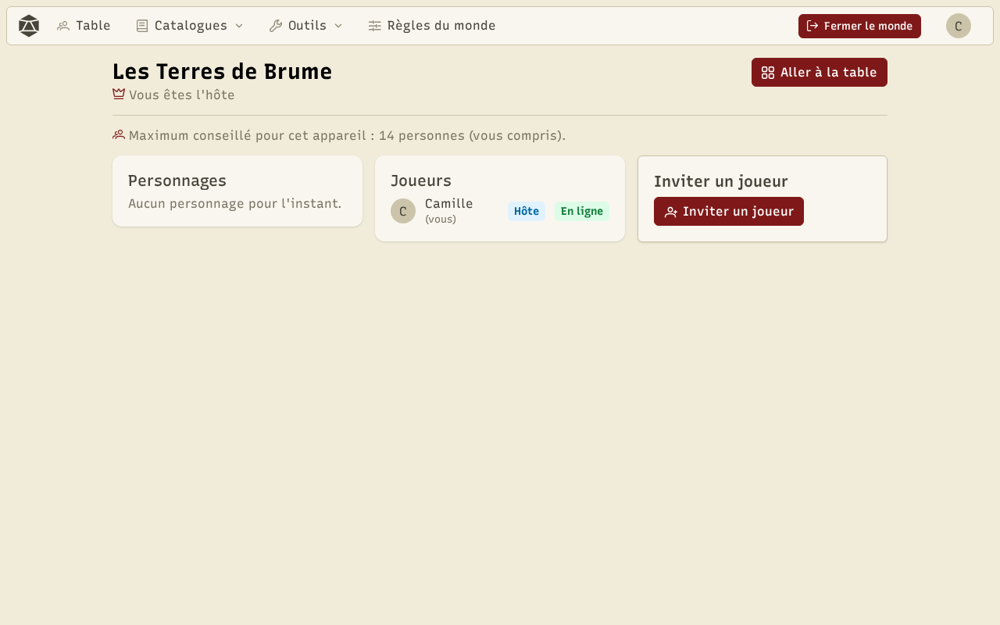
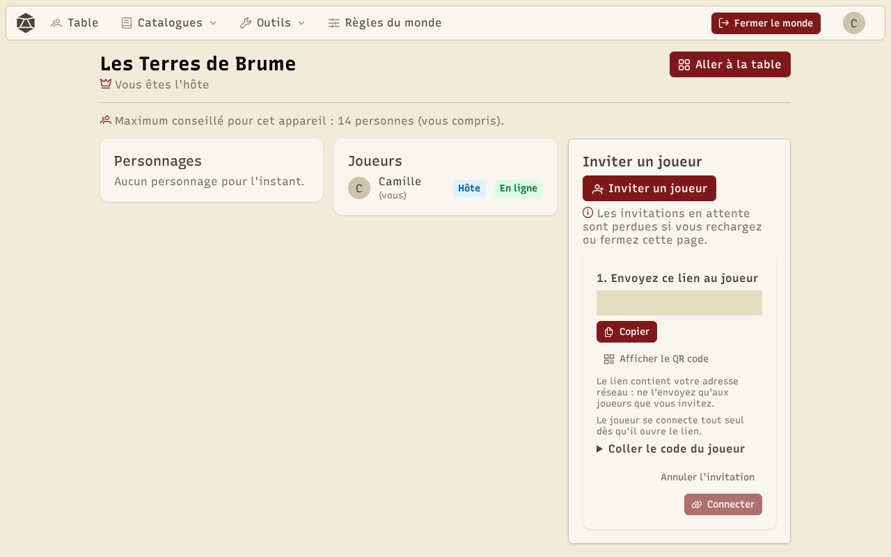
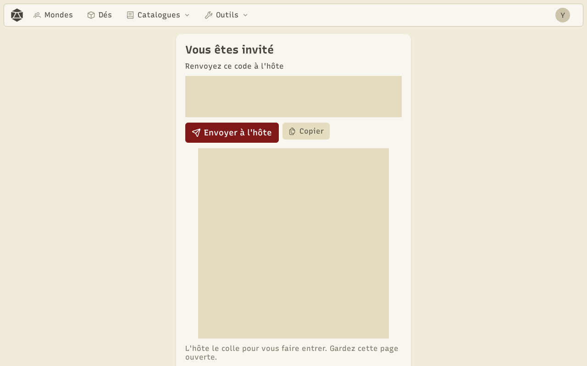

Pour jouer, le meneur de jeu **héberge** son monde : son appareil devient l'hôte de la **salle**. Les joueurs le rejoignent avec un lien d'invitation. Les appareils se connectent directement entre eux, sans serveur de jeu.

## Héberger

Dans **Mondes**, cliquez sur **Héberger** sous votre monde. Le **salon** s'ouvre : la liste des membres et les invitations.

## Inviter un joueur

Cliquez sur **Inviter un joueur**, puis envoyez le lien au joueur (**Copier**, **Partager**, ou **Afficher le QR code** pour qu'il le scanne). Une invitation sert à un seul joueur ; créez-en une par joueur.

En général, le joueur se connecte tout seul dès qu'il ouvre le lien. Si la connexion automatique n'est pas disponible, le joueur reçoit un **code de réponse** à vous renvoyer : collez-le dans **Coller le code du joueur**, puis **Connecter**.

:::caution
Le lien contient votre adresse réseau : ne l'envoyez qu'aux joueurs que vous invitez.
:::

## Rejoindre

Le joueur ouvre le lien. Si la connexion n'est pas automatique, la page affiche son code de réponse (et son QR code) : il l'envoie à l'hôte avec **Envoyer à l'hôte** ou **Copier**, et garde la page ouverte.

À sa première venue, le joueur crée son personnage (voir [Personnages](/docs/characters/)), puis arrive à la table.

## Recharger, réinviter, reprendre

- Si l'hôte recharge la page, la salle se rouvre, mais les connexions ne survivent pas : utilisez **Réinviter** à côté de chaque joueur.
- Si une connexion directe échoue, **Essayer via le relais** passe par un relais réseau.
- Un joueur retrouve sa place et son personnage grâce à son identifiant de joueur.

## Hors ligne

Chaque joueur garde une copie de son personnage. Dans **Mondes → Mondes rejoints**, il peut le consulter même quand l'hôte est hors ligne, et faire ce que les [règles du monde](/docs/worlds/) autorisent hors ligne. Les changements sont envoyés à l'hôte au retour.
