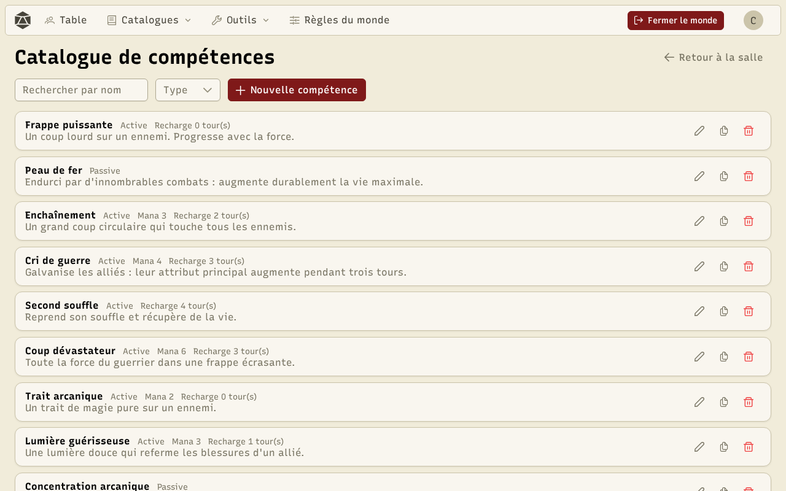
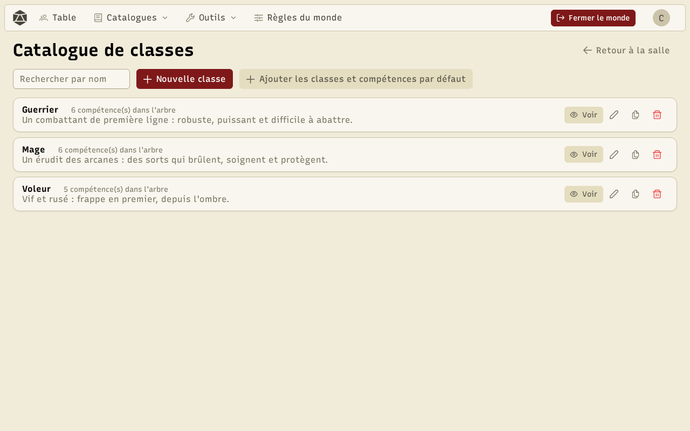

Les **compétences** décrivent ce que les personnages savent faire : une attaque, un soin, un bonus durable… Les **classes** les organisent en arbres que les joueurs débloquent avec leurs **points de compétence**.

## Le catalogue de compétences

**Catalogues → Compétences** liste les compétences du monde, une carte par compétence.

Une compétence a un **type** (active ou passive), un coût (en mana par exemple), un temps de recharge, un **niveau de compétence** maximal et des **effets** : dégâts, soins ou modification d'un attribut, avec des formules. Une compétence active peut lancer des dés et avoir une **formule de réussite** (par exemple « jet + niveau de compétence ≥ 10 »). Des préréglages de formules aident à les écrire.

## Les classes

**Catalogues → Classes** liste les classes et le nombre de compétences de leur arbre.

L'éditeur de classe dessine l'**arbre de compétences** par glisser-déposer : chaque compétence peut demander qu'une autre ait atteint un certain niveau. **Ajouter les classes et compétences par défaut** remplit le monde de classes prêtes à jouer (Guerrier, Mage…).

## Les points de compétence

Les personnages reçoivent des points de compétence au départ et à chaque niveau (réglés dans les [règles du monde](/docs/worlds/)), et le MJ peut en donner. Sur sa fiche, onglet **Compétences**, le joueur apprend une compétence de sa classe ou monte son niveau, tant que les prérequis sont remplis.
