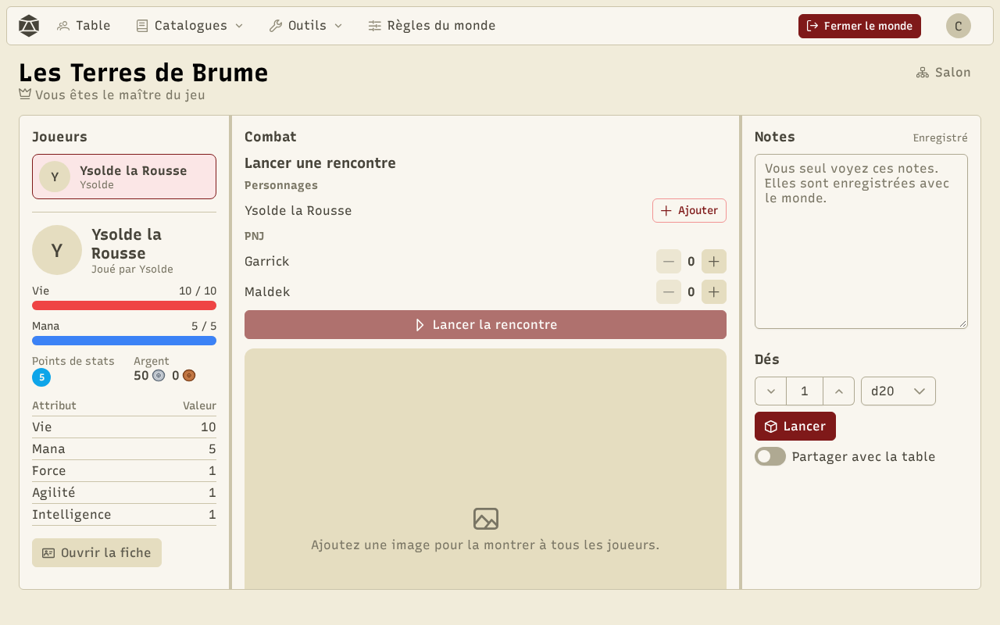
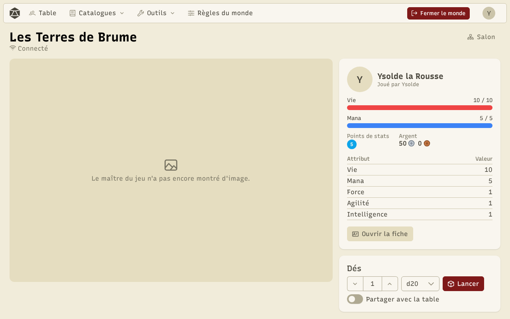
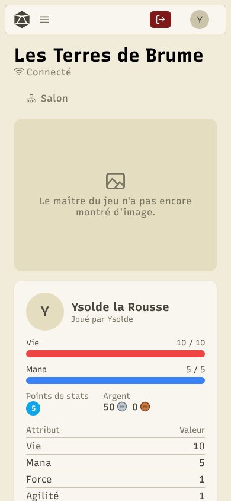

La **table** est l'écran principal d'une partie. Le meneur de jeu et les joueurs n'y voient pas la même chose.

## La table du MJ

- **Joueurs** : les personnages présents, avec leurs barres et leurs attributs. Cliquez sur un personnage pour ouvrir sa fiche et lui donner de l'expérience, des points de stats ou des points de compétence.
- **Combat** : lancer une rencontre (voir [Combat](/docs/combat/)).
- **Illustration** : ajoutez une image pour la montrer à tous les joueurs. Les images ajoutées restent dans les **images rapides** : un clic les remontre.
- **PNJ** : montrez jusqu'à quatre PNJ, et ouvrez la boutique d'un marchand.
- **Notes** : vos notes de MJ, que vous seul voyez, enregistrées avec le monde.
- **Dés** : lancez, et partagez le jet avec la table si vous le voulez.

## La table d'un joueur

Le joueur voit l'illustration montrée par le MJ, les PNJ montrés, son personnage (barres, argent, attributs) et ses dés.

**Ouvrir la fiche** mène à la fiche complète du personnage. **Partager avec la table** montre le jet à tout le monde.

Sur un téléphone, tout s'empile en une colonne.

