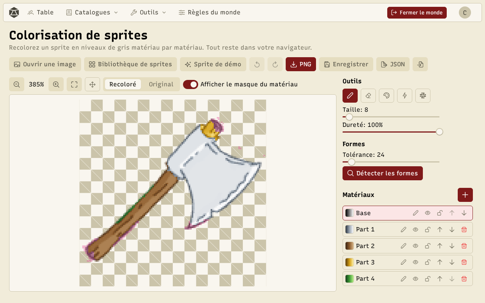
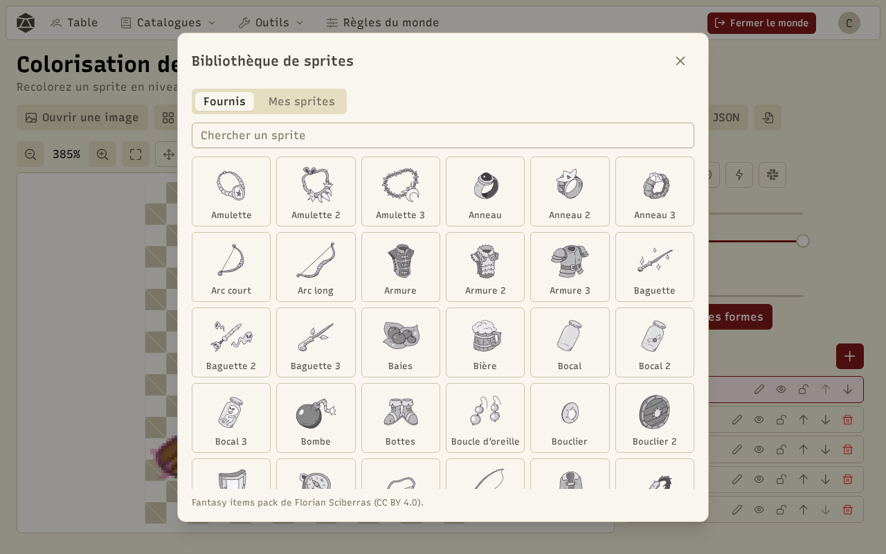
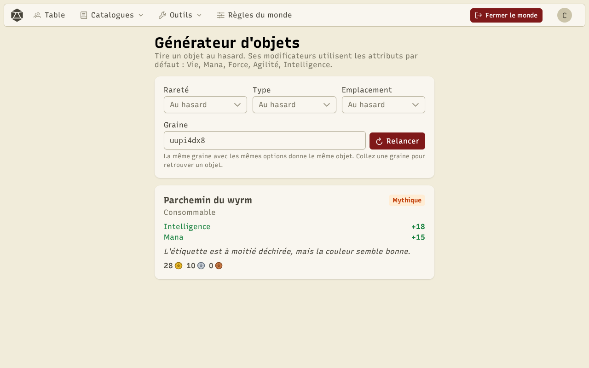
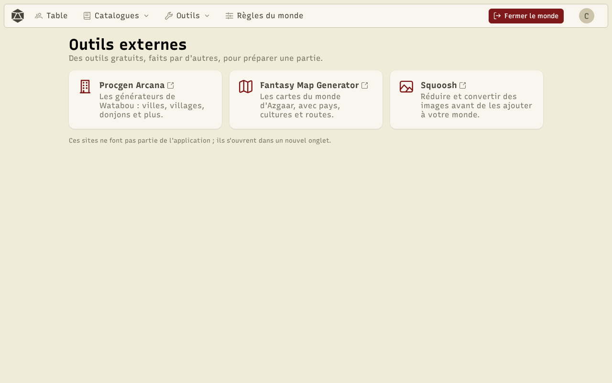

Les **outils** s'utilisent sans partie, depuis le menu **Outils**. Les catalogues, la fiche et le combat d'exemple fonctionnent sur un **monde bac à sable** : rien n'y est enregistré.

## Coloriseur de sprites

Le coloriseur recolore un sprite en niveaux de gris, **matériau par matériau** (lame, manche, gemme…), avec des dégradés qui gardent les ombres et les reflets.

- **Ouvrir une image**, **Sprite de démo** (une hache), ou la **Bibliothèque de sprites**.
- Outils de sélection : pinceau, gomme, pot de peinture, baguette magique, polygone, et **Détecter les formes** pour proposer des zones.
- **Matériaux** : chacun a son masque et son dégradé, modifiable, ou pris dans les **préréglages** (acier, bois, or, glace…).
- **Enregistrer** garde le sprite et ses matériaux sur cet appareil ; **PNG** et **JSON** les exportent.

La bibliothèque propose les 101 sprites du « Fantasy items pack » (Florian Sciberras, CC BY 4.0), déjà découpés en matériaux, et vos sprites enregistrés (**Mes sprites**). Donnez un **type d'objet** à un sprite enregistré pour qu'il serve aux images aléatoires des objets.

## Générateur d'objets

Tire des objets à partir d'une graine, avec la rareté, le type et l'emplacement voulus. La même graine donne toujours le même objet.

## Outils externes

Des liens vers des générateurs gratuits faits par d'autres (cartes, villes, images), qui ne font pas partie de l'application.

