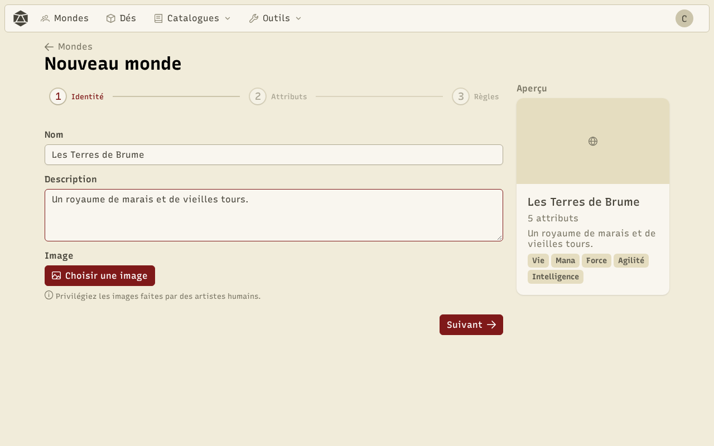
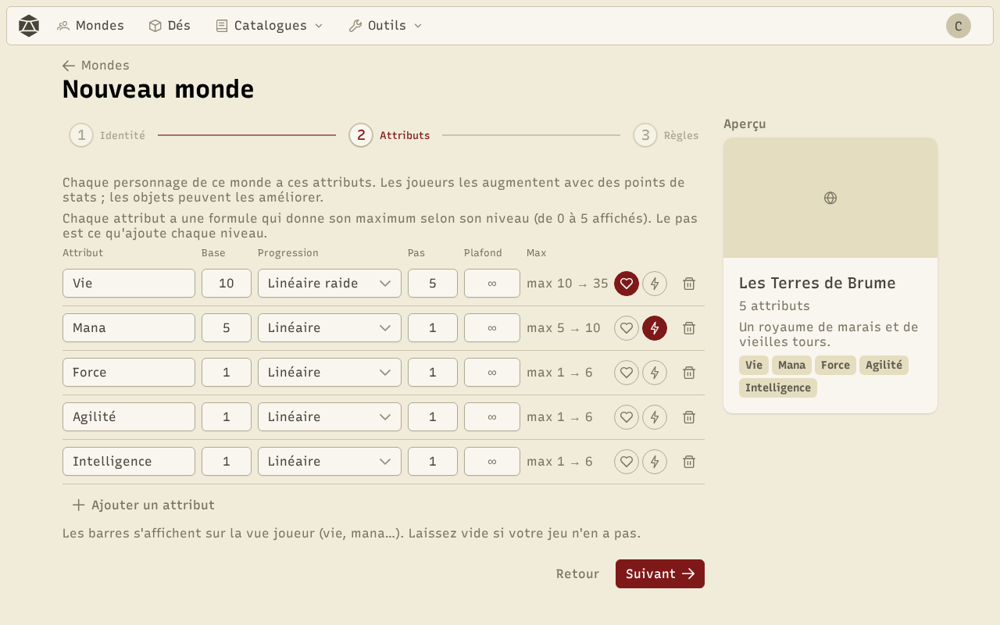
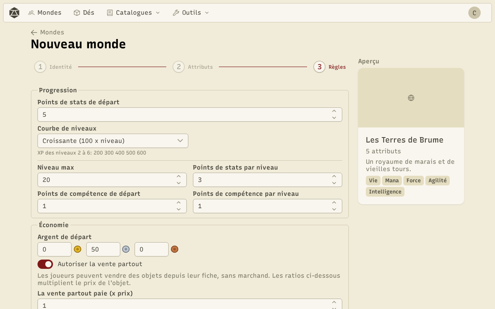
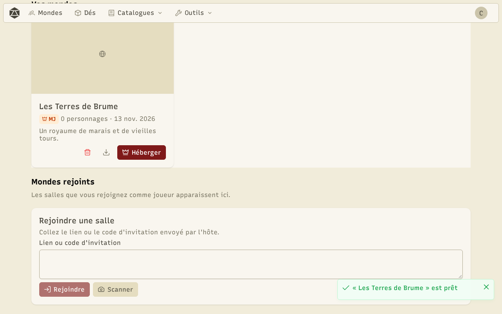
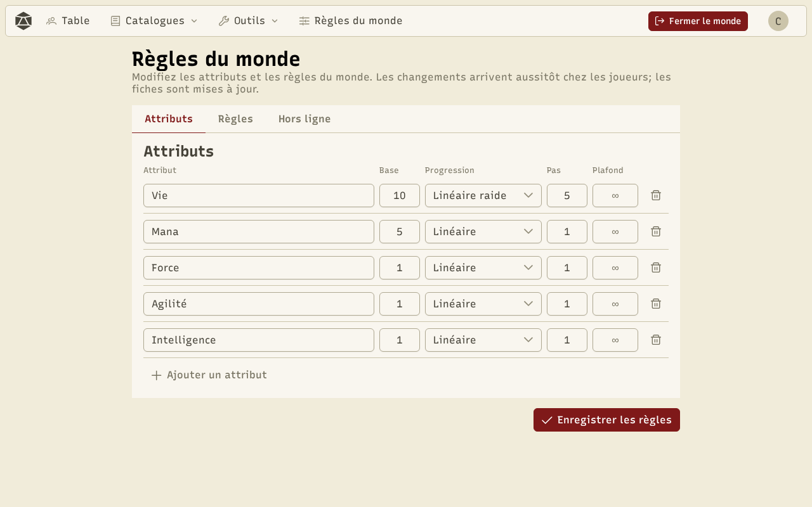
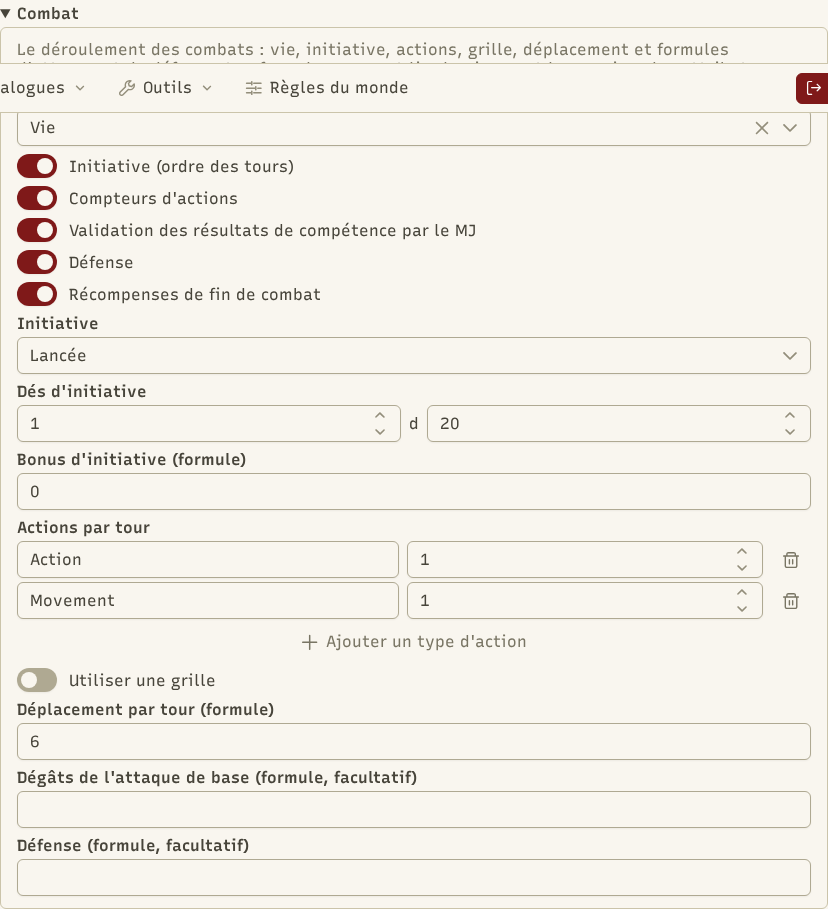

Un **monde** regroupe tout ce qu'il faut pour jouer : les attributs des personnages, les règles de progression, l'économie, les catalogues (objets, PNJ, compétences, classes) et les réglages de combat. C'est le meneur de jeu qui le crée et qui l'héberge.

## Créer un monde

Dans **Mondes**, cliquez sur **Nouveau monde**. L'assistant compte trois étapes, avec un aperçu du monde sur la droite.

**1. Identité** : le nom et une courte description.

**2. Attributs** : ce que chaque personnage possède (Vie, Mana, Force…). Pour chacun, une valeur de base et une **progression** qui donne son maximum selon son niveau : linéaire, linéaire raide, dégressive, en pourcentage ou personnalisée (une formule). Les icônes cœur et éclair choisissent les deux attributs affichés en barres (vie et mana).

**3. Règles** : progression, économie, compétences, combat et les [packs de contenu](/docs/packs/#les-packs-dun-monde) du monde (par défaut, le Base de la langue de l'application). Vous pouvez aussi ajouter les **objets par défaut** et les **classes et compétences par défaut** pour avoir un monde jouable tout de suite.

## Vos mondes

Vos mondes apparaissent dans **Mondes**, avec ceux que vous avez rejoints comme joueur (badge **MJ** ou **Joueur**). Pour chacun de vos mondes : **Héberger** pour lancer une partie, **Exporter dans un fichier** pour en garder une copie ou le passer sur un autre appareil, **Importer** pour l'y recharger.

## Les règles du monde

Une fois la partie lancée, **Règles du monde** permet de tout ajuster. Les changements arrivent aussitôt chez les joueurs. La page a trois onglets :

- **Attributs** : les mêmes réglages que dans l'assistant.
- **Règles** : progression (points de stats et de compétence, niveau max, courbe d'expérience : constante, croissante, raide, classique ou personnalisée), économie (argent de départ, vente), compétences (lancer de dés ou non), ce que les joueurs voient des PNJ montrés sur la table, le combat et les [packs](/docs/packs/#les-packs-dun-monde) utilisés par les générateurs.
- **Hors ligne** : ce que les joueurs peuvent encore faire quand l'hôte est hors ligne (lancer les dés, écrire des notes, s'équiper, vendre…).

### Le combat

La section **Combat** règle l'attribut de vie (0 = à terre), l'initiative, les actions par tour, la grille, le déplacement et les formules d'attaque de base et de défense. **Chaque étape du combat est facultative** : initiative, compteurs d'actions, validation des résultats par le MJ, défense et récompenses de fin de combat. Une étape désactivée cache ses réglages et disparaît des combats (voir [Combat](/docs/combat/)).

:::tip
Les formules (progression, initiative, attaque, défense…) acceptent les nombres, `+ - * / ^`, les parenthèses, `min`, `max`, `floor`, `round`, `sqrt`, ainsi que `level` et les attributs par leur nom. Elles sont vérifiées pendant la saisie.
:::
